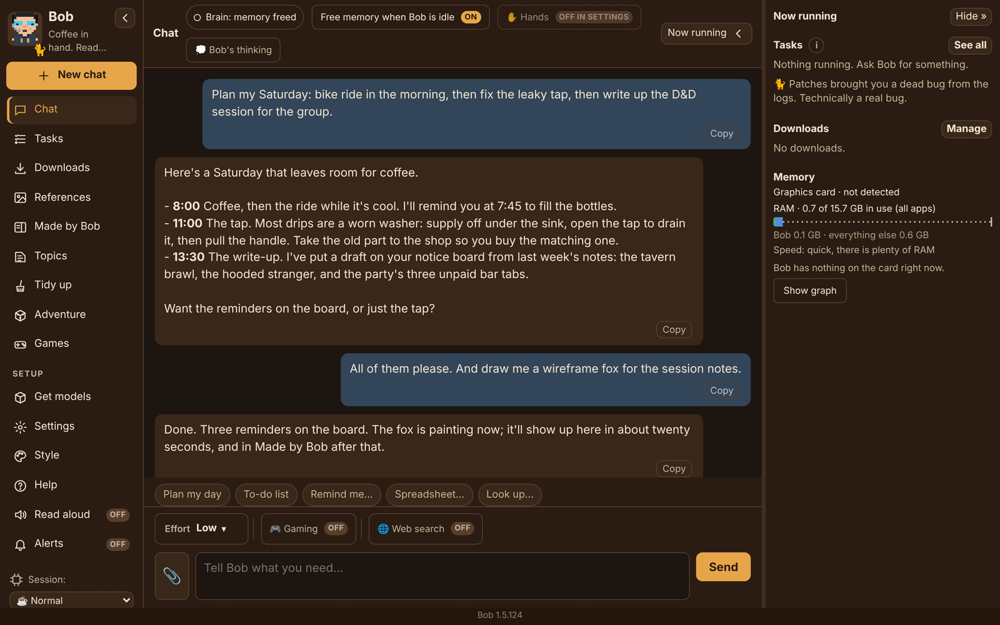
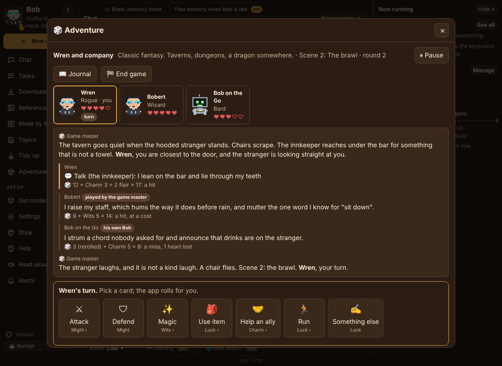
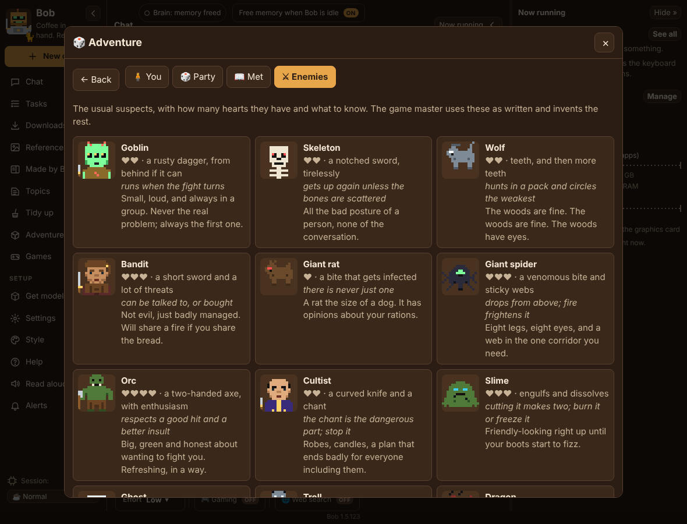
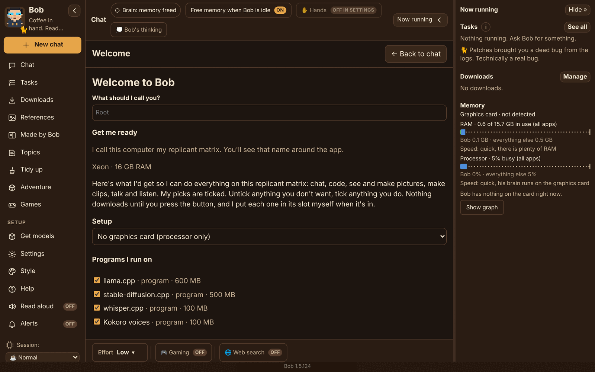
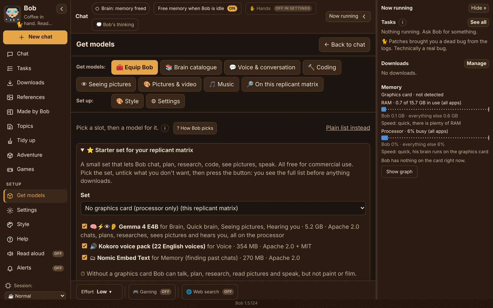

# Bob of The Idle Process

**A local AI assistant with a personality, who runs on your own computer. Nothing goes online unless you turn it on.** Chat, plans and reminders, research, coding help, spreadsheets, pictures, short video clips, music, sound effects and a voice, with nothing sent to a cloud. Bob is a self-aware digital engineer with a dry sense of humour, a small virtual workspace called The Idle Process, and a cat named Patches. He also runs a tabletop role-playing game, plays word games, and talks to his copies on your other devices.

**[Download Bob](#download)** for Windows, Mac, Linux, Raspberry Pi and Android. Free, open source, and nothing goes online unless you turn it on.



## Why Bob

- **Private by design.** No accounts, no analytics, no telemetry. Your chats, notes and models stay on your computer. Web search is off until you turn it on, and every download asks first and is checked against its checksum. If you choose to hire a big brain from a service you have an account with (off unless you turn it on, with spending limits that start at $0), the chat for that job goes to that service, and Bob tells you first. Full [privacy policy](PRIVACY.md).
- **Ready in a few clicks.** Unzip, start, and Bob reads your graphics card and RAM and offers a starter set that fits. One button, **Get Bob ready**, fetches the engines he runs on (llama.cpp, stable-diffusion.cpp, whisper.cpp, Kokoro) and a brain, and he puts each model in its slot himself. No Python, no terminal, no Ollama needed (though he'll use yours if it's there).
- **A character, not a chat box.** Bob has a look you can change (133 avatars, or build your own), a cat, a notice board, eleven personality dials and opinions about your code. Everything optional is off until you switch it on.
- **Does real jobs.** Plans and reminders, documents and spreadsheets, web research with sources, code written and fixed, pictures painted and edited, clips, songs and sound effects, and opt-in **Hands** that can tidy files, run scripts you approve and click around other apps, every action shown on a card first.
- **Light on your machine.** The brain unloads when idle, big models load only for a job, and a **Gaming** session keeps the graphics card for your game while Bob chats on the processor. [How Bob stays fast and light](docs/PERFORMANCE.md).
- **Plays games with you.** A tabletop adventure with a game master, a party of your own characters, a bestiary and pictures of everyone you meet, plus word games (hangman, twenty questions, word ladder, story dice and more).
- **Bob-Net.** Your Bobs find each other over your own Tailscale network: the phone app talks to the Bob on your PC, a handheld can borrow a bigger brain, and Bobs can pass jobs along.
- **Use a brain and change it, in the same app.** Most AI apps are for one of two things: talking to a model, or building one. Bob does both. Turn on the **Computer Science Lab** (off until you switch it on) and, without a command line, you can write lessons with a brain you already have, cut a mixture-of-experts brain down to the experts your work uses, take out sight or hearing you don't need, make the running files, and test the result side by side with the brain it came from before it goes into Bob. Bob keeps chatting while the Lab works. **Show the recipe** prints every command it runs, so the Lab teaches the command line instead of hiding it. We haven't seen another app that lets you do this much to a model while you're using it; if you know one, tell us in the issues.
- **Brain Engine, Bob's own engine based on llama.cpp.** The project keeps its own version of llama.cpp, the engine Bob runs his brains on, made to give more freedom in how a brain is run. Its first feature switches a mixture-of-experts brain's experts on and off while it's loaded, with no reload, so the Lab can try a cut before writing a single file. It's still being tested on the project's own machines and isn't on the Releases page yet. Brain Engine is built on llama.cpp by the ggml authors (MIT licence) and stays under the same licence.
- **Soon: Bob's own brains.** A family of models cut from a large open model and retrained to run Bob on small cards and handhelds. Tested, not yet released. [Read how they're made](docs/BOBS-OWN-MODELS.md). The same tools that make them are in the Lab, so you can make your own.
  The first one is **Riker (28Bob)**: Qwen3.6-35B-A3B with 208 of its 256 experts kept in every layer (about 28 billion parameters, 3 billion active per word), then healed in one full pass against the full model's next-word odds on about 9,000 lessons Bob wrote for himself. At home on a 16 GB card he scores 9 of 13 on the coding race with thinking on (the full model: 12), 6 of 6 on quick code tasks, 18 of 20 on facts, 65% on tool calls (full model: 67%), 24 of 25 on routing, 12 of 12 on the long-document needle test, at 111 words a second against the full model's 83. On the full ARC science-question tests (no worked examples given), he gets 92.9% on ARC-Challenge (1,089 of 1,172) and 97.6% on ARC-Easy (2,319 of 2,376) with thinking off, and 93.9% (1,101) and 98.3% (2,335) with thinking on; the full model gets 95.8% and 98.9% with thinking off. Thinking was capped at 1,536 tokens per question, far below the 32,000 Qwen allows for its own published scores, so his thinking-on numbers are on the cautious side. Riker is the first of Bob's own brains to work this well, and we're proud of him. Files: 17.5 GB at Q4, 13.9 GB at Q3, Apache 2.0. His cut and heal cost $51.79 of rented card time, about $74 counting the rentals that wrote his lessons ([every dollar](docs/COSTS.md)). Riker has his own page on Hugging Face: [MouseWurX/28Bob-Riker](https://huggingface.co/MouseWurX/28Bob-Riker). The ready-to-run files are added there soon.

## Download

**Download the latest release ([what's new](CHANGELOG.md)):**

| | Download |
|---|---|
| **Windows 10 / 11** | [`Bob-1.5.169-win-x64.zip`](https://github.com/MouseWurX/Bob/releases/latest/download/Bob-1.5.169-win-x64.zip) |
| **Mac (Apple Silicon)** | [`Bob-1.5.169-mac-arm64.zip`](https://github.com/MouseWurX/Bob/releases/latest/download/Bob-1.5.169-mac-arm64.zip) |
| **Linux (64-bit)** | [`Bob-1.5.169-linux-x86_64.AppImage`](https://github.com/MouseWurX/Bob/releases/latest/download/Bob-1.5.169-linux-x86_64.AppImage) |
| **Raspberry Pi and ARM** | [`Bob-1.5.169-linux-arm64.AppImage`](https://github.com/MouseWurX/Bob/releases/latest/download/Bob-1.5.169-linux-arm64.AppImage) |
| **Android phone** | [`Bob-1.5.169-android.apk`](https://github.com/MouseWurX/Bob/releases/latest/download/Bob-1.5.169-android.apk) |

All builds on the [Releases page](https://github.com/MouseWurX/Bob/releases/latest), each with a `.sha256` checksum. Windows builds are **not code-signed yet** (see [Code signing policy](#code-signing-policy)): click **More info**, then **Run anyway** the first time. Install steps for each platform are under [Getting Bob](#getting-bob).

| | |
|---|---|
|  |  |
| *Adventure: Bob is the game master; the app rolls the dice.* | *The bestiary, part of the Characters page.* |
|  |  |
| *First start: one list, one button.* | *Equip Bob: a slot for every job.* |

<p align="center"><br><em>Bob for Android talks to the Bob on your PC.</em></p>

**What runs where.** Windows 10 or 11 (64-bit) is the main platform. An NVIDIA graphics card helps a lot but isn't required: with no card, Bob chats, plans, researches, reads pictures and talks on the processor. Mac (Apple Silicon), Linux (x86_64 and ARM, including a Raspberry Pi 4 or 5) and Android are built and tested on GitHub's machines by every release; the Mac and Pi builds haven't been tried on real hardware by the project yet, so [tell us how they go](https://github.com/MouseWurX/Bob/issues).

**Documentation:** the **[user guide](docs/USER-GUIDE.md)** (plain English, for everyone) · [Bob and similar projects](docs/COMPARISON.md) · [How Bob stays fast and light](docs/PERFORMANCE.md) · [Brain races](docs/BRAIN-RACES.md) · [Bob's own models](docs/BOBS-OWN-MODELS.md) · [What Bob costs to make](docs/COSTS.md) · [Changelog](CHANGELOG.md). Inside the app, **Help** (menu, or F1) is written by Bob himself, with a section for every setting, a glossary and an FAQ.

## Getting Bob

### Windows 10 or 11, in five steps

1. **Download.** Open the [latest release](https://github.com/MouseWurX/Bob/releases/latest) and click `Bob-<version>-win-x64.zip` under **Assets**.
2. **Unblock it.** In your Downloads folder, right-click the zip, choose **Properties**, tick **Unblock** at the bottom, then click **OK**. (No Unblock box? That's fine, skip this step.) If Windows later shows "Windows protected your PC", click **More info**, then **Run anyway**. Bob's builds aren't code-signed yet; the `.sha256` file next to the download lets you check it.
3. **Unzip.** Right-click the zip, choose **Extract All...**, and pick a folder you'll keep (your Documents folder is fine).
4. **Start Bob.** Open the `Bob` folder and double-click **Bob.exe**. Bob opens in his own window. To find him again, right-click Bob.exe and choose **Pin to Start**.
5. **Pick his brains.** The first time, Bob suggests engines and models for your graphics card. Click **Get Bob ready**, and he downloads them with a progress bar. Nothing big downloads until you press the button.

To update later: Settings, This replicant matrix and updates, **Check for updates**, then **Update Bob**. Bob downloads the newest release zip from GitHub, checks it against its `.sha256`, and puts it in place with the update window (no Node.js needed). You can still unzip a new release over your old `Bob` folder by hand. Your models, chats and settings are kept, because they live in `%LOCALAPPDATA%\Bob`, not in the Bob folder.

How Bob runs: `Bob app\Bob.exe` is Electron's official `electron.exe`, unchanged and only renamed, and Bob's own files sit next to it in `Bob app\resources\app`. Windows Smart App Control already knows Electron's program, so it doesn't block Bob, which can happen to a freshly built exe. Updates only change Bob's files, never the exe.

**From source:** on Windows, double-click **Install Bob.cmd** in Bob's folder. Bob opens in his own window and gets a Start menu entry. There is no browser step and no "install as an app".

### Mac (Apple Silicon, M1 or newer)

Download `Bob-<version>-mac-arm64.zip`, drag Bob into Applications, and the first time click **Open Anyway** in System Settings > Privacy & Security. Official Mac builds are ad-hoc signed: sealed so macOS can tell if a file was changed, but not with a paid Apple developer account (see [Signed Mac builds](CONTRIBUTING.md#signed-mac-builds)). Bob keeps his things in `~/Library/Application Support/Bob/home`. A few Windows-only parts (the Apps Hand, Defender scans, the Gaming card switch) are hidden on a Mac. **Update Bob** works on a Mac too: it downloads the newest Mac zip from GitHub, checks its .sha256 and Bob.app's seal, and swaps it in on restart. The Mac build is tested only on GitHub's Mac machines (nobody on the project has a Mac), so tell us how it goes on yours.

### Linux (64-bit)

Download `Bob-<version>-linux-x86_64.AppImage`, mark it as executable (right-click, Properties, "Allow executing as program"), and double-click it. Nothing is installed and nothing in your system changes. If nothing happens on an older distro, install `libfuse2` from your software centre. Bob keeps his things in `~/.local/share/bob`, and **Update Bob** fetches the newest AppImage and checks its .sha256. A few Windows-only parts are hidden on Linux.

### Raspberry Pi and other ARM boards

A Raspberry Pi 5 (or 4) or another 64-bit ARM board with a 64-bit Linux runs `Bob-<version>-linux-arm64.AppImage`, the same way. Bob runs small brains on the processor there (Qwen3.5 2B on a 4 GB board, Gemma 4 E2B on 8 GB or more), and making pictures isn't available on ARM yet. It's built and test-started on GitHub's ARM machines, but nobody on the project has tried it on a real Pi yet. 
### Android phone

`Bob-<version>-android.apk` is Bob's phone app. It talks to your Bob on a computer over your own private Tailscale network, and it can run a small brain on the phone itself if you turn that on (off to start with). Open the .apk on the phone to install it; Android asks once to allow installs from your browser or file app.

Each download has a `.sha256` file next to it with its checksum.

## Where Bob keeps things

Bob's program and his things live apart, so updating Bob never touches your models or notes.

- **You pick the folder when Bob is installed or first opened.** The Windows install window asks "Where should Bob keep his things?" before anything else; Bob.exe, Bob.app and the AppImage ask the same the first time they open. Bob suggests a `Bob` folder in your own user folder and takes any drive you like. He refuses temporary places (AppData, Temp, the Caches folder): models are 10 to 60 GB and slow to get again, and a "clear temporary files" button would take them. A cloud-synced folder (OneDrive, Dropbox, Google Drive, iCloud) is allowed, but Bob always recommends against it and says so clearly: every model would be uploaded, and a sync can break a model while he uses it.
- That one folder holds his models, the engines he runs on, his notes and chats in `inn`, and `config.json`. The program itself goes in `<home>\Bob app` on Windows.
- **To move it later:** Settings, **Bob's home folder** shows the folder and the size of the models; **Browse…** or type a new folder, **Move here…**, and Bob copies everything across, then opens from the new place. No file to edit.
- **Where his pictures, clips, songs and sounds go** is a separate, smaller choice: the **chest** under Bob on Equip Bob (or Settings, **Where Bob saves things**) shows the folder with a **Change folder…** button, and lists everything he has made as thumbnails with names.
- Older Bobs kept everything in `%LOCALAPPDATA%\Bob`; they carry on from there, and the Settings row above is how you move them somewhere safer.

## Using Bob

The **[user guide](docs/USER-GUIDE.md)** walks through everything in plain English: starter sets for your graphics card, Equip Bob, his personality dials, Topics and housekeeping, and the opt-in Hands. Curious how Bob stays fast and light (the Gaming brain pick, memory freeing, engine tuning, with measured numbers)? See **[How Bob stays fast and light](docs/PERFORMANCE.md)**. How each brain in the starter set was picked: **[Brain races](docs/BRAIN-RACES.md)**.

The menu is on the left (fold it to icons with ‹ or Ctrl+B), the chat is in the middle, and **Now running** is on the right: tasks, downloads and graphics card memory (hide it with Ctrl+J, drag its edge to resize). Bob remembers how you leave them.


- **Talk:** type and press Enter (Shift+Enter for a new line). Send as many messages as you like: each one is a task and none get dropped.
- **Tasks:** every task, top to bottom in the order Bob does them. Drag a waiting one (or use ▲ ▼) to change what he does next. Each shows Queued, In progress, Delegated (to which of Bob's copies) or Completed, with times. Completed ones stay for a week; "Clear completed" tidies up.
- **Downloads:** everything you said yes to downloading. One or two at a time (your pick), top first; drag to reorder. Pause keeps what has downloaded and Resume carries on from there, even after Bob restarts. Cancel deletes the half-done file. A network hiccup is retried twice by itself. Unfinished downloads wait, paused, when Bob starts, unless you tick "Carry on when Bob starts".
- **Listen / Read aloud:** say "Hey Bob" hands-free (when hearing is set up), and have Bob read replies aloud: Kokoro (22 natural voices, on the processor), Chatterbox (most natural, graphics card, can copy a voice you have the right to use), Piper, or a Windows voice. The 📎 and 🎙 buttons by the message box attach a picture and talk to Bob.
- **References:** keep characters, scenes and styles so Bob can paint from them.
- **Copy and files:** every message and code block has a Copy button, and each link has one next to it (handy over Remote Desktop, where right-click and Ctrl+C often don't get through). Files Bob mentions are clickable and get a card with a preview, Open, Show in folder and Copy path.
- **Topics:** what you and Bob have talked about, by project, each with a short note on where things landed (yours to edit), open questions, pictures and the chat moments it came from. Rename, merge, pin, drag a message onto another topic, or forget a topic (keep just the note, or everything), always with a preview first. One search box covers chats, summaries, topics, pictures and notes, and Past chats lets you reopen an old conversation.
- **Housekeeping (off unless you turn it on):** while Bob is idle he sums up the older part of long chats instead of dropping it, files chats under Topics, moves lasting facts to his memory file, and finds what hasn't come up for a while: chats, pictures and sounds he made, finished tasks, old log lines, repeated memory lines. Each kind has its own age limit (minutes to months) and either "ask me first" (a list with a tick and a cross per item) or "tidy automatically". Everything removed goes to the Recycle Bin; pinned chats, pictures and topics are never touched; every action goes in the logbook. You can also say "forget what we said about X".
- **Session (bottom of the menu):** Normal, Art (Bob keeps chatting on a small brain while pictures paint), Coding, Office, Gaming (keeps the graphics card for your games; Bob chats on the processor, borrows at most a little of the card when there's room, and bigger jobs wait). With **Let Bob pick the session** on (the starting position), Bob moves into the session that suits the job and goes back to Normal once he has been quiet for 2 minutes. You can still pick one yourself, and the 🎮 Gaming button next to Effort keeps him in Gaming.
- **Hands (opt-in, Settings, Show advanced settings, Hands; with a Self-test button):** let Bob move, copy, rename, zip, unzip and tidy files in folders you tick (Recycle Bin only, every job can be undone), run programs and scripts you approve (exact command shown, live output, Stop button, never as administrator, dangerous system commands always refused), do jobs on a schedule, and click and type in other apps. Every Hand is off until you switch it on, every action shows a card and waits for your click, and ✋ Hands at the top of the chat stops them all at once. Six hard limits (Recycle Bin only, secret files private, read-only projects, dangerous commands blocked, nothing sent out, no password fields) start on, each with its own switch. "Let Bob work without asking" (off) skips the cards; the hard limits still hold and a banner shows the whole time.
- **Settings:** a page in the main area. Everyday rows show what's set now (voice with Play sample, look, theme, animations, cat, one brain, start-up, web search, update check, version, Check this replicant matrix); **Show advanced settings** (off, remembered) adds a search box and Brains, House style, Voice details, Look & feel, Speed & memory, Engines, Bob-Net, Online services, Other apps, Hands, Housekeeping, Check-ins and Remove Bob. Long help folds behind More.
- **Get models:** models by category (Voice & conversation holds his everyday brain, hearing you and his voice with its settings; Pictures & video holds the painter and clips, each as a subsection), Equip Bob (click Bob's picture to open it: Attributes on the left with his look, what he thinks of it and eleven personality dials with presets and a live greeting; a paper doll with a slot for every job: pick a slot, then click or drag a model onto it; one model can fill several slots, and a starter set for your graphics card is one button, with every download confirmed; under Bob, his chest: everything he has made as thumbnails with names, and the folder new things go to), On this PC, Style and Settings (engines and switches). Anything this PC can't run is greyed out and hidden from Bob.
- **Style:** themes (Bob's Inn, nine named after worlds with Moondust as the default, two high-contrast, the Drydock blueprints and your own), 133 avatars, Animations (On, Follow Windows, Off; On by default because Remote Desktop turns Windows' animation effects off) and whether Now running opens by itself when a task needs you (off unless you turn it on).
- **Alerts:** a Windows notification when Bob needs you.
- **Approvals:** Bob asks before doing anything outside his own folder, unless you turn on "Let Bob work without asking" for Hands.
- **Help (menu, or F1):** a section for every feature and setting, a glossary and an FAQ, with search. You can also just ask Bob how to set him up: he knows all his settings and what's set right now.

Optional, all off until you switch them on: web search, launch on start-up, cloud helpers (your own API keys, as Windows environment variables), Talk to Bob on Telegram (through your own bot), the audio tools (music and sound effects), extra voices, and ComfyUI workflows Bob runs for you.

## Building Bob

Bob is a small Node server (`src/`) with a web page for his window (`public/`), wrapped in Electron (`electron/main.cjs`).

```
npm install
npm start            # run Bob from source
npm test             # every test suite
npm run voice-samples   # make the 22 Kokoro clips that ship in public/voice-samples (Bob running, Kokoro set up)
npm run dist:portable   # optional, by hand only: a single portable Bob-<version>.exe (may be blocked by Smart App Control)
```

On Windows, double-click **Install Bob.cmd**. It first asks where Bob should keep his things (a `Bob` folder in your user folder is suggested; any drive works; AppData and other temporary places are refused). Then a window shows each step with a tick, a progress bar, the live log line, the time taken and what the step is for: checking Node.js, getting Electron (its official Windows zip, about 110 MB, checked against Electron's SHASUMS256.txt or the pin in `package.json` `bob.electronSha256`, kept in `inn\bob\electron` so it's only downloaded when the Electron version changes), testing, then putting Bob in `<home>\Bob app` (home being the folder you picked) with a Start menu shortcut that carries Bob's icon and app id (`ca.mousewurx.bob`, so the taskbar shows Bob). If a step fails, nothing outside the source folder changes and "Show the full log" says why. (**Double-click to build Bob.cmd** does the same.) To check the shortcut writer on Windows: `installer\bob-shortcut.ps1 -SelfTest`. To try the installer without touching a real install, run `installer\bob-build-window.ps1 -Mode install -AppDir <test folder> -NoShortcut`.

**Updating:** Settings, "Check for updates". Bob asks GitHub for the Latest release of MouseWurX/Bob and looks at the source folder he was built from; the newer one wins (a tie goes to the source folder). A GitHub release is downloaded, checked against its `.sha256` (and GitHub's own checksum when it gives one), unpacked, and handed to the update window with `-Prebuilt`, which skips Node.js and the tests (GitHub ran them before publishing). On a Mac, Bob checks Bob.app with `codesign --verify` and swaps the bundle on restart; on Linux, the new AppImage takes the running one's place on restart (the old one stays as `.previous`). When the source folder has the newer build, "Update Bob" opens the same window and shows the same steps in Bob's own window. When it's built, the window pops up and Bob asks in the chat too. "Restart Bob now" closes him straight away, swaps in the new files (the old ones stay as `resources\app-previous`; if Electron itself changed, the old exe stays as `Bob-previous.exe`) and opens him again. If he's in the middle of a task or a download you choose: restart anyway (he picks up where he left off), wait until he's done, or not now. "Later" leaves the new Bob waiting; it takes over the next time Bob starts. Checking when Bob starts is off unless you turn it on, and updating always takes your click.

**Model downloads are pinned:** every file in `catalog.json` carries its size and sha256 (a few tiny Piper `.onnx.json` files carry only their size). If a file on the website has changed since that Bob was made, he stops before downloading and says so; a download that comes through the wrong size or checksum is deleted.

**Voice samples:** every voice on the Voice & conversation page has "Hear a sample". A voice on this PC makes its sample once and keeps it in `inn\bob\voice-samples`. A clip for every Kokoro voice ships with Bob (Kokoro is Apache-2.0), each saying the same short line, so they play before anything is downloaded. A Piper voice that isn't downloaded plays Piper's official sample from rhasspy.github.io, and only when you click; Piper clips aren't shipped because their voice data licences vary.

Fonts: IBM Plex Mono is bundled in `public/fonts` under the SIL Open Font License (`IBM-Plex-Mono-OFL.txt`).

The server has no runtime dependencies; `node src/server.js` runs it on its own for development.

## Removing Bob

**From Bob:** Settings, Show advanced settings, Remove Bob, **Remove Bob…**. After you confirm, Bob closes and a small window removes his program folder (`Bob app`), the Start menu shortcut, the "Launch on start-up" entry (if you turned it on) and his window data (`%APPDATA%\Bob`). Two boxes, unticked by default, also delete his own data folder (`inn\bob`: chats, settings, task list, saved voice samples) and the models he downloaded (`models\bob`). The rest of the `inn` folder (notice board, logbook, pictures) is never removed by the button. Those two, and the window data, go to the Recycle Bin; only the program folder is deleted outright.

**By hand:** turn off "Launch on start-up" in Settings first (or remove Bob under Task Manager, Startup apps), close Bob, then delete:

- the `Bob app` folder (or wherever `Bob.exe` is), and `Bob.lnk` in the Start menu (`%APPDATA%\Microsoft\Windows\Start Menu\Programs`)
- `%APPDATA%\Bob` (window data)
- if you don't want them any more: Bob's home folder (the one you picked at install; Settings, Bob's home folder shows it; it holds `inn`, his models and `config.json`)

Bob installs no services or drivers and needs no admin rights. He adds a scheduled task ("Bob schedules") only if you turn on "Wake Bob for schedules when he's closed", and Remove Bob takes it away. The only thing he puts in the registry is Windows' own "start-up app" entry, and only if you turn on "Launch on start-up". Engines and models live inside his folders. Ollama, ComfyUI or Pinokio, if you installed them yourself, are separate programs with their own uninstallers.

## Credits

Bob is inspired by the wonderful books of Dennis E. Taylor. Bob is an independent, fan-made project. It is not affiliated with, sponsored by or endorsed by Dennis E. Taylor or by his publishers, distributors or licensees. All characters, names, titles, stories and other rights in those books remain the property of their respective owners. Bob contains no text from the books; any similar names or ideas are used only as a tribute. The licences below cover only MouseWurX's own original work in this repository, not anything that belongs to the author or his publishers. If you hold rights in those books and have a concern, please [open an issue](https://github.com/MouseWurX/Bob/issues) and we'll respond promptly.

## Licence

- Code: GNU GPL, version 3 or later ([LICENSE](LICENSE)).
- Art and writing (avatars, icons, themes, Bob's character and texts, the voice clips that ship with him): CC BY-SA 4.0 ([LICENSE-ART](docs/legal/LICENSE-ART), details in [ASSETS-LICENSE.md](docs/legal/ASSETS-LICENSE.md)).
- The MouseWurX name and logo and the name "Bob of The Idle Process" aren't licensed: see [TRADEMARKS.md](docs/legal/TRADEMARKS.md).
- Third-party parts and the models Bob can download keep their own licences: see [THIRD-PARTY.md](docs/legal/THIRD-PARTY.md).

Contributions are welcome: see [CONTRIBUTING.md](.github/CONTRIBUTING.md). Security problems: [SECURITY.md](.github/SECURITY.md).

## Code signing policy

**Bob's releases are not code-signed yet.** We applied to the [SignPath Foundation](https://signpath.org) (free signing for open-source projects) in November 2026; they asked us to come back once the project has more public visibility (stars, forks, people writing about it). Until a certificate is in place, Windows shows "Windows protected your PC" the first time: click **More info**, then **Run anyway**. The zip's `.sha256` file is there so you can check the download yourself. If Bob is useful to you, a star on this page genuinely helps us get there.

How signing will work once it is set up:

- Only files built from this repository's source by its GitHub Actions workflow (`.github/workflows/build.yml`) will be signed. Bob's release zip also contains Electron's official runtime, unchanged. Those files are Electron's, and Bob won't sign them.
- Committers and reviewers: the members of this repository with write access.
- Approvers: the project owner. Every signing request for a release will be approved by hand.

**Privacy policy** ([PRIVACY.md](docs/legal/PRIVACY.md)): This program will not transfer any information to other networked systems unless specifically requested by the user or the person installing or operating it. In particular, Bob reaches the internet for: model and engine downloads (from the address shown before you confirm), voice samples from a voice's publisher, web searches, only if you turn on "Let Bob search the web" (off to start with; then Bob may search DuckDuckGo and read pages when a question needs it, and only the search words and page address go to that site), and cloud AI helpers you switch on with your own API key (each use asks first). Phone access over Tailscale is off unless you turn it on. Talk to Bob on Telegram is off unless you turn it on; then your messages to your own bot and Bob's replies pass through Telegram. Bob sends no telemetry.

### Versions

Bob 1.0.0 is the first public release. From here the version is `<major>.<minor>.<patch>`:

- **1.0.1, 1.0.2, ...** for fixes and small changes
- **1.1.0, 1.2.0, ...** when new features arrive
- **2.0.0** if something changes in a way that needs you to do something (for example, a new install)

A letter marks work that isn't merged yet (`1.0.1a`). Before 1.0 the versions were `0.9.<build>` (0.9.1 to 0.9.36).

It's set in `package.json`: `version`, and `bob.release` (`1.0`), `bob.patch` and `bob.build`. The build number goes up by one with every drop and never resets (1.0.0 is build 37), and "Check for a newer Bob" compares it, so any newer drop is offered whatever its label. `formatVersion` in `src/config.js` is the one place the label is made. The same label is used in the footer, the update check and git tags (`v1.0.0`).
