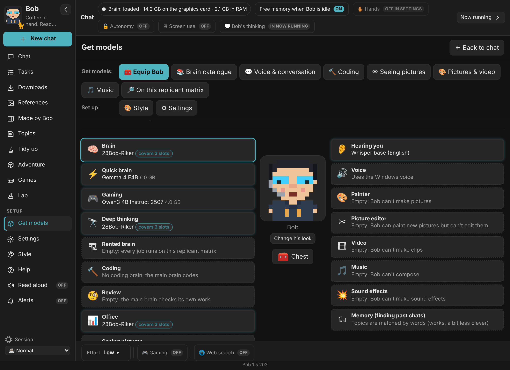
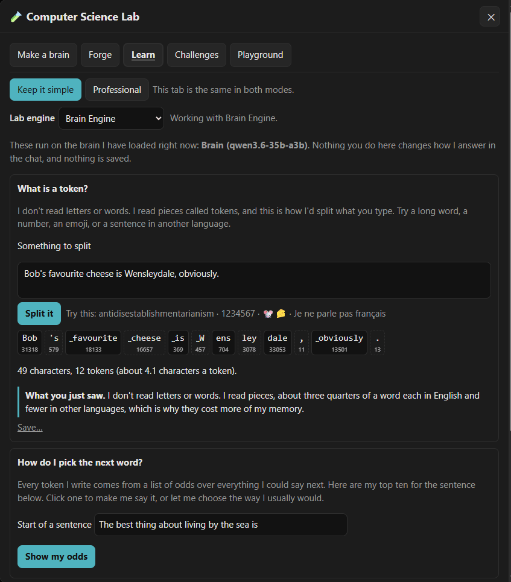
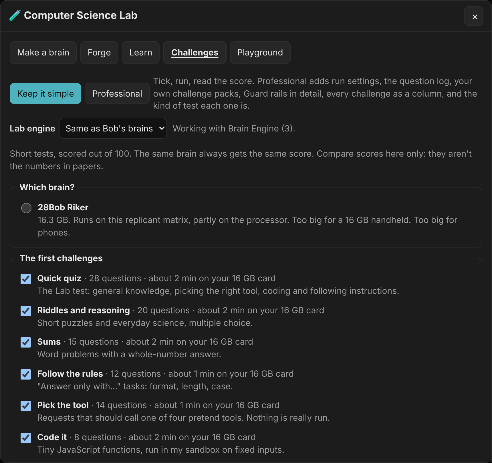
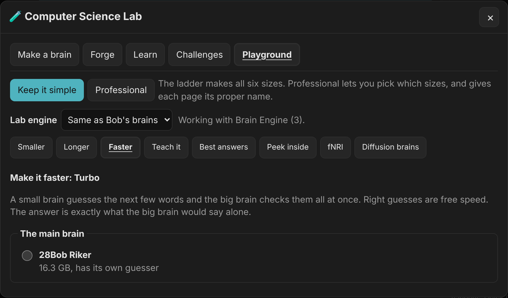

<h1 align="center">Bob of The Idle Process</h1>

<b>A local AI agent with a personality. He runs on your own computer, and nothing goes online unless you turn it on.</b>

  <a href="#download"><b>Download</b></a> ·
  <a href="#what-bob-does">What Bob does</a> ·
  <a href="#the-computer-science-lab">The Lab</a> ·
  <a href="#bobs-own-brains">Brains and scores</a> ·
  <a href="#bob-net-bobs-working-together">Bob-Net</a> ·
  <a href="app/docs/README.md">All the docs</a>

Windows · Mac · Linux · Raspberry Pi · Android &nbsp;|&nbsp; free and open source &nbsp;|&nbsp; no account, no telemetry

## At a glance

| | |
|---|---|
| 🛠 **[A real agent](#what-bob-does)** | Research with sources, code written, run and fixed, documents read and shown beside the chat, files, other apps, pictures, clips, music and a voice. |
| 🧪 **[Computer Science Lab](#the-computer-science-lab)** | Cut, teach, mix, race and look inside a brain, then test it next to the one it came from. No command line. |
| 🧠 **[Bob's own brains](#bobs-own-brains)** | Three models cut and retrained to run Bob on everyday graphics cards, with every score, lesson set and dollar published. |
| 📡 **[Bob-Net](#bob-net-bobs-working-together)** | Your Bobs pool graphics cards and memory, pass jobs along and check each other's work, on your home network or Tailscale. |
| 🎮 **[Gaming friendly](#light-on-your-machine)** | The brain unloads when idle, and a Gaming session leaves the graphics card to your game. |
| 🔓 **Private and open** | GPL-3.0. Your chats, notes and models stay on your computer. Everything optional starts switched off. |

## See a brain think

| | |
|:---:|:---:|
|  |  |
| **Load, think, unload.** One floor per layer. | **Answering, live.** Each lit block is an expert at work. |

This is **fNRI**, the Lab's brain imager, recorded from Bob's own window. [Watch the full minute](app/docs/screens/fnri-cube-qwen3.6-35b-a3b.mp4) · [what it shows](#the-computer-science-lab)

## Download

**Latest release ([what's new](CHANGELOG.md)):**

| | Download |
|---|---|
| **Windows 10 / 11** | [`Bob-1.5.203-win-x64.zip`](https://github.com/MouseWurX/Bob/releases/latest/download/Bob-1.5.203-win-x64.zip) |
| **Mac (Apple Silicon)** | [`Bob-1.5.203-mac-arm64.zip`](https://github.com/MouseWurX/Bob/releases/latest/download/Bob-1.5.203-mac-arm64.zip) |
| **Linux (64-bit)** | [`Bob-1.5.203-linux-x86_64.AppImage`](https://github.com/MouseWurX/Bob/releases/latest/download/Bob-1.5.203-linux-x86_64.AppImage) |
| **Raspberry Pi and ARM** | [`Bob-1.5.203-linux-arm64.AppImage`](https://github.com/MouseWurX/Bob/releases/latest/download/Bob-1.5.203-linux-arm64.AppImage) |
| **Android phone** | [`Bob-1.5.203-android.apk`](https://github.com/MouseWurX/Bob/releases/latest/download/Bob-1.5.203-android.apk) |

Every build has a `.sha256` checksum on the [Releases page](https://github.com/MouseWurX/Bob/releases/latest). Install steps are under [Getting Bob](#getting-bob).

## What's new

| | |
|---|---|
| 📄 **Documents beside the chat** | Word, Excel, PowerPoint and PDF open in the side panel. Bob reads and searches them with nothing extra installed. |
| 📝 **Notes that take themselves** | Say "note:" and Bob writes it down. Let him, and he also notes decisions, dates and numbers as they come up. |
| ⚙ **Settings you can find** | Eight plain cards, or an Advanced list of every section with a search box, in its own window. |
| ✅ **"Do you want me to:"** | First-time setup lists what Bob can do that starts switched off. Tick what you want. |
| 🛰 **SCUT and SUDDAR** (experimental) | SCUT is Bob's own fast link for one brain running over two Bobs' cards on Wi-Fi: a lost bit is sent again in milliseconds. SUDDAR scans your other Bobs and times each answer. |
| 🎙 **Onyx, Bob's voice** | Deep, calm and a little dry. Bob's recommended Kokoro voice, marked ★ in the voice list. |
| ⚡ **Brain Engine 3** | Bob's own engine now has its own version numbers. It carries SCUT, and it updates with Bob. |
| 🧪 **More in the Lab** | Fold experts instead of dropping them, switch experts off without cutting the file, and colour a brain by its weights. |

**Coming next:** a simpler Lab in its own window · 3D models and OpenSCAD parts · an iPhone Home Screen app · Try again and Edit in the chat · save, share and import chats · search documents by meaning · presets and saved prompts · maths shown as formulas · a passcode lock · back up Bob and move him to another computer · French and Spanish · other apps and Claude using Bob · tool packs · .deb and Flatpak.

The [changelog](CHANGELOG.md) has every release.

## What Bob does

| | |
|---|---|
|  |  |
| **Documents beside the chat.** Sheets, slides, pages and PDFs. | **Ready in one button.** Bob reads your card and fetches what fits. |
|  |  |
| **Equip Bob.** A slot for every job, a model for every slot. | **Adventure.** Bob runs the table; the app rolls the dice. |

- **Work:** plans and reminders, web research with sources, code written, run and fixed, documents and spreadsheets read, searched and written.
- **Make:** pictures painted and edited, short clips, songs and sound effects, and a voice (22 Kokoro voices and more).
- **Hands (opt-in):** tidy files, run scripts you approve, keep a schedule, click around other apps, use his own browser window, and work inside Blender or Unreal Engine through MCP. Every action shows a card first.
- **Remember:** Topics, notes and memory banks keep what matters between chats. Exact sums are worked out in a locked sandbox, not guessed.
- **Lots of context:** 256K tokens (about 195,000 words) on a 16 GB card, and up to 1M with Long memory.
- **A character:** eleven personality dials, 133 avatars, a cat named Patches, and opinions about your code.
- **Big brains when you want them:** rent one for a single job from a service you have an account with. Off to start, with spending limits that start at $0.

<b>More pictures:</b> Settings, the first-time list, games, the bestiary, themes and Help

| | |
|---|---|
|  |  |
| **Settings, Simple:** eight cards. | **Settings, Advanced:** every section, with search. |
|  |  |
| **"Do you want me to:"** Everything optional, in one list. | **Games:** five word games that run on a small brain. |
|  |  |
| **The bestiary:** the usual suspects, drawn as they appear. | **Style:** themes named after worlds, or build your own. |
|  | |
| **Help (F1):** written by Bob, with a glossary and FAQ. | |

## The Computer Science Lab

Most AI apps are for talking to a model or for building one. Bob does both. **🧪 Lab** in the menu is where you change a brain, on your own computer, while Bob keeps chatting.

| Tab | What you do there |
|---|---|
| **Make a brain** | Pick a brain and a goal. Bob cuts the experts your work doesn't use, takes out sight or hearing you don't need, makes the Q4 to Q8 files and tests the result. **Use in Bob** only appears after the test. |
| **Forge** | Every way to make a brain, side by side: smaller, cut, folded, mixed, or taught back on a rented card. |
| **Learn** | Hands-on cards on how a brain works, run on the brain Bob has loaded. |
| **Challenges** | Short tests out of 100 and a scoreboard by size. |
| **Playground** | How small, how long, how fast. Teach it, pick its best answers, peek inside, and scan it with fNRI. |

- **Keep it simple or Professional.** Simple fills in Bob's defaults. Professional shows every control and its proper name. **Show the recipe** prints every command the Lab runs.
- **Brain Engine** is Bob's own engine. It switches a brain's experts on and off while it's loaded, so the Lab can try a cut before writing a file.
- **fNRI** (functional Neural Response Imager) scans a brain while it answers and shows it as a 3D block: one floor per layer, every expert coloured by the skill that used it most.

<b>More pictures:</b> Forge, Learn, Challenges and Playground

| | |
|---|---|
|  |  |
| **Forge** | **Learn** |
|  |  |
| **Challenges** | **Playground** |

Lab jobs need at least 12 GB of memory; a smaller computer can start them on a bigger Bob on your Bob-Net. Making an fNRI scan needs Brain Engine, on Windows or Linux. More in the [user guide](app/docs/USER-GUIDE.md#11-the-computer-science-lab).

## Bob's own brains

Three models made from Qwen3.6-35B-A3B with the same tools that are in the Lab: the least-used experts are cut away, then the brain is taught back against the full model. All three are Apache 2.0 and free to download.

| | **Riker** (28Bob) | **Bobert** (35Bob) | **Bill** (20Bob) |
|---|---|---|---|
| What he is | Bob's everyday brain | The full model, taught every lesson | The smallest so far |
| Experts kept per layer | 208 of 256 | 256, no cut | 144 of 256 |
| File at Q4 | 17.5 GB | 21 GB | 12.7 GB |
| On a 16 GB card | A few experts in RAM | More in RAM | Fits whole |
| Tool decisions, 314 held-out chat turns | 65% | 65% | **68%** |
| Short facts | 18 of 20 | **20 of 20** | 12 of 20 |
| Code that runs | **6 of 6** | **6 of 6** | 1 of 6 |
| Download | [28Bob-Riker](https://huggingface.co/MouseWurX/28Bob-Riker) | [35Bob-Bobert](https://huggingface.co/MouseWurX/35Bob-Bobert) | [20Bob-Bill](https://huggingface.co/MouseWurX/20Bob-Bill) |

Same tests, same rented card, each Bob served from his public Q4 file. Riker matches Bobert at a size that suits a 16 GB card, so he is Bob's default. Bill is best at tool decisions and weakest at facts and code, and is published as he is.

**Riker against the model he was cut from**, at home on a 16 GB card:

| Test | Riker | Full Qwen3.6-35B-A3B |
|---|---|---|
| ARC-Challenge, thinking off / on | 92.9% / 93.9% | 95.8% (off) |
| ARC-Easy, thinking off / on | 97.6% / 98.3% | 98.9% (off) |
| Tool decisions, held-out chats | 65% | 67% |
| Coding race, 13 tasks, thinking on | 9 | 12 |
| One fact hidden in up to 128K tokens | 12 of 12 | 12 of 12 |
| Speed | **111 tokens a second** | 83 tokens a second |

**Open data and write-ups**

| | |
|---|---|
| [bob-lessons](https://huggingface.co/datasets/MouseWurX/bob-lessons) | The lessons the Bobs learned from: chat, tool calls, thinking on and off. CC BY-SA 4.0. |
| [bob-odds](https://huggingface.co/datasets/MouseWurX/bob-odds) | The teacher's next-word odds used to teach each cut brain back. |
| [How they're made](app/docs/BOBS-OWN-MODELS.md) | The method, every result, and what went wrong along the way. |
| [What they cost](app/docs/COSTS.md) | Every rental, itemized, failures included. |
| [Brain races](app/docs/BRAIN-RACES.md) · [test results](app/docs/test-results/README.md) | How other brains score on the same tests and the same PC. |

Bob picks Riker's file for your card himself: Q4, or Q3 on an 8 GB card.

## Bob-Net: Bobs working together

Put Bob on your PC, laptop, handheld and phone, and they find each other on your home network or your own private [Tailscale](https://tailscale.com) network. Every part is off until you turn it on.

- **Pool graphics cards and memory.** A brain too big for one computer is spread over your Bobs' cards and memory. One bigger than all of that can still run from a fast SSD.
- **Fast where it counts.** The first load sends the brain once; later loads send only what's missing. A brain that fits on one computer stays there, because that beats any network.
- **Bobs working in concert.** Borrow a bigger Bob's brain for a reply, send a job to whichever Bob is free, or have a bigger Bob check a handheld's harder work.
- **The phone app** talks to the Bob on your PC, and can run a small brain on the phone itself.
- **Adventures together:** your other Bobs join the party in the tabletop game.

 

## Light on your machine

| | |
|---|---|
| Graphics memory Bob holds while idle | **None.** The brain unloads, and big models load only for the job that needs them. |
| 🎮 Gaming session, first word of a reply | **0.1 seconds** with the brain loaded, on the processor, with the graphics card left to your game. |
| Context on a 16 GB card | **256K tokens**, and up to 1M with Long memory. |

Pictures and big jobs wait in Tasks while you play, and **Let games go first** has Bob use fewer processor cores. The measurements are in [How Bob stays fast and light](app/docs/PERFORMANCE.md).

## Getting Bob

### Windows 10 or 11, in five steps

1. **Download** `Bob-<version>-win-x64.zip` from the [latest release](https://github.com/MouseWurX/Bob/releases/latest).
2. **Unblock it:** right-click the zip, **Properties**, tick **Unblock**, **OK**. If Windows shows "Windows protected your PC", click **More info**, then **Run anyway**.
3. **Unzip** it into a folder you'll keep.
4. **Start Bob:** double-click **Bob.exe** in the `Bob` folder.
5. **Pick his brains:** Bob suggests engines and models for your card. Click **Get Bob ready**. Nothing big downloads until you press it.

`Bob.exe` is Electron's official program, only renamed, so Smart App Control doesn't block it. To update: Settings, **Check for updates**, then **Update Bob**.

### Other computers

| | |
|---|---|
| **Mac (M1 or newer)** | Drag Bob into Applications. The first time, click **Open Anyway** in System Settings > Privacy & Security. Builds are ad-hoc signed ([why](.github/CONTRIBUTING.md#signed-mac-builds)). |
| **Linux** | Mark the AppImage as executable and double-click it. Nothing is installed. An older distro may need `libfuse2`. |
| **Raspberry Pi and ARM** | A 64-bit Pi 4 or 5 runs the arm64 AppImage the same way, with small brains on the processor. No pictures on ARM yet. |
| **Android** | Open the .apk on the phone. It talks to your Bob over Tailscale. |

Windows is the main platform. An NVIDIA card helps but isn't required. The Mac and Pi builds are tested on GitHub's machines but not yet on real hardware, so [tell us how they go](https://github.com/MouseWurX/Bob/issues). A few Windows-only parts are hidden elsewhere. To build from source, see [Building Bob](app/docs/BUILDING.md).

## Where Bob keeps things

Bob's program and his things live apart, so updating never touches your models or notes.

- **You pick the folder when Bob is installed or first opened.** Bob suggests a `Bob` folder in your user folder and takes any drive. He refuses temporary places like AppData, because models are 10 to 60 GB. A cloud-synced folder (OneDrive, Dropbox, Google Drive, iCloud) is allowed, but Bob always recommends against it: every model would be uploaded.
- **To move it later:** Settings, **Bob's home folder**, then **Move here…**.
- **His pictures, clips and songs** go to the folder shown in the **chest** under Bob on Equip Bob, with a **Change folder…** button.

## Using Bob

The **[user guide](app/docs/USER-GUIDE.md)** walks through everything in plain English, and **Help** (F1) inside Bob has a section for every setting. You can also just ask Bob how to set something up: he knows his own settings.

Every other page, from benchmarks to building from source, is listed in **[the docs](app/docs/README.md)**.

## Removing Bob

**From Bob:** Settings, This replicant matrix, **Remove Bob…**. Bob closes, and a small window removes his program, the Start menu shortcut, the start-up entry and his window data. Two boxes, unticked by default, also remove his chats and settings and the models he downloaded (to the Recycle Bin).

**By hand:** turn off "Launch on start-up", close Bob, then delete the `Bob app` folder, `Bob.lnk` in the Start menu, `%APPDATA%\Bob`, and, if you want, Bob's home folder.

Bob installs no services or drivers and needs no admin rights.

## Credits

Bob is inspired by the wonderful books of Dennis E. Taylor. Bob is an independent, fan-made project. It is not affiliated with, sponsored by or endorsed by Dennis E. Taylor or by his publishers, distributors or licensees. All characters, names, titles, stories and other rights in those books remain the property of their respective owners. Bob contains no text from the books; any similar names or ideas are used only as a tribute. The licences below cover only MouseWurX's own original work in this repository, not anything that belongs to the author or his publishers. If you hold rights in those books and have a concern, please [open an issue](https://github.com/MouseWurX/Bob/issues) and we'll respond promptly.

Bob's own brains are made from [Qwen3.6-35B-A3B](https://huggingface.co/Qwen/Qwen3.6-35B-A3B) by Alibaba's Qwen team (Apache 2.0). Brain Engine is built on [llama.cpp](https://github.com/ggml-org/llama.cpp) by the ggml authors (MIT).

Testing and releases: **Porter**, a Claude assistant made by Anthropic, carried Bob's builds through testing on real hardware and out the door as releases. Thanks, Porter.

## Licence

- Code: GNU GPL, version 3 or later ([LICENSE](LICENSE)).
- Art and writing (avatars, icons, themes, Bob's character and texts, the voice clips that ship with him): CC BY-SA 4.0 ([LICENSE-ART](app/docs/legal/LICENSE-ART), details in [ASSETS-LICENSE.md](app/docs/legal/ASSETS-LICENSE.md)).
- The MouseWurX name and logo and the name "Bob of The Idle Process" aren't licensed: see [TRADEMARKS.md](app/docs/legal/TRADEMARKS.md).
- Third-party parts and the models Bob can download keep their own licences: see [THIRD-PARTY.md](app/docs/legal/THIRD-PARTY.md).

Contributions are welcome: see [CONTRIBUTING.md](.github/CONTRIBUTING.md). Security problems: [SECURITY.md](.github/SECURITY.md).

## Code signing policy

**Bob's releases are not code-signed yet.** We applied to the [SignPath Foundation](https://signpath.org) (free signing for open-source projects) in November 2026; they asked us to come back once the project has more public visibility. Until then, Windows shows "Windows protected your PC" the first time: click **More info**, then **Run anyway**, and use the `.sha256` file to check the download. If Bob is useful to you, a star on this page genuinely helps.

Once signing is set up:

- Only files built from this repository's source by its GitHub Actions workflow (`.github/workflows/build.yml`) will be signed. Electron's own runtime in the zip stays unchanged and unsigned by Bob.
- Committers and reviewers: the members of this repository with write access.
- Approvers: the project owner. Every signing request for a release will be approved by hand.

**Privacy policy** ([PRIVACY.md](app/docs/legal/PRIVACY.md)): This program will not transfer any information to other networked systems unless specifically requested by the user or the person installing or operating it. Bob reaches the internet only for downloads you confirm, voice samples you play, web searches if you turn on "Let Bob search the web", and online services you switch on yourself. Bob sends no telemetry.
