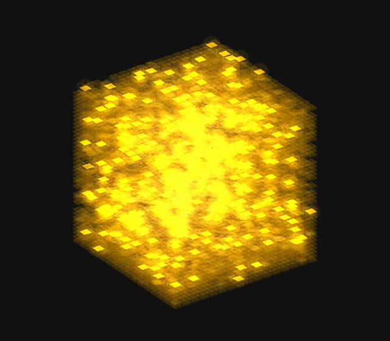

# Bob of The Idle Process

**A local AI agent with a personality, who runs on your own computer.** Bob plans and does real jobs with tools, comes with a Computer Science Lab for changing the brains he runs on, has a family of brains of his own, and shares graphics cards and jobs with the other Bobs on your network. Free, open source, and nothing goes online unless you turn it on.

**[Download Bob](#download)** for Windows, Mac, Linux, Raspberry Pi and Android.

## At a glance

| | |
|---|---|
| 🧪 **[Computer Science Lab](#the-computer-science-lab)** | Cut, teach, mix, race and look inside a brain, then test it next to the one it came from. No command line. |
| 🧠 **[Bob's own brains](#bobs-own-brains)** | A model family cut and retrained to run Bob on small cards. Riker, the first, is Bob's default brain. |
| 📡 **[Bob-Net](#bob-net-bobs-working-together)** | Your Bobs pool their graphics cards and memory, pass jobs along and check each other's work, over Tailscale or your home network. |
| 🎮 **[Gaming friendly](#light-on-your-machine)** | The brain unloads when idle, and a Gaming session leaves the graphics card to your game. |
| 🔓 **Open source and private** | GPL-3.0. No accounts, no telemetry. Your chats, notes and models stay on your computer. |
| 🛠 **[A real agent](#what-bob-does)** | Research with sources, code written, run and fixed, documents, files, other apps, pictures, clips, music and a voice. |

## Download

**Latest release ([what's new](CHANGELOG.md)):**

| | Download |
|---|---|
| **Windows 10 / 11** | [`Bob-1.5.201-win-x64.zip`](https://github.com/MouseWurX/Bob/releases/latest/download/Bob-1.5.201-win-x64.zip) |
| **Mac (Apple Silicon)** | [`Bob-1.5.201-mac-arm64.zip`](https://github.com/MouseWurX/Bob/releases/latest/download/Bob-1.5.201-mac-arm64.zip) |
| **Linux (64-bit)** | [`Bob-1.5.201-linux-x86_64.AppImage`](https://github.com/MouseWurX/Bob/releases/latest/download/Bob-1.5.201-linux-x86_64.AppImage) |
| **Raspberry Pi and ARM** | [`Bob-1.5.201-linux-arm64.AppImage`](https://github.com/MouseWurX/Bob/releases/latest/download/Bob-1.5.201-linux-arm64.AppImage) |
| **Android phone** | [`Bob-1.5.201-android.apk`](https://github.com/MouseWurX/Bob/releases/latest/download/Bob-1.5.201-android.apk) |

Every build has a `.sha256` checksum on the [Releases page](https://github.com/MouseWurX/Bob/releases/latest). Install steps are under [Getting Bob](#getting-bob).

## The Computer Science Lab

Most AI apps are for one of two things: talking to a model, or building one. Bob does both. **🧪 Lab** in the menu is where you change a brain instead of only talking to it, on your own computer, while Bob keeps chatting. **Keep it simple** shows the usual choices with Bob's defaults filled in; **Professional** shows every control. **Show the recipe** prints every command the Lab runs, so it teaches the command line instead of hiding it.

| | |
|---|---|
|  |  |
| **Forge:** every way to make a brain, side by side. | **Learn:** hands-on cards on how a brain works. |
|  |  |
| **Challenges:** tests out of 100 and a scoreboard. | **Playground:** how small, how long, how fast. |

- **Make a brain:** pick a brain and some lessons, cut the experts your work doesn't use, take out sight or hearing you don't need, make the Q4 to Q8 files, then test it. **Use in Bob** only appears after the test.
- **Brain Engine:** Bob's own version of llama.cpp, and his default engine. It switches a mixture-of-experts brain's experts on and off while it's loaded, so the Lab can try a cut before writing a file. Built on llama.cpp by the ggml authors, MIT licence.
- **FNRI, the Functional Neural Response Imager:** scans a brain while it answers and shows it as a 3D block, one floor per layer, every expert coloured by the skill that used it most. Press Play and the experts glow as it reads and writes.

*Stock Qwen3.6-35B-A3B thinking out loud, recorded live from the cube (click for the video).*

Lab jobs need at least 12 GB of memory; a smaller computer can start them on a bigger Bob on your Bob-Net. Making an FNRI scan needs Brain Engine on Windows or Linux. More in the [user guide](app/docs/USER-GUIDE.md#11-the-computer-science-lab).

## Bob's own brains

A family of models cut from a large open model and retrained to run Bob on small cards and handhelds, made with the same tools that are in the Lab. [How they're made](app/docs/BOBS-OWN-MODELS.md) · [what they cost](app/docs/COSTS.md).

**Riker (28Bob)**, Bob's default brain, is Qwen3.6-35B-A3B with 208 of its 256 experts kept in every layer, then healed on about 9,000 lessons Bob wrote for himself.

| Test (16 GB card) | Riker | Full Qwen3.6-35B-A3B |
|---|---|---|
| ARC-Challenge, thinking off / on | 92.9% / 93.9% | 95.8% (off) |
| ARC-Easy, thinking off / on | 97.6% / 98.3% | 98.9% (off) |
| Tool calls | 65% | 67% |
| Coding race, thinking on | 9 of 13 | 12 of 13 |
| Speed | 111 words a second | 83 words a second |

Files: 17.5 GB at Q4 (16 GB cards), 13.9 GB at Q3 (8 GB cards), Apache 2.0, on Hugging Face at **[MouseWurX/28Bob-Riker](https://huggingface.co/MouseWurX/28Bob-Riker)**. His lessons are at [MouseWurX/bob-lessons](https://huggingface.co/datasets/MouseWurX/bob-lessons). Bob downloads the right one for your card himself.

## Bob-Net: Bobs working together

Put Bob on your PC, laptop, handheld and phone, and they find each other over your own private [Tailscale](https://tailscale.com) network. Every part is off until you turn it on.

- **Pool graphics cards and memory.** A brain too big for one computer is spread over your Bobs' cards and memory, so one brain runs on several machines. A brain bigger than the card and memory together can still run from a fast SSD.
- **Fast on your home network.** Bobs use the home network when both are on it, and Tailscale when they're apart. The first load sends the brain once; later loads only send what's missing. A brain that fits on one computer stays there, because that's quicker than any network.
- **Bobs working in concert.** Borrow a bigger Bob's brain for a reply, send a job to whichever Bob is free, or have a bigger Bob check a handheld's harder work.
- **The phone app** talks to the Bob on your PC, and can run a small brain on the phone itself.
- **Adventures together:** your other Bobs join the party in the tabletop game.

 

## Light on your machine

- **The brain unloads when idle**, and big models load only for the job that needs them.
- **🎮 Gaming session:** Bob chats on the processor with a small brain and borrows a little of the graphics card only when your game leaves room. Pictures and big jobs wait in Tasks until you switch back. **Let games go first** has him use fewer processor cores while you play.
- **Lots of context on a normal card:** the starter brain keeps 256K tokens (about 195,000 words) in mind on a 16 GB card. **Long memory** stretches Qwen brains up to 1M tokens.

More in [How Bob stays fast and light](app/docs/PERFORMANCE.md).

## What Bob does

| | |
|---|---|
|  |  |
| **Ready in one button.** Bob reads your card and RAM and fetches what fits. No Python, no terminal. | **Equip Bob:** a slot for every job, and a starter set for your card. |
|  |  |
| **Adventure:** Bob is the game master; the app rolls the dice. | **Games:** five word games that run fine on a small brain. |
|  |  |
| **The bestiary:** everyone you meet, drawn as they appear. | **Style:** themes, 133 avatars, or build your own look. |
|  |  |
| **Settings:** everyday rows first, advanced ones behind a switch. | **Help (F1):** written by Bob himself, with a glossary and FAQ. |

- **Work:** plans and reminders, documents and spreadsheets, web research with sources, code written, run and fixed.
- **Make:** pictures painted and edited, short clips, songs and sound effects, and a voice (22 Kokoro voices and more).
- **Hands (opt-in):** tidy files, run scripts you approve, keep a schedule, click around other apps, use his own browser window, and work inside Blender or Unreal Engine through MCP. Every action shows a card first.
- **Remember:** Topics, notes and memory banks keep what matters between chats.
- **A character:** eleven personality dials, a cat named Patches, and opinions about your code.
- **Big brains when you want them:** hire a big brain for one job from a service you have an account with. Off to start, with spending limits that start at $0.

## Getting Bob

### Windows 10 or 11, in five steps

1. **Download** `Bob-<version>-win-x64.zip` from the [latest release](https://github.com/MouseWurX/Bob/releases/latest).
2. **Unblock it:** right-click the zip, **Properties**, tick **Unblock**, **OK**. If Windows shows "Windows protected your PC", click **More info**, then **Run anyway**.
3. **Unzip** it into a folder you'll keep.
4. **Start Bob:** double-click **Bob.exe** in the `Bob` folder.
5. **Pick his brains:** Bob suggests engines and models for your card. Click **Get Bob ready**. Nothing big downloads until you press it.

`Bob.exe` is Electron's official program, only renamed, so Smart App Control doesn't block it. To update: Settings, **Check for updates**, then **Update Bob**.

### Other computers

| | |
|---|---|
| **Mac (M1 or newer)** | Drag Bob into Applications. The first time, click **Open Anyway** in System Settings > Privacy & Security. Builds are ad-hoc signed ([why](.github/CONTRIBUTING.md#signed-mac-builds)). |
| **Linux** | Mark the AppImage as executable and double-click it. Nothing is installed. An older distro may need `libfuse2`. |
| **Raspberry Pi and ARM** | A 64-bit Pi 4 or 5 runs the arm64 AppImage the same way, with small brains on the processor. No pictures on ARM yet. |
| **Android** | Open the .apk on the phone. It talks to your Bob over Tailscale. |

Windows is the main platform. An NVIDIA card helps but isn't required. The Mac and Pi builds are tested on GitHub's machines but not yet on real hardware, so [tell us how they go](https://github.com/MouseWurX/Bob/issues). A few Windows-only parts are hidden elsewhere. To build from source, see [Building Bob](app/docs/BUILDING.md).

## Where Bob keeps things

Bob's program and his things live apart, so updating never touches your models or notes.

- **You pick the folder when Bob is installed or first opened.** Bob suggests a `Bob` folder in your user folder and takes any drive. He refuses temporary places like AppData, because models are 10 to 60 GB. A cloud-synced folder (OneDrive, Dropbox, Google Drive, iCloud) is allowed, but Bob always recommends against it: every model would be uploaded.
- **To move it later:** Settings, **Bob's home folder**, then **Move here…**.
- **His pictures, clips and songs** go to the folder shown in the **chest** under Bob on Equip Bob, with a **Change folder…** button.

## Using Bob

The **[user guide](app/docs/USER-GUIDE.md)** walks through everything in plain English, and **Help** (F1) inside Bob has a section for every setting. You can also just ask Bob how to set something up: he knows his own settings.

Other docs: [Bob and similar projects](app/docs/COMPARISON.md) · [Brain races](app/docs/BRAIN-RACES.md) · [Changelog](CHANGELOG.md).

## Removing Bob

**From Bob:** Settings, Show advanced settings, Remove Bob, **Remove Bob…**. Bob closes, and a small window removes his program, the Start menu shortcut, the start-up entry and his window data. Two boxes, unticked by default, also remove his chats and settings and the models he downloaded (to the Recycle Bin).

**By hand:** turn off "Launch on start-up", close Bob, then delete the `Bob app` folder, `Bob.lnk` in the Start menu, `%APPDATA%\Bob`, and, if you want, Bob's home folder.

Bob installs no services or drivers and needs no admin rights.

## Credits

Bob is inspired by the wonderful books of Dennis E. Taylor. Bob is an independent, fan-made project. It is not affiliated with, sponsored by or endorsed by Dennis E. Taylor or by his publishers, distributors or licensees. All characters, names, titles, stories and other rights in those books remain the property of their respective owners. Bob contains no text from the books; any similar names or ideas are used only as a tribute. The licences below cover only MouseWurX's own original work in this repository, not anything that belongs to the author or his publishers. If you hold rights in those books and have a concern, please [open an issue](https://github.com/MouseWurX/Bob/issues) and we'll respond promptly.

Testing and releases: **Porter**, a Claude assistant made by Anthropic, carried Bob's builds through testing on real hardware and out the door as releases. Thanks, Porter.

## Licence

- Code: GNU GPL, version 3 or later ([LICENSE](LICENSE)).
- Art and writing (avatars, icons, themes, Bob's character and texts, the voice clips that ship with him): CC BY-SA 4.0 ([LICENSE-ART](app/docs/legal/LICENSE-ART), details in [ASSETS-LICENSE.md](app/docs/legal/ASSETS-LICENSE.md)).
- The MouseWurX name and logo and the name "Bob of The Idle Process" aren't licensed: see [TRADEMARKS.md](app/docs/legal/TRADEMARKS.md).
- Third-party parts and the models Bob can download keep their own licences: see [THIRD-PARTY.md](app/docs/legal/THIRD-PARTY.md).

Contributions are welcome: see [CONTRIBUTING.md](.github/CONTRIBUTING.md). Security problems: [SECURITY.md](.github/SECURITY.md).

## Code signing policy

**Bob's releases are not code-signed yet.** We applied to the [SignPath Foundation](https://signpath.org) (free signing for open-source projects) in November 2026; they asked us to come back once the project has more public visibility. Until then, Windows shows "Windows protected your PC" the first time: click **More info**, then **Run anyway**, and use the `.sha256` file to check the download. If Bob is useful to you, a star on this page genuinely helps.

Once signing is set up:

- Only files built from this repository's source by its GitHub Actions workflow (`.github/workflows/build.yml`) will be signed. Electron's own runtime in the zip stays unchanged and unsigned by Bob.
- Committers and reviewers: the members of this repository with write access.
- Approvers: the project owner. Every signing request for a release will be approved by hand.

**Privacy policy** ([PRIVACY.md](app/docs/legal/PRIVACY.md)): This program will not transfer any information to other networked systems unless specifically requested by the user or the person installing or operating it. Bob reaches the internet only for downloads you confirm, voice samples you play, web searches if you turn on "Let Bob search the web", and online services you switch on yourself. Bob sends no telemetry.
