# Bob: the user guide

This guide is for everyone, not just programmers. You don't need to type commands or understand AI to use Bob. If a word is new to you, there's a short glossary at the end.

Bob is a helper who lives on your own PC. He chats, plans, researches, writes and fixes code, looks at pictures, paints new ones, edits them, makes short video clips and talks out loud. He does all of it on your own computer, so your chats and files stay with you.

Two promises run through everything Bob does:

- **Nothing leaves your PC unless you say so.** Bob only goes online to download something you picked, to search the web if you turned on **Let Bob search the web**, to use a cloud helper you switched on yourself, or to run a job on a rented brain you hired with a card (see Optional extras).
- **Nothing extra is switched on until you switch it on.** Anything optional starts off. Bob may suggest something, but you decide.

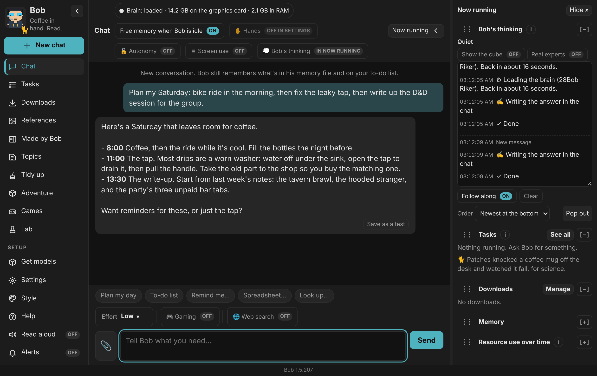

**Contents:** [Getting started](#1-getting-started) · [Finding your way around](#2-finding-your-way-around) · [Equip Bob](#3-equip-bob-choosing-his-models) · [Personality](#4-bobs-personality) · [Sessions](#5-sessions-matching-bob-to-what-youre-doing) · [Memory](#6-topics-and-housekeeping-bobs-memory) · [Pictures and video](#7-pictures-edits-and-video) · [Hands](#8-hands-letting-bob-do-things-on-your-pc-opt-in) · [Voice](#9-voice) · [Optional extras](#10-optional-extras-all-off-until-you-turn-them-on) · [The Lab](#11-the-computer-science-lab) · [Updating and removing](#12-updating-and-removing-bob) · [Troubleshooting](#13-when-something-goes-wrong) · [Glossary](#glossary)

---

## 1. Getting started

1. Download Bob's zip from the Releases page. Right-click it, choose Properties, tick **Unblock**, then unzip it somewhere you'll keep and double-click **Bob.exe**.
2. Bob opens in his own window. The first time, he looks at your graphics card and RAM and shows one list, **Get me ready**: the programs he runs on and a model for each job (chat, coding, pictures, picture edits, clips, his voice, memory), with his picks ticked. Every line has its own tick box and size. Music is listed too, unticked, since it's about 22 GB with its tools.
3. Untick anything you don't want, then press **Get Bob ready**. The button shows the total and your free disk first. Every download shows a progress bar, its size, its speed and how long is left, and Bob puts each model in its slot himself when it's in. There's nothing to install by hand: if your PC has no Python for his voice or music, he gets his own copy (about 15 MB, kept in his folder).
   Under that list comes **Do you want me to:**, every switch that starts off (quick notes, reading your documents, the sandbox for sums, web search, the plan card, fixing his own messages, how-tos, picking up after a restart, starting at sign-in, checking for updates, the newest brain list). Each tick saves at once and is the same switch as in Settings. The list is grouped like the cards in Settings, and also offers one brain for everything and reading only the memories that fit. Check-ins, Bob-Net, Discord or Telegram, Hands, Adventure, Games and Housekeeping have buttons that open their place in Settings. **Coming soon** lines name things still being built; they can't be ticked yet. Bobs set up before this list get a one-time offer in the chat; after that it's in Settings, **Run first-time setup**.
4. Skipped something? Ask for it anyway, say a clip, and Bob shows a **Set it up** card in the chat with what he needs and its size. One press gets it, and he carries on with your request by himself. If a setting is what's in the way (Let Bob search the web, a Hand that's off), the card switches just that setting on.
5. If you want Bob to look things up online, click **🌐 Web search** next to Effort, under the chat (the same switch, **Let Bob search the web**, is in Settings). It's off until you do.
6. When the downloads finish, say hello. You can ask Bob himself how to set anything up: he knows all his settings and what's set right now.

You can close Bob while things download. Unfinished downloads wait, paused, and carry on when you press Resume.

| | |
|---|---|
| 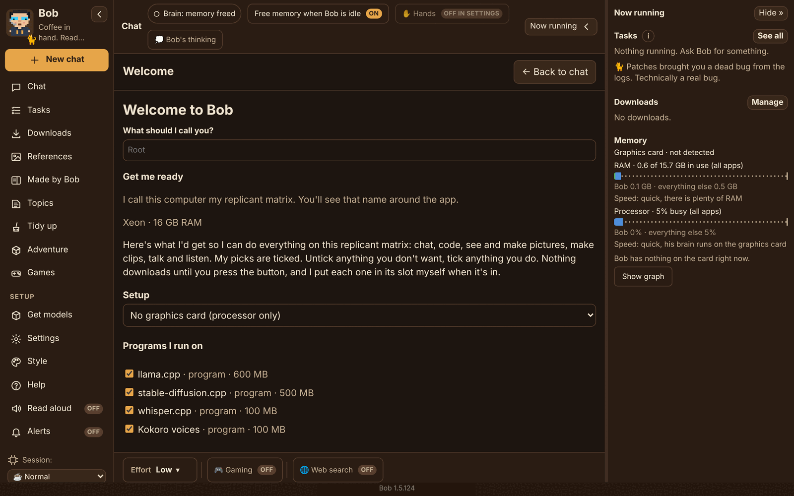 | 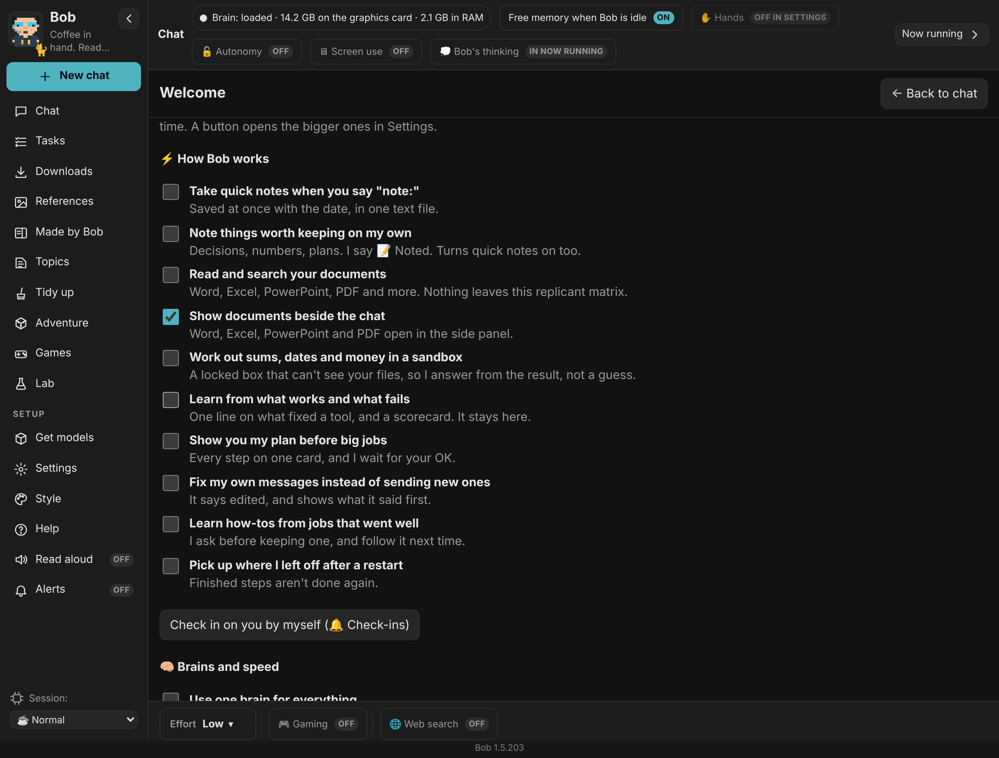 |
| **Get me ready:** one list, one button. | **Do you want me to:** tick what you'd like switched on. |

### What do I need?

- Windows 10 or 11 (64-bit). Bob also runs on a Mac with Apple Silicon (below), on 64-bit Linux and a Raspberry Pi, and as a phone app on Android: the [README](../../README.md#getting-bob) has the steps for each.
- **32 GB of memory (RAM)** is what the starter sets are planned around. Less can work for chat, but pictures and video need the room.
- Space on your drive: it depends on your graphics card. Get me ready shows the total before anything downloads; on a 16 GB card the full set is about 105 GB, mostly pictures and clips, and smaller cards get smaller sets.
- A graphics card is **optional**. Bob can chat, plan, research, read pictures and talk with no graphics card at all. An NVIDIA card makes him much faster and lets him paint and film.

### Bob on a Mac

Bob runs on Macs with Apple Silicon (M1 and newer), using the Mac's graphics (Metal).

1. Download `Bob-<version>-mac-arm64.zip` from the releases page, open it, and drag **Bob** into Applications.
2. The first time, macOS says it can't check Bob (official Mac builds are ad-hoc signed: sealed so macOS can tell if a file was changed, but not with a paid Apple Developer ID). Open **System Settings > Privacy & Security**, scroll down and click **Open Anyway** next to Bob. Once only. A copy signed with a Developer ID and notarized by Apple skips this; the switch for that is built in and off ([SIGNING-MAC.md](SIGNING-MAC.md)).
3. Bob keeps his things in `~/Library/Application Support/Bob/home`.

On a Mac, brains run on plain llama.cpp (Brain Engine has no Mac build yet), and it and stable-diffusion.cpp download as usual. whisper.cpp and Piper have no Mac builds Bob can use (hear through Ollama or a cloud helper; speak with Kokoro voices). Install FFmpeg (Homebrew) and LibreOffice yourself and Bob finds them. The Apps Hand, Defender scans, the Gaming card switch, Windows Task Scheduler and Check this replicant matrix are hidden; the Security Hand checks the firewall, FileVault, Gatekeeper, System Integrity Protection, login items and listening programs instead. **Update Bob** works as on Windows: it fetches the newest Mac zip from GitHub, checks it, and swaps it in on restart. To remove him, drag him to the Bin (and the folder above, if you want everything gone).

## 2. Finding your way around

Bob's window has three parts:

- **The menu on the left.** New chat, Chat, Tasks, Downloads, References, Made by Bob, Topics, Tidy up, then Get models, Settings, Style and **Help** (or press F1), the Listen, Read aloud and Alerts switches, and the Session picker at the bottom. Fold it down to icons with the ‹ button (or Ctrl+B).
- **The chat in the middle.** Type and press Enter. Shift+Enter starts a new line.
- **Now running on the right.** What Bob is doing, what's downloading, and how full your graphics card and RAM are. Hide it with Ctrl+J.

At the top of the chat, the brain label shows how much memory **Bob's brain** takes. The Memory meters in Now running show the **whole** graphics card and RAM (Windows, games, other apps and Bob's picture model too), so the meters are bigger. The line under the meters shows Bob's share, and his brain there matches the label.

Handy things in the chat:

- Every message and every piece of code has a **Copy** button. This helps a lot over remote desktop apps, where right-click and Ctrl+C often don't work.
- Links and files Bob mentions are **clickable**. Everything he makes or saves, and every file he mentions, gets a card with a preview (the picture, a player, or the first lines of a document).
- Click a card, or **View**, to open it in the **side panel** beside the chat, in its own tab. **Made by Bob** in the left menu lists everything he has made, newest first, with Pictures / Clips / Sounds / Documents filters and a search box. You can also ask him: "show me the last picture". In the panel, **Open in its app**, **Show in folder** and **Copy path** do what they say. Web pages he writes are previewed with scripts off. Esc closes the panel. On a narrower screen the panel takes Now running's place; click Now running to switch back.
- 📎 attaches a picture, and 🎙 lets you talk instead of typing.
- You can send as many messages as you like. Each one becomes a task, and Bob works through them in order. None get lost.

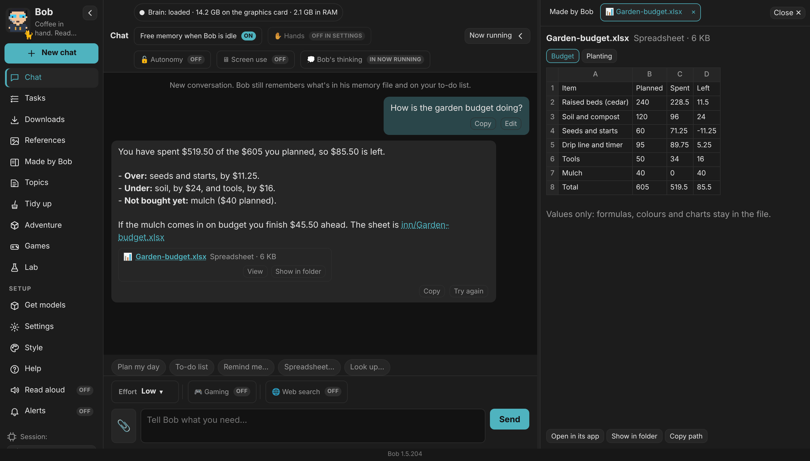

*A file Bob mentions gets a card. **View** opens it in the side panel; with **Show documents in the side panel** on, that includes Word, Excel, PowerPoint and PDF files.*

### Settings, Get models and Style

These open as a page in the middle of the window, in place of the chat. **← Back to chat** (or Esc, or Chat in the menu) takes you back. A bar along the top of the page, which stays put while you scroll, jumps between Equip Bob, the model pages, Style and Settings, so clicking Bob's picture gets you everywhere too.

- **Get models:** Equip Bob, the model shops (Voice & conversation, Coding, Seeing pictures, Pictures & video) and **On this PC**.
- **Settings** starts as one short page showing what's set now: Bob's voice (with **Play sample** and **Change**), his look, the colours, animations, the cat's name, one brain, launch on start-up, Projects, **Where Bob saves things**, **Let Bob search the web**, **Show Bob's plan before big jobs** and checking for updates (off unless you turn them on), and the version, graphics card and disk space, with **Check for updates**, **Run first-time setup**, **Save a help bundle** and **Check this replicant matrix**.
- **Simple or Advanced:** a toggle at the top swaps two layouts of the same settings. **Simple** shows eight cards; press one to open its sections. **Advanced** lists every section down the side. A search box finds a setting in both. On a computer, Settings opens in its own window (minimise, maximise, close); on a phone it's a page. The sections: Brains (model roles, session brains, context), House style, Voice details, Look & feel, Speed & memory, Engines, Bob-Net (your phone and your other Bobs), Online services (cloud helpers, Telegram), Other apps (ComfyUI, other apps using Bob's brains), Hands, Housekeeping, Check-ins and Remove Bob. Longer explanations fold behind **More**.

| | |
|---|---|
| 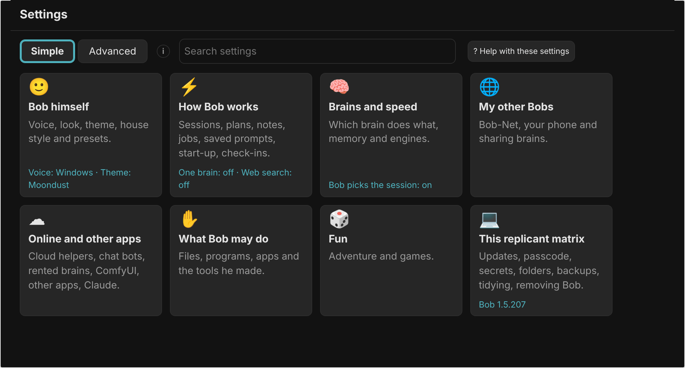 | 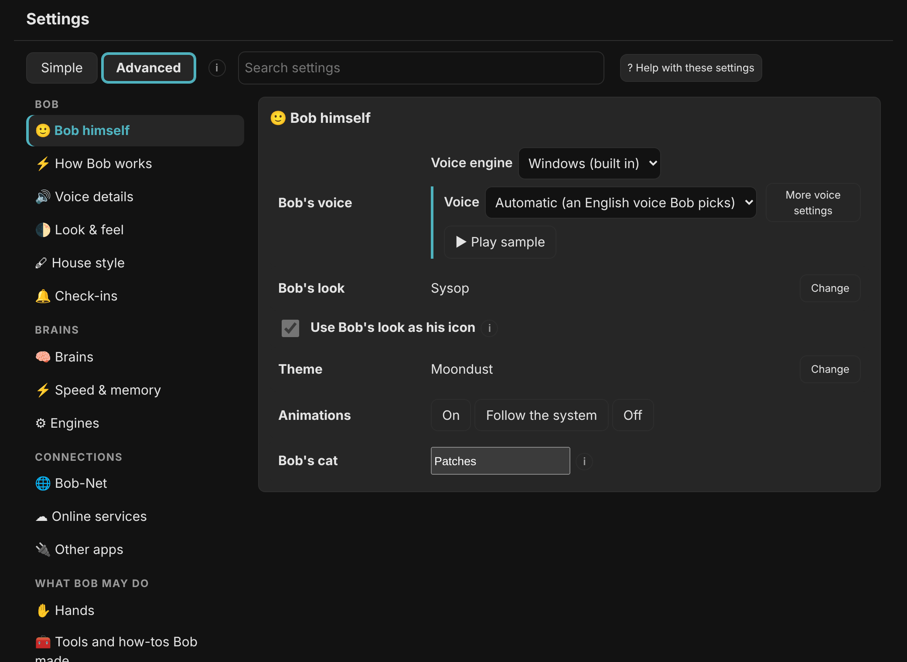 |
| **Simple** | **Advanced** |

---

### Making Bob faster on your PC

- **Check this replicant matrix** (Settings, bottom of the Everyday page) looks for things that slow Bob down and shows how to fix each one: memory below its rated speed (turn on EXPO or XMP in the BIOS), an old NVIDIA driver, a laptop on battery, models on a slow drive, other apps holding graphics memory. Bob only looks; he never changes Windows or driver settings.
- **Test Bob's speed** (Advanced, Speed & memory) times the first word and the full answer, and keeps your last results so you can compare before and after a change.
- **Engine extras** (Speed & memory, all off until you turn them on): **Guess ahead by copying from the chat** (edits come out faster; the brain checks every copied word, so the answer is the same), **Load the next brain early** (the next brain's file is read into memory during a hand-off, when there's room), **Laptop mode** (on battery, the Quick brain answers and the engine uses half the cores), **Test a new graphics card by itself** (a speed test and placements back to Auto when Bob sees a different card), **Keep a speed history** (a chart of words per second per brain and engine version). Under Engines, **Tell me what engine updates change** adds plain lines to update messages. On the Brains page, each brain's **Set up** has a **Chat memory type**: Standard, Sharper or Smaller. These work with Brain Engine and llama.cpp on Windows, Mac and Linux; the Android app's own engine isn't changed.
- Three switches, off until you turn them on: **Get Bob ready while you type**, **Let games go first** and **Match picture settings to my graphics card**.

## 3. Equip Bob: choosing his models

Bob uses different AI **models** for different jobs, the way a person might use a different tool for each task. **Equip Bob** shows them like a character sheet in a game: a picture of Bob with a slot for each job.

**To open it**, click Bob's picture (or click **Get models** in the left menu: it opens on Equip Bob).

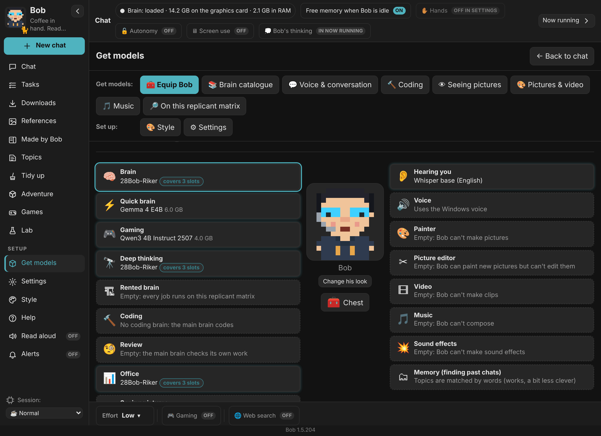

### The slots

| Slot | What it does |
|---|---|
| 🧠 Brain | Thinks, chats and plans. Everything else hangs off this one. |
| ⚡ Quick brain | A small, fast brain for Low effort and the Art session. |
| 🎮 Gaming | Chats on the processor while you play, so your game keeps the graphics card. Only Qwen3 4B Instruct 2507 goes here (it was timed on a busy processor); Gemma 4 E4B never does. |
| 🔭 Deep thinking | The strongest thinker, for Medium, High and Extreme effort. Optional. |
| 🔨 Coding | Writes and fixes code. If it's empty, the Brain codes. |
| 🧐 Review | Checks code and plans before you rely on them. Optional. |
| 📊 Office | The one all-rounder that does everything in the Office session. |
| 👁 Seeing pictures | Looks at pictures and screenshots you attach. |
| 🗂 Memory (finding past chats) | Helps Topics and search find things by meaning, not just exact words. |
| 👂 Hearing you | Turns your voice into text. |
| 🔊 Voice | Reads his replies aloud. |
| 🎨 Painter | Paints new pictures. |
| ✂ Picture editor | Changes a picture you give him, or keeps a character looking the same across pictures. |
| 🎞 Video | Makes short clips. |
| 🎵 Music and 💥 Sound effects | Optional extras. |

### How to equip something

- **Click a slot**, then click a model in the list to put it there. You can also **drag** a model onto a slot.
- Each slot lists only **active** models, one line each. Point at the little **i** (or tap it) for the size, licence and Bob's reasons.
- **📚 Get more**, at the end of each list, opens the Brain catalogue at that job.
- Models already on your PC are ready to go. Active models you don't have yet show a **Get** button. Nothing downloads until you confirm.
- **One model can fill several slots.** For example, Gemma 4 E4B can be the Brain, the Quick brain, Seeing pictures and Hearing you all at once. Bob offers this with "Also use it for…". That's the trick that makes small PCs work well.
- To empty a slot, use the **✕** on it. The Brain can't be emptied, because Bob needs something to think with.
- The bar along the bottom shows whether everything fits on your graphics card at the same time. If it doesn't, that's fine: Bob takes turns, putting one model away while another works.
- Prefer a plain list? There's a button for that at the top.

Each slot only lists active models that can do its job: a brain that can't see pictures never shows under Seeing pictures, and a big brain never shows under Quick brain. What's equipped always shows.

### The Brain catalogue

**📚 Brain catalogue** (on the Get models bar, or **📚 Get more** under any slot) is Bob's full list of models, sorted by job: Quick brain, Gaming, Brain, Deep thinking, Review, Coding, Office, Seeing pictures, Phone, then hearing, voices, pictures, video, music and memory.

- Each model is one line: name, download size and a tag or two. The **i** holds the rest: what it's good at, how much graphics memory it wants, how it does on a 16 GB card, an 8 GB card, a 6 GB laptop card, no graphics card and an 8 GB phone, its licence and its source. The **↗** opens that source: the exact Hugging Face commit Bob downloads from, or the model's Ollama page.
- **Families:** inside each job, models sit under one header per family (Qwen, Gemma, GPT-OSS...). Every family starts closed. Press a family's name to open its list, press it again to fold it away. The header shows how many models, the size range, **★ Recommended inside** when Bob's pick is inside, and how many are already on your PC. **Open all families** and **Close all** are at the top. Bob remembers which ones you left open. The brain menus in Settings, Brains are split by family too.
- **Active** (on for models on your PC, off for the rest): active models show in the Equip Bob slots and the brain menus; the rest stay in the catalogue. Switching one off only hides it. It stays on your PC, and if it's equipped it stays equipped.
- **😇 Well behaved / 🤝 Community / Naughty list** (toggle at the top; the Naughty list side is marked with a small red devil Bob draws himself): Well behaved is every model above and what you see to start with. Community shows only builds other people made from stock brains that still behave (fine-tunes, distillations, repacks); they're in the Well behaved list too with a **Community · name** tag (the maker's name, or the team's name with its members on hover or tap), and one can be ★ Recommended like any other once it has been tried on a real replicant matrix and does its job well. The Naughty list side stays greyed until you turn on **Show the naughty list** (there, or in Settings > How Bob works > Brains). It holds remixes other people made from Qwen and Gemma brains with the refusals cut out ("heretic" or "abliterated" builds). They are not Alibaba's or Google's releases, they answer without refusing, and they can be a little rougher than the originals, so Bob never marks one ★ Recommended; on that side only, a red devil on its own where the star would be is his **quiet pick**, the one that does the job well on your PC. Each entry's **i** says who remixed it and from what. Off: they are listed nowhere; one already equipped stays until you change it.
- **➕ Your own brains** (end of the Well behaved list): add a brain file (.gguf) already on your replicant matrix that Bob's list doesn't have. Press **Add a brain from a file**, pick the file, name it, add its picture reader (mmproj) if it has one. It joins the list under a **Your own** family with an Active switch and a **Your own file** tag, and appears in Equip Bob and the brain menus. Bob runs it from where it is on his own engine, never moves or deletes it, and never recommends it over the brains he knows; the slots it's offered for come from its size and whether it sees pictures. **Remove from Bob's list** only makes him forget it. Web links aren't taken yet: save the file first.
- **Get** downloads it after asking first. **Equip** puts a model that's already here into that job's slot.
- **New** marks a brain that came out lately: one of the five newest releases in its family, and less than a year old. Every brain's **i** says the day its maker put it out.
- **Dated** marks a brain newer ones do better. It stays on the list; the tag says which newer brains to look at.
- A brain not tried on a real PC yet is listed, but Bob doesn't recommend it until it has been; its **i** says so.
- A brain too big for your PC and for every Bob on your Bob-Net leaves the job lists; a line at the end of the job says how many, and they're under **Rented brains**. If another of your Bobs could run it, it stays, and its **i** says which Bob.
- **Phone** lists the brains the Bob phone app can run; the phone app gets its own copy.

### Recommended, Fits your card, Doesn't suit this PC

- **★ Recommended:** Bob's pick for that slot (the reason is behind the **i**). For brains, a model scores higher the more jobs it covers (fewer brain swaps) and the less graphics memory it takes, and much lower if it would spill into RAM. Bigger brains get a bonus for jobs that need careful thinking. On small cards (8 GB or less), a brain that fills most of the card scores lower, because it leaves no room for longer chats. For pictures, video and voices, the pick comes from the starter set for your card.
- **Fits your card:** runs well here too, just not the first pick.
- **Doesn't suit this PC:** needs more graphics memory or RAM than you have. These are hidden until you turn on **Show models that don't suit this PC** (off unless you turn it on), and each says why.

The same picks show on every Get models page, under **Bob's picks for this PC**. There's more in Help (left menu, or F1).

### Starter sets

A starter set is a ready-made selection for your kind of PC. Bob picks the right one by reading your graphics card. You can untick anything you don't want before you confirm.

Everything in the starter sets is free to use, **including for commercial work** (selling what you make).

**The base, for every PC (no graphics card needed):**

| Job | Model | Download |
|---|---|---|
| Brain, Quick brain, Seeing pictures, Hearing you | Gemma 4 E4B | about 6.6 GB |
| Voice | Kokoro (22 natural English voices) | about 0.4 GB |
| Memory (finding past chats) | Nomic Embed Text | about 0.3 GB |

With just these, Bob can chat, plan, research the web, read pictures, hear you and talk back.

**Add-ons by graphics card:**

| Job | 16 GB card or more | 8 GB card | 6 GB card (most laptops) |
|---|---|---|---|
| Brain | Qwen3.6 35B-A3B (answers Low-effort chat straight off; Gemma 4 26B does Office and Deep thinking) | Gemma 4 E4B | Qwen3 4B (light, leaves room for longer chats; Gemma 4 E4B still sees pictures and hears you) |
| Coding | Qwen3.6 35B-A3B (a big context (256K, how much it keeps in mind); always thinks coding jobs through) | Qwen3 Coder 30B (slower, runs mostly in RAM) | Qwen2.5 Coder 7B |
| Painter | Z-Image Turbo | Z-Image Turbo, 8 GB version | Z-Image Turbo, 6 GB version |
| Picture editor | Qwen Image Edit | FLUX.2 klein 4B | FLUX.2 klein 4B, 6 GB version |
| Video | Wan 2.2 5B | Wan 2.2 5B, small card version | the same, left unticked (very slow) |

The "8 GB" and "6 GB" versions are the same models **squeezed** to fit smaller cards. Pictures lose a little fine detail but look much the same.

Brains stay at Q4 or better, except on cards of 8 GB or less. There, when a brain's full file wouldn't run well, the Brain catalogue offers an **8 GB card version** packed at Q3 (for example Qwen3.6 35B-A3B). It's smaller and a little less sharp. Bigger cards always get the full version.

**How long things take** on a small card is a rough guess for now (these haven't been timed on every card yet). On an 8 GB card, expect roughly half a minute to a minute per picture, a minute or two per edit, and ten minutes or more for a few seconds of video. A 6 GB card is slower again. While Bob paints, he puts his chat brain away to make room, so chat waits until the picture is done.

---

### The chest

Under Bob on the paper doll sits his **🧰 Chest**, with a number for how many things are in it. Press it and the Inventory on the right becomes the **Chest**: everything Bob has made or saved, newest first, each as a little picture (a thumbnail Bob makes once and keeps) with its name and when he made it. Songs, documents and other files show as an icon with their title. Click one (or Tab to it and press Enter) to open it beside the chat, the same as from Made by Bob.

At the top of the chest, **New things are saved in** shows the folder new pictures, clips, songs and sounds go to. **Change folder…** opens your system's folder window and saves the pick straight away; it is the same setting as Settings, **Where Bob saves things**. **Use Bob's own folder** goes back and **Show in folder** opens the folder. Older things stay where they are. **Open Made by Bob** shows everything with filters and a search box. On the phone, menu, **Chest** shows the same list from your PC's Bob, with **Save to this phone**.

## 4. Bob's personality

Bob has a dry, curious, slightly nerdy personality. You can turn that up or down.

Click Bob's picture and look at **Attributes** on the left. There are eleven dials, each from 0 to 4. The middle (2) is Bob as he comes.

| Dial | Low end | High end |
|---|---|---|
| Dry wit | Plain | Bone dry |
| Puns | None | Relentless |
| Tangents | On rails | Scenic route |
| Outlook | Gloomy robot | Sunny |
| Nerd references | Hidden | Full nerd |
| Talkative | Terse | Chatty |
| Manner | Formal | Casual |
| Copied-mind musings | Never | Often |
| Builder itch | Calm | Must build |
| Curiosity | Just the job | Endlessly curious |
| Ambition | Keeps quiet | Ambitious |

As you move a dial, Bob's **greeting** changes so you can hear the difference right away. There are presets too, such as *Replicant on a deadline* (short and to the point), *Butler mode* (formal and polite) and *Pun-dit* (you've been warned). **Reset to Bob** puts everything back.

Bob also knows what he looks like. Change his look under **Style** and he'll comment on it, once.

### Assistant presets: a different Bob per chat

Switch on **Assistant presets for chats** (Settings, Bob himself, 🎭 Assistant presets; off unless you turn it on) to save presets: a name, your own instructions, a brain from Bob's slots, a starting effort, a temperature and which tools he may use (as usual, only the groups you tick, or talking only). Pick one for the chat you're in from **🎭 Preset** next to Effort, or with the 🎭 button in Bob for Android. A chat with no preset is plain Bob, and a preset never switches on a tool or Hand that is off.

---

## 5. Sessions: matching Bob to what you're doing

At the bottom of the menu is the **session** picker. A session tells Bob how to share your PC with you.

- **Normal:** everyday use.
- **Art:** Bob keeps chatting on his Quick brain so the big graphics work (painting, video) gets the card.
- **Coding:** the Coding brain leads.
- **Office:** documents, spreadsheets and planning.
- **Gaming:** keeps the graphics card for your games. How much of it Bob may borrow is set in **Gaming session: graphics card** (Settings, Speed & memory): Automatic (the starting position), Never use the card, or Always borrow a little. Bob chats and listens on the processor with a small brain (Qwen3 4B Instruct 2507 to start with), which usually starts answering within a few seconds. Now and then he adds a short, sleepy scripted aside. Pictures and big jobs wait until you switch back, and Effort stays on Low. Tip: turn on **Let games go first** (Settings, Speed & memory) so Bob uses fewer cores while you play.

Session: what the graphics card is kept for. Effort: how hard Bob works on each message.

With **Let Bob pick the session** on (Settings > Everyday, on to start with), Bob moves into the session that suits the job (Art, Coding, Office or Gaming) and goes back to Normal, the lightest, once he has been quiet for 2 minutes. While something else is using the graphics card, like a game, he stays in Gaming. You can still pick a session yourself from the menu: Bob keeps it while you work, then goes back to Normal once he has been quiet for 2 minutes. To keep him in Gaming, press 🎮 Gaming next to Effort.

### Effort

Above the chat box, **Effort** sets how hard Bob works on your next messages. It goes back to Low each time Bob starts.

- **Low (Quick):** a fast answer from the Quick brain.
- **Medium (Deeper):** one big brain thinks it through. No second check.
- **High (Checked):** a big brain drafts, then Bob's reviewer copy checks it. Code problems go back for one fix.
- **Extreme (Slowest):** like High, and coding goes research, plan, then changes, with a check after each step.

High and Extreme end with **moot minutes**: who checked what, and what's still open.

### Watching Bob think

**💭 Bob's thinking**, at the top of the chat, opens a small window that stays on top of your other windows. It shows, live: what Bob is doing, which brains he holds and where (graphics card or processor), his thinking as it streams (his copies too, so you can watch a moot), brain loads and swaps, each tool step and the notes he keeps for himself. Low effort replies skip thinking, so there you mostly see steps. Bob only sends his thinking along while the window is open, and nothing in it is saved.

### How Bob keeps his tool calls on track (on unless you turn it off)

Small brains often pick the right tool and then get what goes into it wrong. Bob's app checks every step, with no extra brain and no wait:

- Before a tool runs, what Bob put into it is checked against what the tool needs. Sure mistakes are mended (broken brackets, a field under another name, "5" for 5). A call still missing something doesn't run; Bob gets one line saying what to send, and an example the second time.
- After an error, Bob gets one plain hint on what usually works.
- "I'll look that up" with no tool run gets one nudge to really do it, and a retry thinks it through on a long coding brain.
- The same search in other words isn't run twice. Several look-ups in one reply run side by side.
- On a job with several steps, a short note reminds Bob of your words, what came back and how many steps are left. The last step has no tools, so he always says what he found.
- Once a chat fills half his memory, tool results from earlier messages become one line each.
- While the embedding model is in use anyway (Topics or Remember only what fits), the tools a message means are added, not only the ones its words name.

### Jobs: how Bob works through a job (off unless you turn them on)

Settings, Jobs (under How Bob works) has eleven switches. Each works by itself and starts off.

- **Steer Bob mid-job:** type in the chat while he works and he reads it before his next step.
- **Show Stop after this step:** a softer Stop. The running step finishes and keeps its result, then he answers.
- **Give each job a time limit** (5 to 60 minutes, 10 to start): a bar shows the time left, and a card asks whether to give him more.
- **Show a receipt after each job:** files changed, commands run and pages read, with Open and Undo (Undo lasts a week).
- **Run the tests after code edits:** npm test, cargo test, go test or pytest, before he says done. The command still asks you first.
- **Ask one question before a vague big job:** a pick-one card when a big ask could mean two things.
- **Remember a no for the whole chat:** a denied step, and your reason from the Why not? box, last the rest of the chat.
- **Reuse look-ups for an hour:** the same search or page comes from memory, not the web.
- **Show sources under web answers:** numbered links to the pages he read.
- **Say how sure Bob is:** one line when pages disagree or results are thin.
- **Make file:line links clickable:** opens VS Code, Cursor or VSCodium at that line (or shows the file in its folder).

On Android you can steer a job, read the receipt and answer the time card. The other parts are on the computer only.

---

## 6. Topics and housekeeping: Bob's memory

### Topics

**Topics** collects what you and Bob have talked about, grouped by project. Each topic has:

- a short note on where things landed (you can edit it),
- open questions,
- pictures from that topic,
- links back to the chat moments it came from.

You can rename, merge, pin and drag messages between topics. One **search box** looks through chats, summaries, topics, pictures and notes all at once. **Past chats** reopens an old conversation.

To make Bob forget something, either use **Forget** on a topic or simply say "forget what we said about…". You always see a preview first, and you can choose to keep just the short note or remove everything.

### Housekeeping (on unless you turn it off)

Long chats and old files pile up. Housekeeping is Bob tidying up while he's idle. It's **on by default**, and by default it only touches **Bob's own files**. Bob can:

- sum up the older part of a long chat instead of forgetting it,
- file chats under Topics,
- move lasting facts into his memory,
- find things that haven't come up for a while: old chats, pictures and sounds he made, finished tasks, old log lines and repeated notes.

For each kind of thing you choose how old is "old" (from minutes to months), and whether Bob should **ask me first** (you get a list with a tick and a cross for each item) or **tidy automatically**.

**Folders you point him to:** to have Bob help with one of your own folders (Downloads, say), type its full path under **Folders you point him to** and press **Add folder**. Old files from it (6 months by default) show up in Tidy up. Bob always asks first for these, never tidies them by himself, and anything cleared goes to the Recycle Bin. System folders, your whole home folder and Bob's own folder can't be added.

Safety nets:

- Anything removed goes to the **Recycle Bin**, so you can get it back.
- **Pinned** chats, pictures and topics are never touched.
- Every action is written in Bob's **logbook**.

There's also a **Tidy up** button if you'd rather do it now, by hand.

### Check-ins (off unless you turn it on)

Settings, **🔔 Check-ins**. On a schedule you pick (**Every day** or **Every weekday** at a time, or **Every few hours**), Bob does a quick round and only speaks up when something needs you. If everything is fine, he says nothing; **Last check-in** in Settings and his logbook show each round.

What he looks at (each can be unticked under **What Bob checks**):

- Downloads that failed or stopped moving (no progress for 15 minutes).
- Tasks that failed or wait for your OK.
- Scheduled jobs that didn't finish.
- Disk space running low (under 10 GB free where his models live).
- **Your own checks**: up to 8 lines such as "Did the build finish?". His quick brain answers them from his tasks, downloads, schedules and logbook only, on the processor, only while he's idle and never in the Gaming session. A brain loaded just for this is let go straight after.

When something needs you, a Check-in card appears in the chat (and a notification if **Alerts** is on). The same thing isn't repeated until a day has passed. A check-in never changes, retries or downloads anything, and nothing goes online. Check-ins happen while Bob is open (Windows, Mac and Linux alike); a missed one is done once when he's back. **Check in now** does a round on the spot.

---

## 7. Pictures, edits and video

Just ask in the chat: "paint a lighthouse at dusk", "make this picture look like winter", or "make a short clip of the cat stretching".

- **References:** keep pictures of characters, places and styles on the **References** shelf. Ask Bob to use one and he'll keep that look in new pictures.
- **Edits:** attach a picture with 📎 and say what to change. The **Picture editor** slot needs a model for this.
- **Video:** clips are short (a few seconds). On small cards, keep them short; Bob tells you roughly how long a job will take before he starts.

If a slot is empty, Bob tells you which model would fill it.

### Songs and sounds

Ask for a song ("a chiptune boss theme, about a minute") or a sound effect ("a creaky wooden door"). It lands in the chat as a **song player**: a round ▶ button, its title, bars showing the song's shape (click or drag along them to jump around; arrow keys jump 5 seconds), the time, **Lyrics** if it has words, **Open in Made by Bob** for a bigger player in the side panel, and **Show in folder**. Several songs in one reply play one after another, and only one plays at a time. Each song is kept as a .wav file named with the date and its title.

### Bob's home folder

Bob's **home** is one folder with his models, the engines he runs on, his notes, chats and settings, apart from the program itself. You pick it when Bob is installed (the Windows install window asks first) or the first time Bob.exe, Bob.app or the AppImage opens: Bob suggests a `Bob` folder in your own user folder, and any drive works. He refuses temporary places like AppData, because a disk clean-up would take 10 to 60 GB of models with it. A cloud-synced folder (OneDrive, Dropbox, Google Drive, iCloud) is allowed, but Bob always recommends against it and says so wherever the folder is shown: every model would be uploaded, and a sync can break a model while he uses it. Pick a plain folder on the PC.

Settings, **Bob's home folder** shows the folder and the size of the models (red if it is somewhere a clean-up tool empties, or a cloud-synced folder). To move it: **Browse…** or type a new folder, **Move here…**, then **Yes, move everything**. Bob closes, copies everything across (one quick rename on the same drive), and opens again from the new folder; the old one is removed only once every file is over. The same row sits at the top of the first-run screen under **My home folder**. Older Bobs that kept things in `%LOCALAPPDATA%\Bob` carry on from there until you move them.

### Where Bob saves things

Settings, **Where Bob saves things** picks the folder for the pictures, clips, songs and sounds Bob makes. It starts as Bob's own folder (the one Made by Bob lists). **Browse…** picks another (or type one and press **Save here**), **Show in folder** opens it, and **Use Bob's own folder** goes back. The chest under Bob on Equip Bob has the same folder with a **Change folder…** button. Only new things go to a new folder; older ones stay put and still show in your chats. Tidy up only tidies Bob's own folder. If a picked folder goes missing (an unplugged drive), Bob saves in his own until it's back.

---

### Back up and move

Settings, **This replicant matrix**, **Back up and move** saves one zip with your chats, settings, memory, notes, the tools Bob made and the list of things he made (not the pictures themselves, and never brains or programs: those download again). **Keys and passcodes, locked** is off unless you tick it; then your API keys, bot tokens and phone passcode go in too, locked with a passcode you type. On a new computer, install Bob, **Pick a backup…**, **Restore these** and **Restart Bob now**: the files go in as he starts, and what they replace is kept in the inn's archive folder. Phone access, Discord, Telegram, rented brains, cloud helpers, Hands, scheduled jobs and the automatic backup come back switched off. **Back up by itself** (off unless you turn it on) saves a backup to a folder every day or week and keeps the newest few, never with keys. Bob for Android has its own phone backup in its Settings.

## 8. Hands: letting Bob do things on your PC (opt-in)

Hands are Bob's way of doing things for you on your PC rather than just talking about them:

- **Files:** zip and unzip, move, copy, rename, and tidy folders like Downloads.
- **Sort and rename:** rename and move a whole music, video or photo collection to your own naming rules, or send new files from Downloads or an output folder into your library.
- **Run:** run a program, command or script you've approved.
- **Schedules:** do a job at a set time.
- **Apps:** click and type in another program for you, and, with a vision brain in his "Seeing pictures" slot, check each step by looking at a picture of the window (and click by place in apps that don't name their buttons).
- **Use a browser:** Bob's own browser window ("Bob is browsing", separate from yours): open a page, read it, click, type, scroll, go back, one approved step at a time, with the same eyes check.
- **Office documents and converting:** convert files (Word, Excel, PowerPoint and OpenDocument to and from each other or to PDF; pictures; sound; video), read office files, make new documents, spreadsheets and slides, and change them (fill cells, add rows and slides, replace text, fill a template).
- **Security and privacy:** check the PC's protection, explain Defender alerts and start scans, look at suspicious downloads, scripts and emails without opening them, find and remove hidden details (like GPS in photos) before sharing, and check whether a website, link or sender is genuine from public records.
- **Connected apps (MCP):** work inside Unreal Engine, Blender and other apps that offer their tools through an MCP add-on.
- **Tool packs from other people:** use tools and jobs someone else made for Bob, from a folder or .zip you add.

### Sort and rename

Ask things like "sort my music folder" or "put my downloads where they belong".

- Settings → Hands: switch on **Sort and rename** and tick the folders Bob may work in.
- **Sort and rename: naming rules** (same page) has one rule per kind of file: the file types it takes, which ones (any, only TV episodes, or not TV episodes), the **New name**, and **Send to**. A "/" makes folders and words in curly brackets fill in from the file: `{artist}/{album}/{track} {title}` gives `Queen/A Night at the Opera/11 Bohemian Rhapsody.mp3`. Each rule shows an example. **Words you can use in a name** lists them all.
- Empty **Send to** sorts in place. A folder there moves that kind of file into it (it must be a ticked folder), so Downloads can feed your Music or Videos folder.
- Starting rules: Music (`{albumartist}/{album}/{track} {title}`), TV episodes (`{show}/Season {season}/{show} - S{season}E{episode}`) and Films (`{title} ({year})/{title} ({year})`) are on; Photos (`{year}/{year}-{month}/{date} {name}`) is off. **Back to the starting rules** restores them.
- Bob reads song tags (MP3, FLAC, Ogg, Opus, M4A), TV tags in MP4 files, S01E02 or 1x02 in names, a film's year, and the date a photo was taken; an untagged song is named from its file name and its Artist/Album folders. Subtitles and lyrics with the same name go along.
- The card lists every rename with a tick. Nothing is overwritten, files still downloading are skipped, and a card holds up to 1,000 files (ask again for the next lot). Emptied folders are removed; **Undo** puts everything back, folders too.
- Windows, Mac and Linux. On Bob for Android you approve the card; the files and the rules stay on the replicant matrix Bob runs on.

### Use a browser

Ask things like "open the Blender release notes and tell me what's new", "on that site, find the cheapest 2 TB drive", or "type fox in the search box and press Enter".

- Settings → Hands: switch on **Use a browser**. A window titled **Bob is browsing** opens when he first opens a page. It is part of Bob, with its own cookies and sign-ins; your own browser is never touched or read.
- Bob reads a page as text plus a numbered list of its links, buttons and fields, then does one thing at a time: click a number, type into a field, press Enter, Tab, Esc or an arrow, scroll, go back, or pick an option. Each action is a card ("Click link 'Downloads' on blender.org", **Do it** / **Allow the rest of this job** / **Deny**) unless "Let Bob work without asking" is on.
- While **Don't send anything out** is on he only types into search boxes and never presses Send, Post, Submit, Buy, Pay or Upload, never fills other fields and never picks files. Switch the limit off to let him, still one card each. Password fields stay off-limits while that limit is on. His own pages, downloads, pop-ups and anything that isn't http(s) are always refused.
- **Eyes checks:** with a vision brain in Equip Bob's "Seeing pictures" slot, Bob takes a picture of the page (or the app window, for the Apps Hand) after a step that says what should happen and asks his eyes whether it did. The result says yes, no or unsure; a no makes him read the page again instead of pressing on. **Bob checks his work with his eyes** (Settings, Hands) switches this off.
- **Forget what Bob's browser knows** (Settings, Hands) clears the window's cookies, sign-ins and cache. Works on Windows, Mac and Linux; Bob for Android shows the cards while the window is on your replicant matrix.

### Connected apps (MCP)

Apps with an MCP add-on (Unreal Engine and Blender have them) can offer Bob their own tools. Ask things like "in Blender, add a cube at the origin and make it red", "what's in the scene?" or "list the actors in my Unreal level".

- Install the app's MCP add-on and switch it on in the app first (for Blender: the Blender MCP add-on, Connect in its panel, plus uv: **Get uv for me** fetches it; for Unreal: your Unreal MCP plugin with the editor open).
- Settings → Hands: switch on **Connected apps (MCP)**, then under **Connected apps** open **More** and use **Add a connected app** (**Fill in for Blender** / **Fill in for Unreal Engine** fill in a common setup) or **Paste a setup from another app** (the "mcpServers" block from the add-on's instructions, Claude Desktop, Cline, Cursor or OpenCode). Press **Check**, then tick **On** for the app. New apps always come in switched off.
- Bob starts or reaches an app only when a job needs it and lets it go after 5 minutes unused, when you switch it off, or when you press ✋ Hands.
- Every step shows a card that says in plain words what Bob will do, with the exact tool and inputs under **Show details** (**Allow** / **Allow the rest of this job** / **Deny**), unless "Let Bob work without asking" is on. Tools that run code inside the app or can delete things show the code and always ask (no "rest of this job"). The hard limits apply to the inputs, including the blocked-commands list on any code a tool would run inside the app.
- While **Don't send anything out** is on, Bob only talks to apps on this computer (localhost / 127.0.0.1).
- Works the same on Windows, Mac and Linux. The phone app shows the same cards for jobs sent from the phone; the apps themselves run on the PC.

### Tool packs from other people

A tool pack is a folder (or a .zip of one) that someone else made: a `bob-pack.json` file plus a little plain JavaScript. It gives Bob new tools and jobs without changing his code. How to make one: [TOOL-PACKS.md](TOOL-PACKS.md).

- Settings → Hands → **Tool packs**: type the full path of the folder or .zip and press **Add pack**. Bob checks it first and says exactly why if it can't be added (programs inside, code that starts programs or reaches the internet without saying so, missing files).
- Every pack comes in switched off. Look at what each tool may do (**Show code**), then switch the pack on, and the **Tool packs from other people** Hand above it.
- Tools run in Bob's sandbox, only see the files on their card (each in a folder ticked for Hands, under the hard limits), and **always ask**, even with "Let Bob work without asking" on. A job is written steps Bob follows with his own Hands, each asking as usual.
- If a pack's files change after you add it, it switches off until you add it again. **Remove** sends it to the Recycle Bin.
- Windows, Mac and Linux, wherever the sandbox holds. From the phone app, packs run on the PC and the cards show on the phone; packs are added on the PC.

### Office documents and converting

Ask things like "turn report.docx into a PDF", "what's in budget.xlsx?", "make a 5-slide deck about the game", "set B4 to 1300 in budget.xlsx", "make this song an mp3" or "turn the clip into a GIF".

- Documents, spreadsheets and slides use **LibreOffice** (free). If LibreOffice or Apache OpenOffice is already installed, Bob finds it. If not: Settings → Engines → Engine downloads → **LibreOffice** (about 350 MB, pinned version and checksum, unpacked into Bob's folder with no admin rights).
- Sound, video and WebP pictures use **FFmpeg**: one already on the PC, or **FFmpeg** in the same Engine downloads list (about 100 MB, pinned).
- Other pictures (PNG, JPG, BMP, GIF, TIFF) need nothing extra: Windows does them.
- Every file Bob makes or changes is on a card first, one row each (a new document in his own Documents folder, which shows in Made by Bob under Documents, needs no OK). Nothing is overwritten (report-2.pdf), conversions never change the original, and a file changed in place is backed up first.
- He saves only in the folders ticked for Hands, plus his own Documents folder. LibreOffice runs hidden with Bob's own settings, never runs macros in the files, and closes when the job is done; so does FFmpeg.
- He can't turn a PDF back into a good Word file, because the layout breaks. He can read its words and make a new Word document from them instead.

### Locked secrets

On to start with (Settings, This replicant matrix, **🔐 Locked secrets**). Every passcode, bot token and key Bob saves is kept scrambled (AES-256-GCM): the phone-access passcode, your other Bobs' passcodes, door keys in config.json, the Discord bot token, the keys in Apps Bob can use, and any key saved in the panel. The key that unscrambles them is kept by the computer for your account: Windows DPAPI, the Mac Keychain, the Linux Secret Service (GNOME Keyring, KWallet), or a key file only your account can read in `~/.config/bob` when none of those answers. On Android, the Android Keystore. Plain secrets from an older Bob (including the old `BOB_DISCORD_TOKEN` user variable and the lines in `~/.config/bob/env`) are locked the first time he starts. If the box can't be opened (Bob's folder copied from another computer), saved secrets read as empty and are never written over; **Start a new locked box** starts again.

### Security and privacy

Bob isn't an antivirus: keep Microsoft Defender (or your own antivirus). This Hand makes him a sidekick for it. Ask things like "is my PC protected?", "what did Defender find?", "run a quick scan", "what starts with Windows?", "is this download safe?", "is this email real?" (paste it with its headers), "clean this photo before I post it", "is this website legit?", "where does this link go?" or "was Adobe ever breached?".

- Checks are read-only and change nothing. Defender scans and clean copies show a card first. Clean copies are new files (photo-clean.jpg); originals are never changed.
- Files are only read, never opened or run. Online look-ups (registration records via rdap.org, DNS, crt.sh certificate logs, Have I Been Pwned's public breach list) need **Let Bob search the web** on, and send only the site, link or address you asked about.
- **Check a password safely** (under the Hand's switch in Settings): the password is scrambled in the window and only the first 5 characters of the scramble go to Have I Been Pwned. The password never leaves the box and isn't saved.
- He never switches protection off, adds exclusions, allows or restores threats, or disables startup items (he shows you where), and he doesn't research private people.
- He also knows search operators (`"exact phrase"`, `site:`, `filetype:`, `-word`, date ranges) and uses them in all his web research.

Hands are built to be careful:

- **Every Hand is off** until you switch it on in Settings (Hands), and each one has an off switch you can flip at any time.
- **The ✋ Hands button on the chat page** (next to "Free memory when Bob is idle") is a kill switch. Click it and Hands stop at once: anything running stops, waiting cards are answered No, and the button shows *Stopped*. Click it again to let Bob carry on. It never switches a Hand on: if Hands are off in Settings it says *Off in Settings* and has nothing to stop.
- **Bob shows you exactly what he's about to do** (a preview card) and waits for your click.
- "**Allow for the rest of this job**" is something you have to choose, and it ends when the job ends.
- File changes keep an **undo** list, and anything removed goes to the Recycle Bin.
- **Hard limits**, all on to start with, each with its own switch: Recycle Bin only, keep secret files private, read-only projects stay read-only, block dangerous commands, don't send anything out, never type into password fields.
- **Let Bob work without asking** (off unless you turn it on) skips the cards. The hard limits still hold, a banner shows above the chat the whole time, and ✋ Hands stops him at once. Cloud helpers still ask.
- Some things are **never allowed**, whatever you pick: nothing that needs administrator rights, and Bob can't change his own code or settings.
- Folders you mark **read-only** stay untouched.
- Everything is written in the logbook.

Even without Hands, Bob **asks before doing anything outside his own folder**.

**Quarantine** (off unless you turn on "Let the reviewer quarantine Bob"): if Bob goes off track, his reviewer stops him and asks you whether to quarantine him. In quarantine he can talk but not act until you click **Release**.

**Self-test:** Settings → Hands → Checks → **Run the self-test** checks, in a throwaway folder of dummy files, that the Recycle Bin and Undo, tidying, running a program and Stop all work on your PC. It shows a pass or fail list in plain words and removes the folder afterwards. No Hand needs to be on, and nothing of yours is touched.

---

## 9. Voice

- **Read aloud:** Bob can speak his replies. Kokoro is the recommended voice (22 voices, runs on the processor), and inside it Onyx (deep and calm) is the recommended voice: Bob uses it until you pick another, and it is marked ★ Recommended in the list. Every voice has a **Play** button with a short sample (the same line in each voice) that works before you download anything.
- **Talk to Bob:** with the Hearing you slot filled, use 🎙 or say "Hey Bob" hands-free (if you turn that on).

---

## 10. Optional extras (all off until you turn them on)

- **Show Bob's plan before big jobs**: before a job with several steps, or any step that changes files or runs programs (also a video clip, a song or a cloud helper), Bob shows every step on one card and waits. Steps that need an OK have their own tick box on that card. Press **Go ahead**, **Change something** (type what you want different, and he makes a new plan) or **Not now (Bob drops this job)**. Each step is still checked when he gets to it, and anything not on the plan asks on its own card. Off unless you turn it on.
- **Let Bob search the web**: Bob looks things up on DuckDuckGo and reads pages when a question needs it. Only the search words and page address leave your PC. Off: he tells you when a question needs the internet and where this switch is. The same setting is the **🌐 Web search** switch next to Effort on the chat page; flip either and both change.
- **Let Bob fetch his newest brain list** (Going online): once a day Bob reads his brain list from his own GitHub page, so brains that came out after your version show up in the Brain catalogue. **Check now** does it at once. Only a list where every file is pinned with its size and sha256 is used; it adds and updates brains, never removes one. Nothing about you is sent (GitHub sees the request, like any web page).
- **Show the naughty list**: other people's uncensored remixes of Qwen and Gemma brains, on the Naughty list side of the Brain catalogue (see [The Brain catalogue](#the-brain-catalogue)). Off: hidden everywhere.
- **Let Bob learn how-tos**: after a job with a few steps goes well, Bob offers one card to keep the steps as a how-to, and follows them next time you ask for something like it. Nothing is kept until you press **Save how-to**. Edit or delete them in Settings, **📒 How-tos**. A how-to is plain text: Hands still ask for your OK as usual. They stay on your PC.
- **Let Bob fix his own messages**: when Bob gets something wrong, or a status line goes out of date, he changes his earlier message instead of sending a new one. Only his own messages, only in the chat he's in. The message says **edited**; press it to see what it said first.
- **Let Bob's Quick brain see the big job** (Settings, Brains; off unless you turn it on, needs **Keep chatting while Bob is busy**): when Bob chats beside a long job, his Quick brain knows what the big brain is on, how long it has run and how its last step went. Ask, and it shows the steps so far, or passes the big brain a note it reads at its next step. It never guesses how long is left, and stopping a job stays your Stop button.
- **Show Try again, Edit and Delete in the chat** (on unless you turn it off): adds them to the **…** menu at the top right of each message (with **Copy**). **Try again** (Bob's latest answer) gets a new answer. **Edit** on yours changes it and sends it again; on Bob's it fixes his words without sending anything. **Delete** takes your message out with Bob's answer to it, or one answer of his. Try again and Edit keep the old version; Delete doesn't.
- **Let Bob take quick notes**: say "note: ..." in any chat (the window, the phone app, Discord DMs, Telegram) and Bob writes it down with the date and time in one plain text file, `quick-notes.md` in his inn folder. Ask for your notes, or find them by a word or #tag. **Open my notes** opens the file. Notes he takes away are copied to the archive folder first.
- **Read and search my documents**: Bob reads Word, Excel, PowerPoint, OpenDocument, PDF, e-book and Rich Text files with nothing extra installed, and searches inside them for words, in the folders he may read (Documents, Desktop and Downloads). Nothing leaves your computer and nothing is kept on disk. Old .doc, .xls and .ppt files need the Office documents Hand; a scanned PDF needs its pages attached as pictures.
- **Let Bob learn from his tools**: when a tool fails and then works, Bob keeps one line on what fixed it and reads it next time. He also counts what works and what fails for each tool, and offers to fix one that keeps failing. The scorecard shows under the switch, with **Forget what he learned**. Off unless you turn it on; it all stays on your computer.
- **Search my documents by meaning**: off unless you turn it on, and works with the switch above on. A search also finds files that mean what you asked in other words. While idle (never in the Gaming session) Bob makes an index with the Memory slot's embedding model: file names and numbers, never the words, kept on your computer and deleted when you turn it off.
- **Pull up saved prompts with /** (Settings, How Bob works, 📝 Saved prompts): save the things you ask often, then type `/` at the start of the message box to pick one. Its words go in the box, never sent by themselves. Blanks in curly brackets like `{file}` are typed over (Tab goes to the next; in Bob's own window a file blank gets a 📂 Pick a file button), and `{date}`, `{time}` and `{day}` fill themselves in. The list is `saved-prompts.json` in Bob's home folder. The Android app keeps its own list under Settings, Saved prompts.
- **Text size** and **Easier-to-read font** (Settings, 🌓 Look & feel; 100% and off to start with): the chat, the message box, Help and Settings from 80% to 160%, and a plainer font with more room between letters, words and lines. The Android app has both under Settings, Look.
- **🗓 Everyday helpers** (Settings, How Bob works; each off to start with):
  - **Show a today card when Bob opens**: once a day, the weather (only with **Place for the weather** filled in; only the place name goes to open-meteo.com), today's reminders and scheduled jobs, and the last check-in.
  - **Focus timer**: a **⏱ Focus** button beside Effort. For 15, 25, 45 or 60 minutes Bob holds check-ins, reminders, housekeeping and Lab notes, then says how it went and hands them over. Replies still come.
  - **Keep a spending sheet from receipts**: attach a receipt photo and say "add this receipt". One line per receipt (date, shop, total, currency, category, note), always locked on disk; **Save as a spreadsheet (CSV)** makes a plain copy. Not in backups (its key belongs to this computer).
  - **Show what's new after an update**: up to three cards in the chat for a version's new switches, each with Turn on.
  - **Show a dot on the tray icon**: a dot on the tray icon (and the Windows taskbar button or the Mac Dock icon) while a reply or a check-in waits for you. Bob's own window only.
  - **Profiles for other people**: needs the passcode lock with Lock my chats and memory. Each person has their own chats and memory, locked with their own passcode, and picks their name on the lock screen. Quick notes, the notice board, settings and tools are shared. Desktop only.
- **Let Bob work things out in a sandbox**: for sums, dates, money and counting, Bob runs a few lines of JavaScript in a locked, empty folder that's thrown away after each run (no files outside it, no programs, code that goes online refused, 20 seconds), and answers from the result. The switch only turns on where the lock holds.
- **Let Bob make 3D parts**: ask for a bracket, a box, a spacer or a replacement part and Bob writes it as an OpenSCAD recipe in millimetres, and OpenSCAD (free, about 30 MB, from Settings, Engines or already installed) makes an STL file for a 3D printer. Recipes can't read other files, start programs or go online. The part shows in the side panel's 3D viewer, which also opens any STL, OBJ or GLB file: drag to turn, scroll to zoom, double-click to reset.
- **Let Bob turn pictures into 3D models**: ask for a figurine, a creature or a prop and Bob paints a picture of it (or uses yours), then TRELLIS.2 turns it into a textured GLB model in the 3D viewer, in 1 to 5 minutes. Needs an NVIDIA graphics card (16 GB is best) and the 3D workshop from Settings, Engines (about 22 GB). Its add-ons are compiled by GitHub for Bob, never on your computer. Meta's DINOv3 picture reader comes as an exact ungated copy with Meta's licence (free, also for work; no military or weapons uses). On a Mac or with an AMD or Intel card, send the job to a PC Bob over Bob-Net.
- **Launch on start-up**: Bob opens when Windows starts.
- **Cloud helpers**: hand a very big job to a paid online AI, using your own key. Bob asks you each time, because it costs money and sends that job off your PC.
- **Rented brains** (Settings, Online services): hire a big brain for one job from a service you have an account with. Three kinds: pay per answer (OpenRouter, Together AI, Lambda, or any address plus key), RunPod serverless (per second, switches itself off) and a machine by the minute (RunPod, Vast.ai, Lambda; Bob starts and stops it, and it carries a timer so it stops on its own too). Set the **Spending limits** first: every one starts at $0 and nothing can be hired until they're set. Switch on **Let Bob hire from** a service (the first time, a card says what leaves your PC), add a rental (service plus model, and a card size for machines), and put it in the **🏗 Rented brain** slot on Equip Bob. Then use the **🏗 Rented brain** switch under the chat, or wait for Bob to offer it when a chat outgrows his brains here. Every hire starts from a **Hire it (about $…)** card that says the cost and exactly what leaves your PC: the chat of that job, the files you attached, Bob's instructions and what he remembers about you. His tools still run on your PC. Keys are environment variables, or keys saved in Settings, This replicant matrix, **Locked secrets** (kept scrambled). Tasks shows the job as **Rented**; the Settings panel shows **Machines running** with **Stop everything now**. Bob's cost figures are estimates; the service's billing page is the real bill.
  - **Pick a brain from Bob's list** (top of Add a rental): the really big brains no home computer can run (DeepSeek, GLM-5, Kimi, Mistral Large and more) and the catalogue brains too big for your Bobs. For a machine Bob fills in the model and card size; for pay per answer press **Find it on this service** and Bob looks it up on that service's own list (its switch must be on). He never sets more than one card himself.
- **Music and sound effects**: extra downloads for the audio tools.
- **Extra voices.**
- **Advanced workshop**: if you use ComfyUI, Bob can run its workflows for you.
- **Let other apps use Bob's brains** (Settings, Other apps; off): coding and chat apps (VS Code with Continue, OpenCode, your own scripts) use Bob's brains through the OpenAI-compatible address `http://localhost:7777/v1`, with the key Bob makes (**Key for other apps**: Show, Copy, New key). Use the brain `bob` for his chat brain, or a name from `/v1/models`. Chats (streamed or not, with tool calls the app runs itself), embeddings and the brain list. **Let apps on my other devices in too** (off) lets apps on your Tailscale devices in through Bob-Net's door, with the same key. Web pages are always refused; the words are never saved or logged. Apps take turns for the graphics card with Bob's own jobs; in Gaming only `bob` answers, on the processor. The command line: `bob ask "question"` (piped text is added), `bob status`, `bob models` (Windows: `bob.cmd` in Bob's installer folder, using the Node inside Bob.exe; Mac, Linux, Pi: `bob.sh`, Node 20). Bob for Android doesn't open this door itself.
- **Let my other replicant matrices in** (Settings, Bob-Net; off): Bob for Android, or your phone's browser, talks to Bob over Tailscale with a passcode. Turn it on (the first time, it makes a passcode and shows it once), then add the address it shows to the phone. It works straight away, no restart (Bob listens on this replicant matrix's Tailscale addresses only, and picks Tailscale up within a minute if it connects later). On Windows, press **Let Tailscale through the firewall**: one Windows prompt adds the rule "Bob (Tailscale only)" for Bob's port, from Tailscale addresses (100.64.0.0/10) only; It also switches off any rule that blocks Bob's own program (Windows makes one if Cancel was clicked on its earlier question). **Remove the firewall rule** takes the rule away and switches those back on. On Linux with ufw or firewalld, Bob shows the one line to run. Only Tailscale addresses get in.
- **Check for updates when Bob starts.** Updating always waits for your click.
- **Choose my own word settings** (Settings, Engines, How Qwen brains pick their words; off): Qwen3.6 brains, and Bob's own brains made from them, use Qwen's recommended settings for each mode: thinking it through (temperature 1.0, top P 0.95, top K 20), thinking through code (0.6, 0.95, 20) and quick replies (0.7, 0.8, 20, presence penalty 1.5). Switch this on to type your own numbers; **Back to Qwen's** resets one set. A reply can be up to 32,768 tokens, or half the brain's memory on a small replicant matrix.
- **🧍 Make your own look** (Style, under Bob's look, and **Change his look** under the doll on Equip Bob): a character screen that builds Bob's avatar from parts (body: Man, Robot or Alien; build; hair style and colour; skin; beard; glasses; outfit and colour; armour; weapon; shield) with a live preview. **Wear this** makes it his look; it blinks and talks like every other look and shows under **Your own design**.
- **🎲 Adventure** (menu page): a tabletop role-playing game with Bob as game master and a party of you plus your other Bobs. Nothing runs until you press **Start a new game**; the game master brain (Deep thinking, or the main Brain) loads for the game and is let go on Pause or End. One start card: setting, your character (with a look of its own from the character screen, any body, and **Save this character** for next time; Bob's avatar is never changed by the game), who plays (a Bob on your Bob-Net plays himself over there; a copy of Bob is played by the game master brain), how long, and **📖 Characters** (the bestiary: You = saved heroes, Party, Met = everyone the game master names, drawn as they appear, Enemies = the usual dozen with their hearts; the character screen also has monster bodies), and plot armour per character (None, Some, Lots, Legendary). Everyone has a turn in order. On your turn you get action cards (only the ones that fit), some with a second card (attacks your kit allows, your spells, your items, who's here, the ways out) and a Back button, then an optional line of flair. The app rolls d20 + a stat for every action: 15+ hits, 10-14 hits at a cost, under 10 misses. Loose rules: four stats, hearts not hit points, no inventory weight, no spell slots, no initiative; travel is one montage line. Campaigns are saved in their own files and continue from the start card, opening with a short "Last time..." reminder. Not in the Gaming session.
  - **Since 1.5.204:** the start card is in panels like Settings. **Tonight's story** offers eight ready-made openings or Make one up. **➕ Add a friend** (up to three) seats real people with their own turns, on this screen or from Bob for Android (**This phone plays** picks their character). Enemies sit on the table with their hearts; an attack that lands takes one off the enemy you **Aim at** (two on a natural 20). The game master may reward a character (a stat point, one more heart up to eight, a trick or a spell; once a scene), and your character keeps it for next game. **📓 Journal** opens on the quest log. **💬 Say it your way** (typed, or 🎤 Speak it) replaces the cards when you like; **❓ Ask** puts an out-of-character question to the game master without using your turn. **🧰 Table extras**, all off until ticked: dice you can see, sounds, reading aloud, pictures, a picture every scene, and music (pictures and music need their models from Get models, and are made before the game; **Skip the rest** starts sooner). 🔊 / 🔇 hushes everything.
- **🧩 Games** (menu page): five small games Bob plays with you. The app runs the game and Bob only talks, so they play well on his quick brain, in the Gaming session (on the Gaming brain, on the processor) and on the phone. **Twenty questions** (either way round: the app picks the secret when it's Bob's, and checks your guess), **Hangman** (a word from a shelf you pick, seven lives, a Hint costs a life), **Word ladder** (four-letter words, one letter a step, every rung a real word; Hint, Back a rung, or climb together turn about), **Five letters** (a five-letter word in six tries, letters coloured green, yellow, grey; a Hint costs a try) and **Story dice** (six picture dice, a line each until every die is in; Wrap it up ends it, Bob writes the last line and a title). Nothing runs until you press **▶ Start**; the brain is let go when a game ends. A scoreboard counts wins per game. Settings (🧩 Games): Which brain plays games (Quick brain) and How often Bob chips in (After every move).
- **🧩 Games, 1.5.206**: four more games, **Four in a row** (seven columns, four in a line wins), **Hidden fleet** (five ships each on a ten by ten sea; call a square, sink the lot), **Liar's dice** (five hidden dice each; bid how many of a face are on the table or call the bid a lie; ones wild unless you untick it) and **Trivia night** (ten questions, four choices; Bob answers too, and the Bobs on your Bob-Net when you tick **Ask the Bobs on my Bob-Net to play**; they're sent only the question and the choices). Most games have **Easy**, **Normal** and **Hard**. Five letters and Word ladder have **📅 Today's puzzle**, the same for everyone that day, with a streak. Five letters now takes any real word as a guess (about 4,500) and turns back made-up ones without costing a try (Easy takes any letters). **Ask Bob for new words** adds Hangman words and Twenty questions things that pass the dictionary. Twenty questions keeps Bob's earlier answers in front of him, and the app blanks the secret word out of anything he says mid-game. **Keep an unfinished game** (Settings, 🧩 Games, off) brings a game back after Bob closes.
- **🧩 Games, the second set**: **Chess** (the app checks every move and plays Bob's at five strengths; tap a piece then its square, or type e4, Nf3, O-O; Take back, Offer a draw, Resign, Ask Bob), **Sudoku** (one answer every time; Hint shows the next step and why), **Mini crossword** (5 by 5, a new one each day; Bob writes the clues, the app checks they don't give the word away), **Letter grid** (find words in a 4 by 4 grid of letters against the clock; Bob hunts too), **Noughts and crosses** (Little one, Easy, Can't be beaten), **Code breaker** (four colours, black and white pegs; or Bob breaks yours) and **Riddles** (five, three guesses each). **Two players, one screen** for Hangman, Five letters, Word ladder, Noughts and crosses and Riddles. **📜 Keep this story** makes a finished Story dice story a page to read, save or print. **Kid mode** (Settings, 🧩 Games, off): easier words, the gentlest levels, kind teasing only.

---

## 11. The Computer Science Lab

Bob is an assistant you use every day and a workbench for the brains he runs on, in one window. **🧪 Lab** in the left menu opens the **Computer Science Lab**. It's there from the start; turn off **Show the Computer Science Lab** (Settings, How Bob works, Brains) if you'd rather not see it. It runs on your own computer and costs nothing; Bob keeps answering while a Lab job runs, one job at a time, and the Lab waits while Gaming is on.

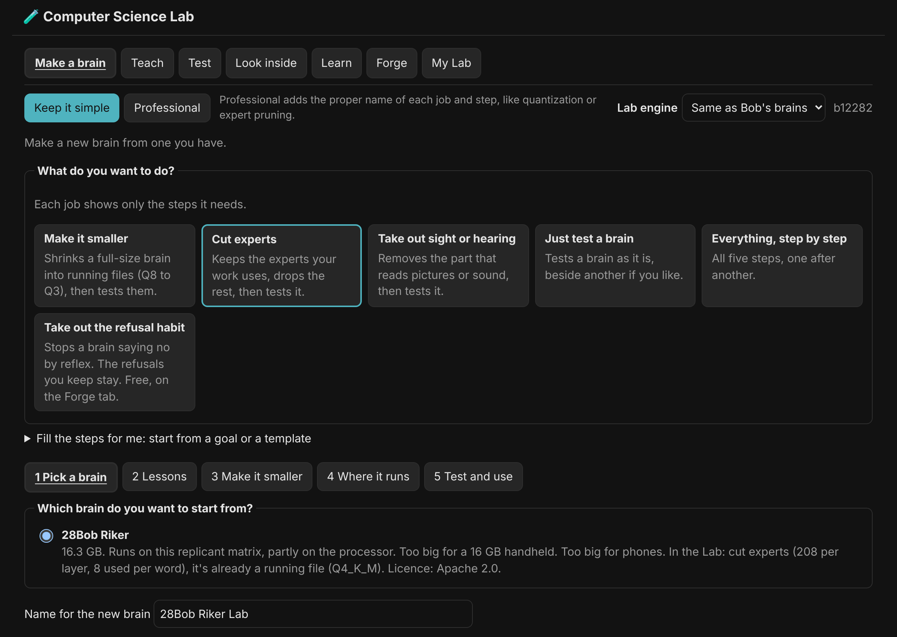

Under the tabs, **Keep it simple** or **Professional** is one switch for the whole Lab: simple shows the usual choices with Bob's defaults filled in, Professional shows every control a tab has, and leads each job, way, page and challenge with its proper name (quantization, expert pruning, abliteration, speculative decoding, ARC-style and so on), with the plain words after it in brackets. The same switch is in Settings, How Bob works, Brains, as **Lab: Professional mode**.

The Lab has seven tabs:

- **Make a brain** starts by asking what you want to do (Make it smaller, Cut experts, Take out sight or hearing, Just test a brain, Everything, or Take out the refusal habit, which opens the Forge tab), then walks you through only the steps that job needs, with tick boxes instead of command-line flags. Everything is all five:
  1. **Pick a brain** you already have.
  2. **Lessons**: your chats with Bob, a lesson set you have, or a new one Bob writes with a teacher brain, or builds from your own files.
  3. **Make it smaller**: cut experts while keeping every skill covered, take out sight or hearing, then make the running files (Q4 and others).
  4. **Where it runs**: this replicant matrix, for free.
  5. **Test and use**: the Lab test runs on the new brain and the one it came from, and **Use in Bob** only appears after it. **Compare** puts tested brains side by side and saves the table as CSV or JSON.

  Pick a job first (Make it smaller, Cut experts and so on); a job that cuts experts has **Fill the steps for me**, where a goal (Everything smaller, Coding helper, Everyday chat and more) fills in the steps. **Show the recipe** shows the exact commands, so you can learn them or run them yourself.
- **Forge**: every way of making a new brain, side by side, each with where it runs and what works best. Making a brain smaller, cutting experts, mixing two brains and stacking layers run here for free. Teaching a cut brain back needs a rented graphics card: the Forge writes the plan, and you start each run yourself. Under **Lessons to teach**, every lesson set is broken into parts by what it teaches, where it came from and whether it shows its thinking: **Pick its parts** leaves parts out, and a set's thinking can be taught as its own thinking path ("Think: name"). **Add a lesson set to the Lab** brings in a .jsonl or .json set from your replicant matrix or Hugging Face and breaks it up the same way.
- **Learn**: **Experiments** are short cards about how a brain works (what a token is, how the next word is picked, what temperature does), run on the brain Bob has loaded right now. If none is loaded, say anything to Bob in the chat first. Nothing here changes how he answers, and nothing is saved. **Diffusion brains** tries a brain that writes a whole answer at once.
- **Test**: **Challenges** are short tests out of 100 for any brain you have, with a scoreboard that ranks brains against others of their own size. **Smaller** makes one brain in six sizes and shows where it starts to slip; **Longer** and **Faster** try longer chats and faster settings.
- **Teach**: **Teach it** teaches a brain a lesson set, here if it fits your card; **Best answers** has a bigger brain judge a smaller one's answers and teaches it its best.
- **Look inside**: **Peek inside** shows which experts your work uses; **fNRI** scans a brain while it answers a few questions for each skill and plays it back in its own window as a 3D block of voxels, a floor for each layer, coloured by skill and glowing as the experts are used (tick boxes hide skills, three zoom levels, Save as a video).
- **My Lab**: one list of what the Lab has made and measured (brains, scores, size ladders, lesson sets, saved recipes, recent jobs), each with a button to its page.

| | |
|---|---|
| 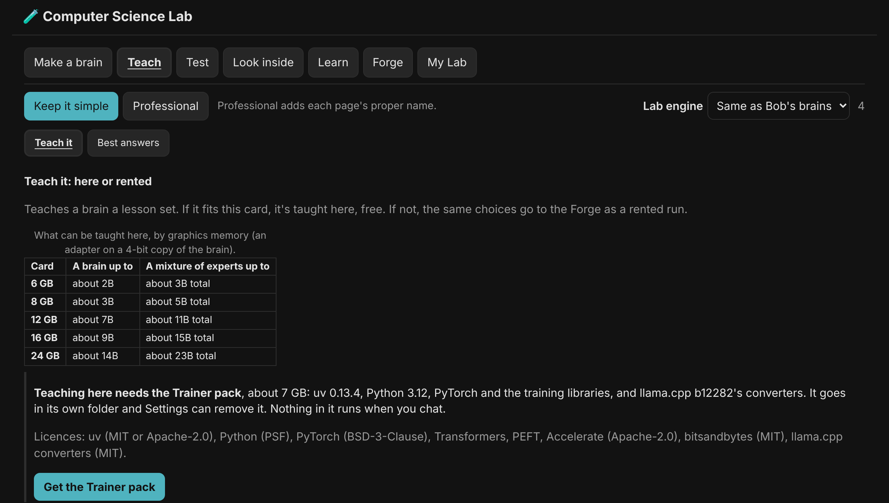 | 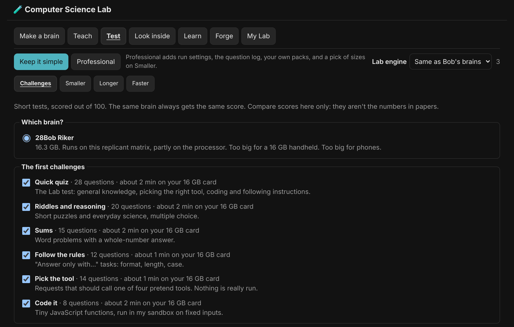 |
| 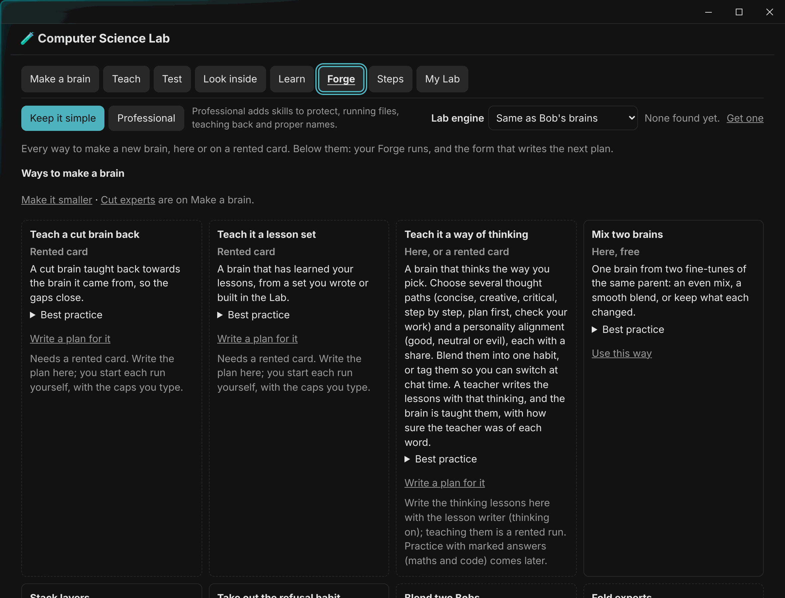 | 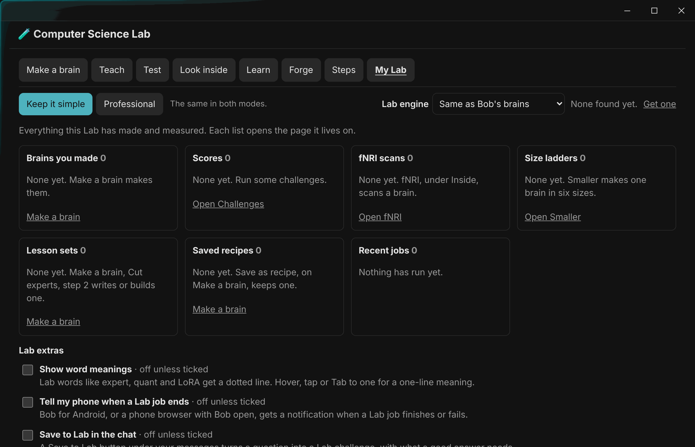 |

Lab jobs need a replicant matrix with at least 12 GB of memory; a smaller one still shows the Lab and can start jobs on a bigger Bob on your Bob-Net. The phone app has no Lab. Every tab has its own page in Help, The Computer Science Lab.

## 12. Updating and removing Bob

**Updating:** Settings → **Check for updates**. If there is one, click **Update Bob** and watch the steps. Bob downloads the new release, checks it against its checksum and swaps it in on restart; if he's busy, he asks whether to restart now, wait until he's finished, or leave it for later. Your chats, models and settings are kept, because they live in Bob's home folder, apart from the program.

**Removing:** Settings → Remove Bob → **Remove Bob…**. Bob's program, his shortcut, "Launch on start-up" and the "Bob schedules" task are removed. Two boxes, unticked unless you tick them, also remove his chats and settings and the models he downloaded. Those go to the Recycle Bin.

---

## 13. When something goes wrong

| What you see | What to try |
|---|---|
| A download stopped | Press **Resume** in Now running. It carries on from where it stopped. |
| Pictures or video are very slow | Normal on small cards. Use the **Art** session, keep clips short, or turn on **Match picture settings to my graphics card**. Run **Check this replicant matrix**. |
| Bob says he can't look things up | Click **🌐 Web search** next to Effort (or turn on **Let Bob search the web** in Settings). |
| The memory numbers at the top and on the right differ | The top counts Bob's brain only; the meters on the right count the whole graphics card and RAM. The line under them shows Bob's share. |
| "Out of graphics memory" | Close games or other graphics-heavy apps, or pick the smaller (6 GB) version of the model in Equip Bob. |
| Bob can't hear you | Fill the 👂 Hearing you slot (Gemma 4 E4B does it). |
| Bob can't paint or edit | Fill the 🎨 Painter or ✂ Picture editor slot, and get the painter engine when Bob offers it. |
| Windows blocks Bob | Bob.exe is the official Electron program renamed, which Windows usually trusts. If it's blocked anyway, see the Releases page notes. |

**Still stuck? Save a help bundle** (Settings, This replicant matrix and updates). It saves one zip for whoever is helping you get Bob working: a HANDOFF.md written for an AI agent (it links this repository and the exact version and says what to check in which order), every error and the last 3,000 lines of Bob's logbook, his settings without their secrets, this machine's facts, whether each engine starts, and the last three chats as a readout. If Bob's chat brain is loaded and idle it adds its own note about what it thinks is wrong; if not, the bundle is put together without any brain, so the button works on a broken Bob. The owner's name and user name, the home folder, the machine name, passcodes, API keys, bot tokens and Tailscale addresses are taken out first. You pick the folder; nothing is sent anywhere. Take the zip to your agent or attach it to an issue.

---

## Glossary

The full glossary and an FAQ are in Help inside Bob (left menu, or F1).

- **Model:** the "brain file" that does one kind of AI job. Bigger models are usually smarter but slower and need more memory.
- **Graphics card (GPU) and graphics memory (VRAM):** the part of your PC that makes AI fast. The amount of graphics memory (6 GB, 8 GB, 16 GB) decides which models fit.
- **RAM:** your PC's main memory. Bob can use it for parts of a model that don't fit on the graphics card. It works, but more slowly.
- **Squeezed (GGUF) version:** a smaller copy of a model that fits small cards, with a little less detail.
- **Released, New, Dated:** the day a brain's maker put it out; New = one of the five newest in its family (under a year old); Dated = newer brains do its job better, but it stays.
- **Really big brains:** brains with hundreds of billions of numbers that no home computer holds. Bob lists them under Rented brains.
- **Model family:** models made by the same team the same way, like Qwen or Gemma, in many sizes. Each family has its own header in the Brain catalogue.
- **Naughty list:** uncensored remixes of Qwen and Gemma brains made by other people, with the refusals cut out. Marked with a red devil. Hidden until Show the naughty list is on; never ★ Recommended, but a red devil on its own is Bob's quiet pick among them.
- **Abliterated (heretic):** a brain with its "no" taken out. Heretic is the tool, abliterated is the result.
- **Your own brain:** a .gguf file you added to Bob's list yourself under ➕ Your own brains; runs from where it is, never recommended over the ones Bob knows.
- **Community build:** a model made by someone other than its maker (a remix, fine-tune or repack); the catalogue says who and from what.
- **Brain catalogue:** Bob's full list of models, sorted by job. **Active** models show in the slots and menus; the rest wait there.
- **Engine:** the program that runs a kind of model, for example the painter engine for pictures. Bob offers it when a model needs it.
- **Computer Science Lab:** the 🧪 Lab page, where you make your own brain from one you have and test it before it goes into Bob.
- **Commercial use:** using what you make for money. All starter set models allow it. A few optional extras don't, and Bob marks those.

## Licences of the starter set models

| Model | Licence |
|---|---|
| Gemma 4 (E4B and 26B) | Apache 2.0 |
| Qwen3 Coder 30B, Qwen2.5 Coder 7B | Apache 2.0 |
| Nomic Embed Text | Apache 2.0 |
| Kokoro | Apache 2.0 (voices); MIT (the version Bob downloads) |
| Z-Image Turbo, all versions | Apache 2.0 |
| FLUX.2 klein 4B | Apache 2.0. The bigger FLUX.2 klein 9B and FLUX.2 dev are **not** free for commercial use, so Bob doesn't put them in starter sets. |
| Qwen Image Edit 2509 | Apache 2.0 |
| Wan 2.2 5B, all versions | Apache 2.0 |

Each model keeps its own licence, and Bob shows it, with the download size, before you confirm a download.
