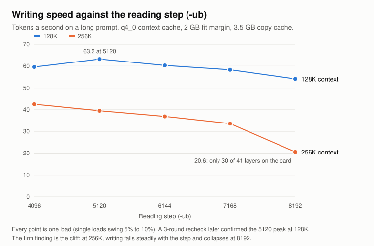
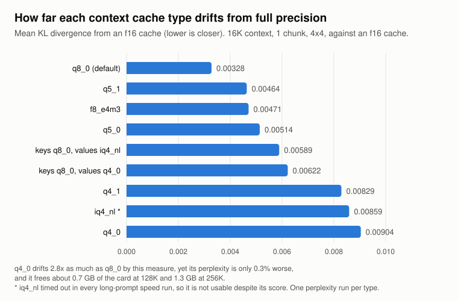
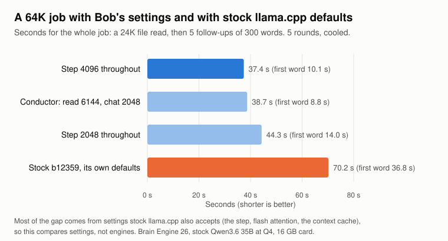
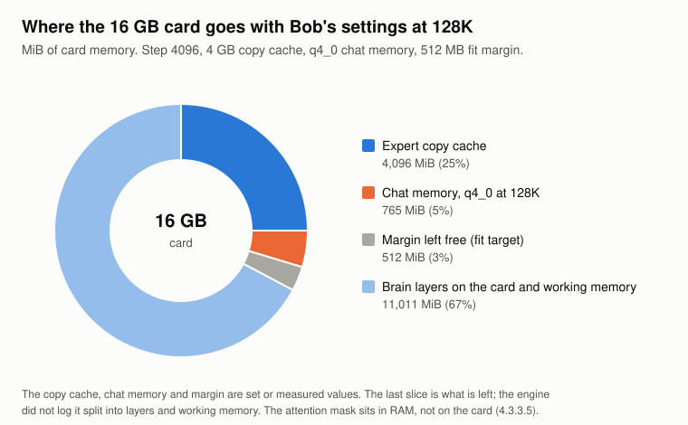
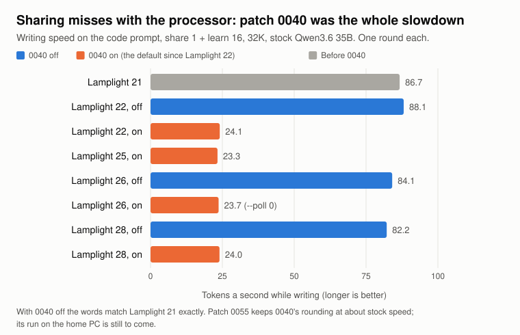

# Chapter 4. Method and rules

## 4.1 Introduction and research question

This chapter sets out how the studies were run and the rules the project adopted for itself. Each rule exists because a past result was wrong, wasted money or could not be trusted. Together they matter more than any single number in chapters 5 to 10.

The chapter serves all five research questions (chapter 1) but is closest to the third: how much do leaked test items distort the scores used to make decisions? A leak is a method fault. It cannot be seen in a result table. It can only be found by checking how the test and the lessons were made. For that reason the method is reported in full, including the parts that went wrong.

The chapter has four aims. First, to state the models, settings and benchmarks. Second, to describe the judges and their known faults. Third, to list the gates, caps and data rules. Fourth, to say plainly what the statistics can and cannot support. Section 4.12 sets out the protocol every new model follows, and section 4.13 collects the threats to validity.

## 4.2 Related work on evaluation method

### 4.2.1 Contamination and leaked tests

Benchmark scores are only meaningful if the model has not seen the test. Sainz et al. (2023) argue that contamination must be measured for each benchmark and each model, not assumed away. Golchin and Surdeanu (2023) describe a method that detects whether a model has seen test data, at the level of single examples and whole partitions. Magar and Schwartz (2022) ask whether seen data is memorised or actually exploited, by comparing performance on seen and unseen examples. Jacovi et al. (2023) propose practical defences, such as encrypting public test sets and asking providers for training-exclusion guarantees.

Most of this work concerns web-scale pre-training, where the question is whether a test appeared somewhere in the crawl. The leak in this dissertation is a smaller and more direct one. The test items were written by the same pipeline as the lessons, and copies of them sat in training-side files. Lee et al. (2021) show a related fact: standard text datasets hold many duplicated passages, and removing them changes what models memorise. The rules in sections 4.6 and 4.7 follow the same idea, that overlap between the test and the training side must be searched for and not assumed absent.

### 4.2.2 Faults in test sets and in judges

Northcutt et al. (2021) found that widely used test sets contain many mislabelled examples, enough to change benchmark rankings. This applies directly here. The 534 held-out tool items were themselves sorted for faults (section 4.7), and most carried one. Zheng et al. (2023) show that a language model used as a judge agrees with human preferences about as often as humans agree with each other, and also report position, verbosity and self-enhancement biases. Panickssery et al. (2024) find that evaluators can recognise and favour their own generations. Both bear on this work, because the teacher that wrote the lessons also wrote the answers that the tool score treats as correct.

### 4.2.3 Statistics for small evaluations

Dror et al. (2018) survey how to choose a significance test in natural language processing, and Card et al. (2020) show that many NLP comparisons lack the power to detect the differences they claim. Miller (2024) recommends that evaluation questions be treated as a sample from a larger population and that results carry error bars, with paired comparisons where the same questions are used in both conditions. The studies here use paired differences with a 95% range for this reason (section 4.10).

### 4.2.4 Tool-use evaluation

Tool use is studied with training sets and benchmarks. Toolformer teaches a model to call tools in a self-supervised way (Schick et al., 2023). Gorilla fine-tunes a model to write API calls and pairs it with a retriever to reduce invented calls (Patil et al., 2023). ToolLLM builds a large tool-use dataset from real APIs and an automatic evaluator (Qin et al., 2023). These works measure whether a model can call tools from a given library. This dissertation asks a different question: whether the lessons that taught a small model its tool habits carried faults, and whether cleaning them changes the habits. The tool score used here is therefore tied to Bob's own tools and uses a recorded teacher answer as its reference.

## 4.3 Models and settings

### 4.3.1 The models

The studies use these models.

| Name | What it is |
|---|---|
| Full Qwen | Qwen3.6-35B-A3B, the stock model and the lesson teacher (docs/FORGE-JOURNAL.md). |
| Bobert (35Bob) | The full model trained on every lesson, with all 256 experts. |
| Riker (28Bob) | Cut from the full model to 208 of 256 experts per layer, then healed. |
| Bill (20Bob) | Cut from Bobert to 144 experts per layer, then healed against Bobert's odds. |
| GPT-OSS 120B | OpenAI's open mixture-of-experts model (OpenAI, 2025), used as a second family. |
| GPT-OSS 38B cut | A REAP cut of the 120B, unhealed in the coaching study. |

The Qwen family is described in Yang et al. (2025). The cut models were made by the Forge (chapter 3).

### 4.3.2 Serving settings

Home benchmarks run on MouseWurX's 16 GB card with Q4 files and 8 experts per word, with the same settings for every model in a comparison (docs/FORGE-JOURNAL.md, 8 November entry). Rented-card benchmarks serve the same Q4 files through Brain Engine with the same test scripts, so that home and rented numbers come from identical tests (model-lab/forge/README.md, Build 18). Where a study changed a setting, such as experts per word, a mask, or a dial, the saved answers carry the condition (section 4.9).

The Bobert wording study ran on a rented 48 GB A40 with 8 slots of 8,192 tokens each. The planned switch to 4 slots of 16k never happened, so 11 to 13 long turns per round overflowed their slot, and 11 to 31 answers per round were cut off at the length limit. Both kinds were scored as wrong, and the same turns were affected in every condition, so comparisons between conditions stay fair, but absolute scores are lower than they would otherwise be (bobert-35bob-tool-study.md).

### 4.3.3 Speed settings measured on the home PC (updated 18 November)

Before any setting that changes how the brain is served becomes a default, it is timed on MouseWurX's consumer PC against the default. **For every speed result in one table, see section 4.3.4.** This section gathers every speed result from 4 to 18 November in one place, oldest first, with later tests in sections 4.3.3.8 to 4.3.3.13. Section 2.10.1 turns the results into advice for a home machine. Section 3.4.3 covers the cost of the fNRI trace.

All speeds are tokens a second. "Read" is prompt reading speed and "write" is writing speed. "First word" is the wait before the first word appears, in seconds. Unless a row says otherwise, the brain is stock Qwen3.6 35B A3B at Q4 (unsloth UD-Q4_K_XL) on a 16 GB card with 32 GB of RAM and an 8-core processor.

**What is settled and what is provisional.** Some conclusions rest on a known mechanism, many loads, or both. Others rest on single loads or wait on the stock comparison, and each of those has a check queued in section 4.3.3.6.

*Settled:*

- **The 128K and 256K "spill" is the attention mask in pinned RAM.** Its size formula matches every load, and turning pinning off removed it in 16 loads over 2 rounds, with identical words (section 4.3.3.5).
- **The speed settings don't change the answers** beyond the last digits of perplexity (section 4.3.3.4).
- **The reading step drives reading speed.** Only `-ub` matters.
- **The 256K cliff at step 8192.** Only 30 of 41 layers fit on the card there (Figure 4.1).
- **512 MB is the floor for the fit margin.** At 256 MB a real spill starts (section 4.3.3.3).
- **What's out:** iq4_nl (it timed out), the context cache in RAM (writing 73% to 76% slower), sending copy-cache misses to the processor (keep the share at 0), and Turbo at big steps (5 more layers go to RAM). Turbo's extra rise is its own pinned buffer, not overflow.
- **Brain Engine 16 freed nothing, and we found why:** Qwen3.6's position codes made it fall back every time. Brain Engine 17 carries the fix (section 4.3.3.5).
- **A busy desktop costs 10% to 18% of writing,** in 8 paired loads.
- **Against llama.cpp's own defaults, our picks finish a 300-token job 2.4 to 2.9 times sooner, and nearly all of that comes from settings any llama.cpp user can pass** (section 4.3.3.2, 20 loads over 2 rounds). That gain is in the first word and reading. Writing, the speed felt through the whole answer, gains far less: 1.3 times at the short prompt (109.8 against 82.9 tokens a second), 1.2 times at 32K (98.5 against 83.8), the same at 128K (63.9 against 63.6), and at 256K stock defaults write 12% faster (48.1 against 42.3). The copy cache only pays on long answers.
- **A 35B load takes about 6 s,** across about 100 loads. The browser left open on 18 November from 11:40 AM to 12:23 PM made no measurable difference.

*Provisional:*

- **The 128K and 256K picks.** A 3-round recheck confirmed step 5120 at 128K and found a three-way tie at 256K, but most loads throttled lightly, and whether these picks keep the copy cache waits on an 18-load run.
- **The 512 MB margin's writing gain.** It rests on 2 loads, and the busy-desktop pass agrees except for 2x4 at 32K.
- **The chat pick between 2x4 and 4x4.**
- **The writing order of cache types at 256K.** These are single loads.
- **q4_0 is a borderline pass.** It does not pass outright. In the second perplexity run it failed the mean-KLD limit of 0.01 by 1.6% on the 4K × 4 split (0.01016) and passed on the 8K × 2 split (0.00951) (section 4.3.3.4). MouseWurX ruled on 19 November that it counts as a borderline pass, so it may be used, with q8_0 still the safe choice where memory allows. Stock llama.cpp has no 3-bit context cache. Brain Engine now adds one (q3_0, patch 0038) and a mixed 3/4/8-bit one (patch 0039). q3_0 passes perplexity and the needle test, and with fix 0044 writes 2.9% slower than q4_0 at 128K. Patch 0039 failed on speed (section 4.3.3.8).
- **Turbo's net effect.** It helped at a small step with a big copy cache and hurt at big steps with a small one, in 1 load each.
- **The copy-cache choices.** By the scoring rules, agent work drops the copy cache and chat keeps it. Long-form work keeps it only on the tie-break, after a 2.1% tie (section 4.3.3.2). Most long-context loads throttled lightly, and a rerun could flip the long-form choice.
- **The 120B soft cut's answer quality.** Its perplexity run is paused.

#### 4.3.3.1 How the speed tests were run

- **Written down first.** The method was written on 16 November, before any timed run. Each later test got a dated addendum (41 by 18 November), written before that test ran, with its settings, its predictions and the rule for "best". Results are graded against the addendum as written, including the predictions that missed. The method and addenda are in `docs/test-results/2026-11-16-speed-test-method.md`.
- **Loads and repeats.** Each setting gets an untimed warm-up after the brain loads, then timed runs. The main runs of 16 and 17 November used 5 loads per setting. Many later runs used fewer: the 18 November cache-type, read-layout, margin and step runs used 1 load per setting, and the GPT-OSS 120B run used 3. Each table states its own count, and the Runs column of the big table gives it row by row. Settings take turns (1, 2, 3, 1, 2, 3...), so heat and background load fall evenly across them. We report the median, with the lowest and highest where they matter, never a mean on its own. With 1 load, the number is that single load and not a median. Single-load results swing 5% to 10%, so they pick a shortlist and decide nothing. From 16 to 18 November (to 1:31 PM) the home PC did about 596 loads in all: 165, 299 and 132 a day.
- **Prompts and context.**
  - "Start" is Bob's real start prompt, his system prompt and tools, about 3,900 to 4,000 tokens, followed by "hi".
  - "16K" and "32K" are public-domain book text cut to exactly 16,384 and 32,768 tokens with the brain's own tokenizer, plus one question.
  - From 17 November the context runs also used prompts of about 60K, 120K and 248K tokens at contexts of 64K, 128K and 256K.
  - Every prompt's sha256 is recorded.
- **Fixed settings.** Bob's own engine flags were used (`--jinja -fa on -ctk q8_0 -ctv q8_0 --fit on -np 1`) at a context of 49,152 unless a row changes one. Each run used temperature 0, seed 42, `ignore_eos` and exactly 300 written tokens, with no prompt cache between runs. The exact command line of every run is saved. The Turbo rows marked "Bob's sampling" used Bob's own sampling instead.
- **What is measured.** First word, read and write come from the engine's own timings. Peak card memory was sampled by nvidia-smi every 250 ms. We also record the layers whose experts `--fit` placed in RAM. For hot-expert rows we record cache hits, misses and megabytes copied.
- **Machine state.** Card temperature, power, clocks and throttle reasons were sampled every 250 ms. Processor temperature came from HWiNFO when it was logging. We recorded free RAM and the top 5 other processes at the start and end of each run. A throttled run is kept and flagged, not dropped.
- **Cool-down, from 20 November (Addendum 74).** The 3-bit memory looked 18% slower at 128K in one run and 6% slower in a same-day head-to-head, because the first run's long rows throttled 43% to 56% of the time. Since then every speed test reads the idle card's temperature first and waits, before every load and timed run, until the card is back within 3 °C of it (at least 35 °C, at most 300 s a wait). Each row records its start and top temperature and its median and lowest clock. Waits, and waits that hit the limit, are written down, and runs whose start temperatures differ by more than 5 °C are flagged, not averaged. A rerun of Progressive Memory with the cool-down matched the run without it within 1% to 3%. The long 128K and 256K runs still showed as throttled at under 72 °C, which is the card's boost backing off for power during the long prompt, not heat. On the 128K switch test the 300 s cap was hit 29 of 30 times (2.4 hours of waiting), because the empty card idles cooler than a loaded one; the target now rises after a full wait.
- **Clean-machine and lock rules.**
  - The test takes the PC's test lock, runs on its own port and in its own folder, and keeps its windows minimized.
  - It never touches the copy of Bob in daily use.
  - It stops at once and frees the card if a game starts.
  - No games, browser or launchers are open, and there are no reboots or compiling.
  - Every run is started by MouseWurX's double-click.
  - Where this was broken, the row says so. The Claude app was open (about 1 GB of RAM) during the 17 November cache sweep. Bob was open during part of the 2 GB rows. A browser with a paused video tab was open from 11:40 AM to 12:23 PM Mountain on 18 November, during the perplexity grid and the first loads of the step sweep. Perplexity does not depend on speed, and the step-sweep loads from that window were within 3% on reading and 10% on writing of matching loads, so none were rerun.
  - Clean-machine numbers are not everyday use. A pass with a browser full of tabs, Discord and Bob open is planned for the final picks.
- **How a spill and free card memory are measured.**
  - **Free card memory** after a load comes from the engine's own `--fit` lines. The peak comes from nvidia-smi.
  - **The first spill rule** marked a load failed when Windows' "shared GPU memory" rose by more than 512 MB. On 17 November that rule failed every load with a reading step of 4096 or more, but the rise tracked the step and not the cache, so the rule was measuring something else.
  - **The corrected rule** judges each try against its own baseline. On 18 November the engine logs showed that the rise is the attention mask held in pinned RAM (section 4.3.3.5), and the speed test now subtracts that buffer.
- **Perplexity.** llama.cpp's perplexity tool scored each setting against a base with plain settings and a full-precision (f16) context cache, on a fixed text. It reports perplexity (PPL), the mean and 99th-percentile KL divergence from the base (KLD), and how often the top word matches the base ("same top"). The settings group used an 8K context with 2 chunks. The cache-type group used a 16K context with 1 chunk.
- **One runner fault.** On 16 November the runner read pieces of nvidia-smi lines as whole lines, about 6% of samples. That made the card's temperature and power columns wrong for night 1. Speeds and words were not touched. The runner was fixed and tested, and the conditions were worked out again from whole lines.

#### 4.3.3.2 Every setting tried, oldest first

Shorthand used below: **step** is the reading batch (`-b`/`-ub`). **Copy cache** is the hot-experts cache on the card, with a missed expert copied to the card (`--moe-cache-cpu-share 0`). **Processor cache** works a missed expert out on the processor instead (share 1). **Setting codes** give the step (`-ub`) in thousands × the copy cache in GB: **2x4** is step 2048 with a 4 GB copy cache, **4x4** is step 4096 with 4 GB, **6x3.5** is step 6144 with 3.5 GB, and **4x0** is step 4096 with no copy cache. Earlier notes used other names: F4c for 2x4, X4c for 4x4, S6k0 for 6x0 and Y0 (Normal) for 0.5x0.

| Date | Engine | Setting | Runs | Read start / 32K | Write start / 32K | First word 32K | What it showed |
|---|---|---|---|---|---|---|---|
| 4 Nov | Bob at the time | First reply after a load, default | 2 | 125 (first) / 2,221 (second) | 49 to 62 (in the app) | | The first reply after a load reads 15x slower: the brain is still paging in |
| 4 Nov | Bob at the time | `--load-mode none` | 2 | 2,355 on the first reply | | | First reply in 1.4 s instead of 27 s, with load 10 s longer and half the RAM |
| 16 Nov | plain llama.cpp b12359 | its own defaults (P0) | 5 | 1,065 / – | 82.9 / 77.8 | | Baseline |
| 16 Nov | plain llama.cpp b12359 | Bob's settings (P1) | 5 | 1,161 / – | 87.7 / 77.7 | | Bob's settings write 6% and read 9% faster |
| 16 Nov | Brain Engine 8 | everything off (E0) | 5 | 1,168 / – | 87.9 / 78.2 | | The patches cost nothing while off; same words |
| 16 Nov | Brain Engine 8 | step 512 (Normal) | 5 | 1,162 / 1,238 | 87.8 / 78.1 | 26.5 | Default |
| 16 Nov | Brain Engine 8 | step 2048 | 5 | 3,027 / 3,094 | 84.1 / 76.1 | 10.6 | Read 2.5x |
| 16 Nov | Brain Engine 8 | step 4096 | 5 | 4,225 / 4,161 | 80.1 / 73.8 | 7.9 | Read 3.4x, writing 5% to 9% slower |
| 16 Nov | Brain Engine 9 | 4 GB processor cache, our ranking (N4) | 5 | 807 / – | 103.7 / 87.6 | 37.5 | Writing +17%, reading −30% |
| 16 Nov | Brain Engine 9 | 4 GB copy cache, learned (H7) | 5 | 782 / – | 109.2 / – | | Fastest writer that night |
| 16 Nov | Brain Engine 9 | prefetch (N5) | 5 | – / 1,091 | – / – | | Reading 12% slower in this round (6% to 13% slower across rounds); dropped |
| 16 Nov | Brain Engine 9, MTP file | Turbo, 3 ahead, Bob's sampling (T3S) | 5 | – / 1,048 | 70.0 / 77.7 | 31.3 | −17% to +3%; not offered |
| 17 Nov | Brain Engine 9 | calibration default (0.5x0) | 5 | 1,154 / 1,232 | 87.7 / 77.3 | 26.6 | Baseline for the pairs |
| 17 Nov | Brain Engine 9 | 2x4 | 5 | 2,180 / 2,290 | 109.2 / 99.2 | 14.3 | Won the rule set beforehand: +25% / +28% writing |
| 17 Nov | Brain Engine 9 | 4x4 | 5 | 3,212 / 3,276 | 102.0 / 91.9 | 10.0 | Runner-up; reads 2.7x |
| 17 Nov | Brain Engine 9 | step 2048 + 4 GB processor cache (F4p) | 5 | 1,852 / 2,284 | 102.4 / 73.6 | 14.4 | The copy cache beats the processor cache |
| 17 Nov | Brain Engine 9 | CUDA graphs off (G0) | 5 | 1,148 / 1,218 | 50.9 / 48.0 | 27.0 | −42%; same words |
| 17 Nov | Brain Engine 10 | default (0.5x0) | 5 | 1,190 / 1,271 | 91.1 / 81.3 | 25.8 | |
| 17 Nov | Brain Engine 10 | 2x4 | 5 | 2,209 / 2,303 | 109.1 / 102.3 | 14.3 | |
| 17 Nov | Brain Engine 10 | step 2048 + 5 GB copy | 5 | 2,071 / 2,225 | 112.2 / 95.5 | 14.8 | Bigger cache: faster start, slower 32K |
| 17 Nov | Brain Engine 10 | step 2048 + 6 GB copy | 5 | 1,962 / 2,158 | 112.4 / 90.9 | 15.2 | |
| 17 Nov | Brain Engine 10 | 4x4 | 5 | 3,330 / 3,380 | 107.4 / 95.3 | 9.7 | Coding pick: reads 32K 47% faster than 2x4 |
| 17 Nov | Brain Engine 10 | step 4096 + 5 GB copy | 5 | 3,173 / 3,187 | 105.6 / 96.2 | 10.3 | No cache over 4 GB helps |
| 17 Nov | Brain Engine 10 | step 4096 + 6 GB copy | 5 | 3,026 / 3,114 | 106.9 / 97.4 | 10.5 | |
| 17 Nov | Brain Engine 10 | step 5120 + 2 GB copy | 5 | 3,660 / 3,904 | 91.2 / 77.7 | 8.4 | Fast reading, slow writing |
| 17 Nov | Brain Engine 10 | step 6144 + 2 GB copy | 5 | 3,598 / 4,148 | 91.3 / 75.1 | 7.9 | |
| 17 Nov | Brain Engine 10 | step 6144, no cache | 1 | 3,039 / 4,626 | 81.3 / 74.7 | 7.1 | Reading needs no cache |
| 17 Nov | Brain Engine 10 | step 6144 + 512 MB / 1 GB / 2 GB | 1 each | 2,879 / 2,849 / 2,798 (start) | 56.5 / 68.9 / 85.1 (start) | 7.2 / 7.7 / 8.0 | A small cache writes slower than none |
| 17 Nov | Brain Engine 11 | 4x4 | 5 | 2,666 / 3,377 | 99.3 / 94.5 | 9.7 | Head to head |
| 17 Nov | Brain Engine 11 | 6x3.5 | 5 | 2,671 / 3,902 | 95.2 / 88.5 | 8.4 | Finishes long prompts about 1 s sooner, writes 4% to 24% slower |
| 17 Nov | Brain Engine 13 | 6x4, cache lent to reading (6x4 lend) | 1 | 2,672 / 3,657 | 99.3 / 92.8 | 9.0 | Lending lifts writing over plain 6x4 in the same round (Brain Engine 13, 32K: 92.8 against 88.4); plain 6x4's 91.9 / 76.2 elsewhere in this section are from another round |
| 17 Nov | Brain Engine 14 | 6x4 lend with the cache refilled behind writing | 1 | 3,325 / 3,859 | 109.0 / 92.8 | 8.5 | |
| 17 Nov | Brain Engine 14 | refill batch 64 (B64) | 1 | 3,414 / 3,868 | 109.1 / 70.4 | 8.5 | Big refill batches hurt 32K writing |
| 17 Nov | Brain Engine 14 | 6x3.5 (6x3.5) | 1 | 3,394 / 3,913 | 104.6 / 88.2 | 8.4 | |
| 17 Nov | Brain Engine 14 | step 6144, no cache (6x0) | 1 | 4,408 / 4,715 | 82.1 / 74.4 | 7.0 | Fastest reader of all |
| 17 Nov | Brain Engine 8 | GPT-OSS 120B, soft cut to 41 of 128 experts, step 2048, q8_0 cache | 9 replies | – | 24.1 (in Bob) | | The full file crawled (RAM full); the cut loads in 29 to 39 s instead of 240 s |
| 18 Nov | Brain Engine 15 | 4x4, 120K prompt at 128K | 1 | 3,060 (start) / 2,463 (120K) | 86.9 / 65.0 | 50.0 (120K) | Long contexts: see the tables below |
| 18 Nov | Brain Engine 15 | read layout (4x4 R1, `-b 8192`), 120K prompt at 128K | 1 | 3,151 / 2,771 | 87.5 / 55.2 | 44.5 | Reads long prompts 10% to 14% faster |
| 18 Nov | Brain Engine 15 | GPT-OSS 120B soft cut, 2x4, 8K context | 3 | 1,137 to 1,223 (start) | 31.8 to 32.4 | | Best 120B writer; Normal writes about 30 |

The 17 November one-round cache sweep (steps 4096, 5120 and 6144, with caches from 2 to 4 GB, 15 setups) and the 17 November context run are in the results pages. Their pattern is that bigger steps read faster and smaller caches write slower at 32K, with 2 GB the worst.

**Longer contexts** (1 load per setting, Brain Engine 14; first word / read / write):

| Context (prompt) | 6x0 | 6x4 lend | 6x3.5 |
|---|---|---|---|
| 32K | 7.4 / 4,437 / 74.5 | 9.3 / 3,548 / 92.3 | 8.8 / 3,731 / 87.3 |
| 64K (60K) | 15.0 / 4,114 / 67.5 | 17.6 / 3,503 / 86.7 | 17.6 / 3,498 / 81.0 |
| 128K (120K) | 37.9 / 3,248 / 53.1 | 41.7 / 2,954 / 57.1 | 42.9 / 2,868 / 61.8 |
| 256K (248K) | 118.5 / 2,147 / 37.7 | 131.1 / 1,940 / 42.5 | 135.1 / 1,882 / 40.9 |

**Context cache types across contexts** (18 November, Brain Engine 15, 1 load per setting, 36 loads in all; long prompt of 60K, 120K or 250K tokens; first word / read / write):

| Cache | 4x4 at 64K | 4x4 at 128K | 4x4 at 256K | 6x3.5 at 64K | 6x3.5 at 128K | 6x3.5 at 256K |
|---|---|---|---|---|---|---|
| q8_0 | 20.6 / 2,989 / 77.7 | 49.9 / 2,469 / 65.3 | 154.2 / 1,649 / 38.1 | 17.0 / 3,622 / 82.3 | 42.4 / 2,909 / 61.5 | 133.2 / 1,909 / 39.5 |
| f8_e4m3 | 19.8 / 3,116 / 71.1 | 48.6 / 2,534 / 55.8 | 155.0 / 1,640 / 31.8 | 17.2 / 3,587 / 68.9 | 42.0 / 2,940 / 53.3 | 130.5 / 1,950 / 33.3 |
| q5_1 | 19.6 / 3,145 / 66.0 | 48.8 / 2,523 / 46.0 | 153.0 / 1,662 / 26.6 | 16.9 / 3,651 / 55.8 | 41.3 / 2,984 / 43.8 | 129.9 / 1,958 / 27.6 |
| q4_0 | 19.7 / 3,126 / 68.5 | 48.0 / 2,564 / 57.8 | 152.5 / 1,668 / 45.2 | 16.6 / 3,725 / 72.9 | 41.0 / 3,009 / 64.5 | 128.1 / 1,986 / 42.5 |
| keys q8_0, values q4_0 | 20.0 / 3,086 / 66.3 | 49.2 / 2,501 / 49.9 | 155.1 / 1,639 / 28.0 | 17.1 / 3,610 / 56.7 | 41.3 / 2,983 / 48.0 | 130.0 / 1,956 / 28.4 |
| iq4_nl | timed out | timed out | timed out | timed out | timed out | timed out |

- **q4_0 gave the best long-prompt writing at 256K** with both settings (45.2 and 42.5, against 38.1 and 39.5 for q8_0). It was also the fastest or near-fastest reader at every size.
- **iq4_nl read Bob's start prompt at about 210 tokens a second.** Every long prompt timed out.
- **The mixed q8_0/q4_0 cache wrote slowest at long contexts.**
- **Writing speed doesn't follow cache size alone, though these are single loads.** At 256K with 4x4, writing ran q4_0 (45.2), q8_0 (38.1), f8_e4m3 (31.8), q5_1 (26.6). f8_e4m3 is the same size as q8_0 yet wrote about 17% slower, and the 5-bit q5_1 wrote slower than the 4-bit q4_0, also at 128K (46.0 against 57.8). We don't claim the order: the needle run saw the same 256K setup write anywhere from 23 to 45 tokens a second depending on the needle's depth. One likely cause is that llama.cpp's standard CUDA build has fast attention kernels only for f16, q4_0 and q8_0 caches, and other types take a slower path. That is unproven in our lab, as we have yet to test. If it holds, part of q4_0's lead comes from its kernel and not only from the card room it frees.

**Read layout across contexts** (18 November, Brain Engine 15, q8_0, 1 load per setting; long prompt; first word / read / write). 4x4 b8192 is 4x4 with `-b 8192`. 4x4 R1 is the same with the read layout on, which keeps whole layers in the cache while reading.

| Context | 4x4 | 4x4 b8192 | 4x4 R1 |
|---|---|---|---|
| 32K | 11.4 / 2,898 / 91.3 | 11.1 / 2,969 / 92.9 | 10.0 / 3,293 / 92.5 |
| 64K | 20.0 / 3,085 / 70.9 | 20.0 / 3,085 / 84.4 | 18.0 / 3,422 / 85.6 |
| 128K | 50.0 / 2,463 / 65.0 | 49.9 / 2,468 / 62.8 | 44.5 / 2,771 / 55.2 |
| 256K | 157.0 / 1,620 / 38.8 | 157.4 / 1,615 / 40.1 | 143.2 / 1,777 / 38.5 |

The read layout reads long prompts 10% to 14% faster and gives the first word 1 to 14 s sooner. Its writing is about level, except at 128K, where it was 15% slower in this single round.

**GPT-OSS 120B with the soft cut** (41 of 128 experts per layer, 8K context, q8_0, 3 loads per setting, shown one by one; start prompt; read / write per round):

| Setting | Round 1 | Round 2 | Round 3 |
|---|---|---|---|
| Old fixed placement (`--n-cpu-moe 28`) | 382 / 30.8 | 244 / 31.0 | 288 / 31.2 |
| Normal | 582 / 30.1 | 579 / 30.2 | 532 / 30.1 |
| Step 2048 | 735 / 29.8 | 1,434 / 29.9 | 1,255 / 29.8 |
| Step 4096 | 1,447 / 29.5 | 1,510 / 29.5 | 1,354 / 29.4 |
| Step 2048 + 2 GB copy | 814 / 17.8 | 1,056 / 17.3 | 1,115 / 17.7 |
| 2x4 | 1,223 / 32.4 | 1,150 / 31.8 | 1,137 / 31.8 |

On the cut 120B, the bigger steps read 2 to 2.5 times as fast as Normal. 2x4 writes about 6% faster than Normal, and a 2 GB cache writes 40% slower. Whether the soft cut answers as well as the full brain is unproven in our lab, as we have yet to test, because its perplexity run is waiting on approval. In a job test it was fast enough but failed its tool calls, for a reason not yet known.

**The step sweep** (18 November, Brain Engine 15, q4_0 context cache, 3.5 GB copy cache, a 2 GB fit margin, 1 load per setting, 12 loads; long prompt):

| Context | Step (`-b` / `-ub`) | First word | Read | Write | Rise / pinned buffer MB | Free MiB, layers' experts in RAM |
|---|---|---|---|---|---|---|
| 128K | 4096 | 50.1 | 2,456 | 59.6 | 1,292 / 1,216 | 2,057, 32 |
| 128K | 5120 | 45.5 | 2,706 | 63.2 | 1,600 / 1,520 | 2,184, 33 |
| 128K | 6144 | 42.2 | 2,917 | 60.3 | 1,903 / 1,824 | 2,054, 34 |
| 128K | 7168 | 41.6 | 2,961 | 58.3 | 2,210 / 2,128 | 2,056, 35 |
| 128K | 8192 | 40.8 | 3,019 | 54.1 | 2,512 / 2,432 | 2,186, 36 |
| 128K | 8192 / 4096 | 49.3 | 2,497 | 61.6 | 1,295 / 1,216 | 2,057, 32 |
| 256K | 4096 | 154.4 | 1,646 | 42.5 | 2,257 / 2,176 | 2,183, 36 |
| 256K | 5120 | 127.9 | 1,989 | 39.5 | 2,803 / 2,720 | 2,144, 37 |
| 256K | 6144 | 131.9 | 1,929 | 36.9 | 3,330 / 3,264 | 2,087, 38 |
| 256K | 7168 | 123.5 | 2,060 | 33.6 | 3,886 / 3,808 | 2,072, 40 |
| 256K | 8192 | 137.1 | 1,855 | 20.6 | 4,436 / 4,480 | 2,071, only 30 of 41 layers on the card |
| 256K | 8192 / 4096 | 153.6 | 1,656 | 40.7 | 2,257 / 2,176 | 2,183, 36 |

*Figure 4.1. Writing speed against the reading step, from the table above. Every point is one load. The firm finding is the cliff at 256K: writing falls steadily with the step and collapses at 8192, where only 30 of 41 layers fit on the card. So don't go past about 6144 at 256K. The 5120 peak at 128K was inside the swing of a single load, but a 3-round recheck (below) confirmed it.*

- **Only `-ub` matters.** `-b 8192` with `-ub 4096` behaves like 4096/4096.
- **A bigger `-ub` reads faster but writes slower,** because the mask's copy on the card pushes expert layers to RAM.
- **The balance point looks like `-ub 5120` at both sizes:** first word 45.5 s with 63.2 writing at 128K, and 128 s with 39.5 at 256K. For writing first, 4096 is best. This rested on 1 load per setting, so it was rechecked over 3 rounds (below). At 128K step 5120 held. At 256K, 5120, 6144 and 7168 tie.
**The step recheck (18 November, 27 loads, 3 rounds, medians).** Brain Engine 15, a q4_0 context cache, a 3.5 GB copy cache, a 512 MB margin and pinning off. Job time is the first word plus the answer at the writing speed.

| Size | Setting | First word s | Read | Write | Job s, 600 tokens | 2,000 |
|---|---|---|---|---|---|---|
| 128K | 4x3.5 * | 47.0 | 2,619 | 60.4 | 56.9 | 80.1 |
| 128K | 5x3.5 * | 43.5 | 2,832 | 66.6 | 52.5 | 73.5 |
| 128K | 6x3.5 * | 40.9 | 3,010 | 56.5 | 51.5 | 76.3 |
| 128K | 8x3.5 * | 39.7 | 3,102 | 49.5 | 51.8 | 80.1 |
| 256K | 4x3.5 | 148.4 | 1,713 | 41.7 | 162.8 | 196.4 |
| 256K | 5x3.5 * | 126.3 | 2,014 | 40.3 | 141.2 | 175.9 |
| 256K | 6x3.5 * | 127.6 | 1,994 | 42.2 | 141.8 | 175.0 |
| 256K | 7x3.5 * | 119.3 | 2,131 | 35.4 | 136.3 | 175.8 |
| 256K | 8x3.5 | 133.1 | 1,911 | 37.2 | 149.2 | 186.9 |

\* The card throttled lightly in more than one load (1% to 8% of samples), moving writing by at most 1.8 tokens a second. A rerun is queued.

- **At 128K, step 5120 holds.** It wrote fastest over 3 rounds (66.6 against 60.4 at 4096, a wider gap than in the single load) and won the 2,000-token job. On a 600-token job, 5120, 6144 and 8192 are within 3%, a tie that the tie-break rule will settle.
- **At 256K, steps 5120, 6144 and 7168 tie** on a 2,000-token job, within 1%. 6x3.5 stays the pick for now. 7168 reads fastest but writes 16% slower.
- **Stock llama.cpp at step 6144 with no copy cache did the 256K 2,000-token job in 169.6 s,** 3% sooner than any copy-cache row here. The copy-cache run below decided what that means for the picks.

- **Against the predictions written beforehand,** reading gains and the fall in writing came as predicted. The best first word was not at 6144 as predicted: it came at 8192 at 128K and 7168 at 256K.

##### Every setting tried, averaged by context size (16 to 18 November)

This puts every setting tried on stock Qwen3.6 35B side by side, one table per context size. Each number is the average of the test runs counted in its row, and each run is the median of its own timed loads (1 to 5). Rows that rest on 1 run are single loads and may swing 5% to 10%. Different engines (Brain Engines 8 to 15) and days are averaged together, so gaps of 1% to 3% are noise. **Bold** marks the best in each column for that context size. Speeds are tokens a second.

- **Experts in RAM:** how many of 41 layers keep their experts in system RAM. Fewer is better for writing.
- **Locked RAM:** the pinned attention-mask buffer that Windows shows as "shared GPU memory" (section 4.3.3.5). It is not a spill.
- **Perplexity change:** against the full-size f16 context cache. The speed settings themselves change nothing (section 4.3.3.4).
- **Load s:** seconds from engine start to ready, from the engine logs. "~6" means not timed for that row, but every 35B load took 5.3 to 7.4 s.
- **Job time:** the first word plus the answer at the writing speed, in seconds. It is shown for a 300-token answer (chat) and a 2,000-token answer (long-form), because the quickest setting can change with the answer's length, for example at 256K. Lower is better. Gaps under 3% count as ties.
- **Score:** the baseline's job time divided by this row's, × 100, at 300 tokens. So 100 is the baseline, and 250 is two and a half times as fast. The baseline is stock llama.cpp b12359 with its own defaults at 32K, 128K and 256K, Normal (0.5x0) for short prompts, and none at 64K.
- **How picks are scored.** The full scorer works per use, not per size, and it has no weights beyond the answer length and the mix of sizes. Each use gets one blended job time: chat is 300 tokens, 60% at the short prompt and 40% at 32K. Agent work is 600 tokens, 60% at 32K and 40% at 128K. Long-form is 2,000 tokens, half at 128K and half at 256K. Its score is stock llama.cpp's blended job time divided by ours, × 100, with gaps under 3% counted as ties. A setting is only eligible if it passes every gate, each of which reads pass, fail or "not measured":
  - real spill under 150 MB
  - the needle found at every depth
  - mean KLD of 0.01 or less, with the top word the same at least 95% of the time. Single-run values are flagged. The q4_0 context cache fails mean KLD by 1.6% on the 4K × 4 split (0.01016) and passes on the 8K × 2 split (0.00951); MouseWurX ruled it a borderline pass on 19 November. This 95% bar is for picks, which a person chooses per use. A change that is on for everyone, such as an engine default, must keep the top word the same at least 99% of the time.
  - no aborted loads
  - a busy desktop costing 25% or less
  - at least 512 MiB of the card left free
  - a load of 15 s or less for the 35B

  A setting that fails a gate, or that hasn't been measured on one, is not picked whatever its score. When two eligible settings tie (job times within 3%, using medians of at least 2 loads where there are any), the tie goes first to the one that left more RAM free at its lowest point during the timed runs, then to the one with more of the card free after loading, then to the sooner first word. This rule was fixed before the new runs, for the 32K tie between 2x4 with a 512 MB and a 1 GB margin (16.6 against 16.8 s clean, 19.4 against 19.4 s busy). Several of the quickest rows, such as 6x0, have no perplexity run yet.
- **Pick:** what we would choose today. Turbo uses a different file of the brain, so its rows compare only with each other, and its full tables are below.

**Short prompt (Bob's start prompt)**

| Setting [code] | First word s | Reading | Writing | Experts in RAM | Locked RAM GB | Perplexity change | Load s | Job s (300 tokens) | Job s (2,000) | Score | Test runs averaged | Pick / note |
|---|---|---|---|---|---|---|---|---|---|---|---|---|
| Plain llama.cpp, its own defaults [plain] | - | 1,065 | 82.9 | - | - | 0% (reference build) | ~6 | - | - | - | 1 | Nov 16, Brain Engine 8 |
| Normal reading, Bob settings [0.5x0] | 3.3 | 1,167 | 90.7 | - | - | ~0% (q8 cache) | ~6 | 6.6 | 25.4 | 100 | 4 |  |
| Faster reading (step 2048) [2x0] | 1.3 | 2,657 | 84.0 | - | - | ~0% (q8 cache) | ~6 | 4.9 | 25.1 | 135 | 2 |  |
| Fastest reading (step 4096) [4x0] | **0.9** | 3,638 | 80.1 | - | - | ~0% (q8 cache) | ~6 | 4.6 | 25.9 | 143 | 2 |  |
| Faster reading + 4 GB copy cache [2x4] | 1.9 | 2,001 | **109.8** | - | - | ~0% (q8 cache) | ~6 | 4.6 | 20.1 | 143 | 4 | **chat pick** |
| Fastest reading + 4 GB copy cache [4x4] | 1.4 | 3,005 | 96.1 | 29 | - | ~0% (q8 cache) | ~6 | 4.5 | 22.2 | 147 | 4 |  |
| Step 6144 + 3.5 GB copy cache [6x3.5] | 1.4 | 2,944 | 99.0 | - | - | ~0% (q8 cache) | ~6 | 4.4 | 21.6 | 150 | 3 |  |
| Step 6144, no copy cache [6x0] | 1.1 | **3,724** | 81.7 | - | - | not measured | ~6 | 4.8 | 25.6 | 138 | 2 |  |
| Lending the cache to reading [6x4 lend] | 1.3 | 2,998 | 104.2 | - | - | not measured | ~6 | **4.2** | 20.5 | 157 | 2 | shelved (refill cost) |
| Read layout [4x4 R1 (b8192)] | 1.2 | 3,380 | 82.1 | 29 | - | ~0% (q8 cache) | ~6 | 4.9 | 25.6 | 135 | 1 |  |
| MTP 2 ahead, step 4096 + 2 GB copy cache [4x2 MTP2] | 1.5 | 2,642 | 54.3 | 34 | - | +0.35% (q4 cache) | ~6 | 7.0 | 38.3 | 94 | 1 | MTP rerun |
| MTP 3 ahead, b8192/ub4096 + 2 GB copy cache [4x2 b8192 MTP3] | 1.3 | 3,040 | 64.9 | 34 | - | +0.35% (q4 cache) | ~6 | 5.9 | 32.1 | 112 | 1 | MTP rerun |
| No MTP, b8192/ub4096 + 2 GB copy cache [4x2 b8192 MTP off] | 1.1 | 3,414 | 66.8 | 29 | - | +0.35% (q4 cache) | ~6 | 5.6 | 31.0 | 118 | 1 | MTP rerun |

**32K**

| Setting [code] | First word s | Reading | Writing | Experts in RAM | Locked RAM GB | Perplexity change | Load s | Job s (300 tokens) | Job s (2,000) | Score | Test runs averaged | Pick / note |
|---|---|---|---|---|---|---|---|---|---|---|---|---|
| Normal reading, Bob settings [0.5x0] | 26.3 | 1,250 | 79.8 | - | - | ~0% (q8 cache) | ~6 | 30.1 | 51.4 | 100 | 5 |  |
| Faster reading (step 2048) [2x0] | 10.6 | 3,084 | 75.7 | - | - | ~0% (q8 cache) | ~6 | 14.6 | 37.0 | 207 | 2 |  |
| Fastest reading (step 4096) [4x0] | 7.9 | 4,167 | 73.5 | - | - | ~0% (q8 cache) | ~6 | 12.0 | 35.1 | 252 | 2 |  |
| Step 6144, no copy cache [6x0] | **7.2** | **4,593** | 74.5 | - | - | not measured | ~6 | **11.2** | 34.0 | 270 | 3 | fastest first word |
| Faster reading + 4 GB copy cache [2x4] | 14.1 | 2,323 | 98.3 | - | - | ~0% (q8 cache) | 6.3 | 17.2 | 34.4 | 176 | 5 | **chat pick** |
| Fastest reading + 4 GB copy cache, q8 cache [4x4] | 10.2 | 3,222 | 94.0 | 29 | 0.6 | ~0% (q8 cache) | ~6 | 13.4 | 31.5 | 225 | 4 |  |
| 4x4, q4 cache, margin 1 GB [4x4 q4 fit1024] | 9.5 | 3,469 | 84.3 | 28 | 0.5 | +0.35% (q4 cache) | ~6 | 13.1 | 33.2 | 231 | 2 |  |
| 4x4, q4 cache, margin 512 MB [4x4 q4 fit512] | 9.3 | 3,541 | **100.6** | 27 | 0.5 | +0.35% (q4 cache) | 6.2 | 12.3 | 29.2 | 246 | 2 | **new candidate** |
| 2x4, pinning off [2x4 unpinned] | 13.6 | 2,411 | 97.0 | - | - | ~0% (q8 cache) | ~6 | 16.7 | 34.2 | 181 | 1 | same words as pinned |
| 4x4, q4 cache, margin 1 GB, pinning off [4x4 q4 unpinned] | 9.7 | 3,404 | 83.5 | 28 | 0.08 | +0.35% (q4 cache) | ~6 | 13.3 | 33.7 | 227 | 1 | same words as pinned |
| 4x4 q4 fit512, a quarter of misses on the processor [4x4 q4 fit512 share 0.25] | 9.3 | 3,539 | 92.8 | 27 | - | +0.35% (q4 cache) | ~6 | 12.5 | 30.9 | 242 | 1 |  |
| 4x4 q4 fit512, half of misses on the processor [4x4 q4 fit512 share 0.5] | 9.2 | 3,566 | 91.3 | 27 | - | +0.35% (q4 cache) | ~6 | 12.5 | 31.1 | 242 | 1 |  |
| Step 6144 + 3.5 GB copy cache [6x3.5] | 8.6 | 3,842 | 88.1 | - | - | ~0% (q8 cache) | ~6 | 12.0 | 31.3 | 252 | 4 |  |
| Lending the cache to reading [6x4 lend] | 9.0 | 3,688 | 92.6 | - | - | not measured | ~6 | 12.2 | 30.6 | 248 | 3 | shelved |
| Read layout [4x4 R1 (b8192)] | 10.0 | 3,293 | 92.5 | 29 | 0.6 | ~0% (q8 cache) | ~6 | 13.2 | 31.6 | 229 | 1 |  |
| MTP 2 ahead, step 4096 + 2 GB copy cache [4x2 MTP2] | 11.7 | 2,815 | 64.8 | 34 | - | +0.35% (q4 cache) | ~6 | 16.3 | 42.6 | 185 | 1 | MTP rerun |
| MTP 3 ahead, b8192/ub4096 + 2 GB copy cache [4x2 b8192 MTP3] | 13.0 | 2,535 | 58.4 | 34 | - | +0.35% (q4 cache) | ~6 | 18.1 | 47.2 | 167 | 1 | MTP rerun |
| No MTP, step 4096 + 2 GB copy cache [4x2 MTP off] | 10.1 | 3,273 | 69.5 | 29 | - | +0.35% (q4 cache) | ~6 | 14.4 | 38.9 | 210 | 1 | MTP rerun |
| 2x4, margin 512, clean desktop [2x4 fit512 clean] | 13.2 | 2,492 | 88.1 | 26 | - | ~0% (q8 cache) | 6.3 | 16.6 | 35.9 | 182 | 1 | real-desktop pass |
| 2x4, margin 1 GB, clean desktop [2x4 fit1024 clean] | 13.7 | 2,397 | 98.0 | 27 | - | ~0% (q8 cache) | 6.3 | 16.8 | 34.1 | 180 | 1 | real-desktop pass |
| 2x4, margin 512, BUSY desktop [2x4 fit512 busy] | 15.3 | 2,147 | 72.5 | 26 | - | ~0% (q8 cache) | 7.1 | 19.4 | 42.9 | 156 | 1 | browser + video open |
| 2x4, margin 1 GB, BUSY desktop [2x4 fit1024 busy] | 15.9 | 2,071 | 85.4 | 27 | - | ~0% (q8 cache) | 7.1 | 19.4 | 39.3 | 156 | 1 | browser + video open |
| Stock llama.cpp, its own defaults (f16 cache) [stock] | 26.6 | 1,234 | 83.8 | - | - | 0% (f16 cache) | 7.1 | 30.2 | 50.5 | 100 | 2 | stock-vs-picks, Nov 18 evening, median of 2 loads |
| Stock llama.cpp with Bob's settings, no copy cache [stock 4x0 q4 fit512] | 7.6 | 4,369 | 79.8 | - | - | +0.35% (q4 cache) | 7.1 | 11.4 | 32.7 | 265 | 2 | stock-vs-picks, Nov 18 evening, median of 2 loads |
| 4x4 q4, margin 512 (same run) [4x4 q4 fit512 (stock run)] | 9.6 | 3,440 | 98.5 | - | - | +0.35% (q4 cache) | 7.1 | 12.6 | 29.9 | 240 | 2 | stock-vs-picks, Nov 18 evening, median of 2 loads |
| 2x4 q8, margin 512 (same run) [2x4 fit512 (stock run)] | 13.5 | 2,434 | 84.2 | - | - | ~0% (q8 cache) | 7.1 | 17.1 | 37.3 | 177 | 2 | stock-vs-picks, Nov 18 evening, median of 2 loads |

**64K**

| Setting [code] | First word s | Reading | Writing | Experts in RAM | Locked RAM GB | Perplexity change | Load s | Job s (300 tokens) | Job s (2,000) | Score | Test runs averaged | Pick / note |
|---|---|---|---|---|---|---|---|---|---|---|---|---|
| 4x4, q8 cache [4x4] | 20.3 | 3,037 | 74.3 | 30 | 0.8 | ~0% (q8 cache) | ~6 | 24.3 | 47.2 | - | 2 |  |
| 4x4, q4 cache [4x4 q4] | 19.7 | 3,126 | 68.5 | 29 | 0.8 | +0.35% (q4 cache) | ~6 | 24.1 | 48.9 | - | 1 |  |
| 4x4, q5_1 cache [4x4 q5_1] | 19.6 | 3,145 | 66.0 | 29 | 0.8 | +0.12% | ~6 | 24.1 | 49.9 | - | 1 |  |
| 4x4, f8 cache [4x4 f8_e4m3] | 19.8 | 3,116 | 71.1 | 30 | 0.8 | -0.12% | ~6 | 24.0 | 47.9 | - | 1 |  |
| 6x3.5, q8 cache [6x3.5] | 17.3 | 3,560 | 81.7 | 30 | 1.1 | ~0% (q8 cache) | ~6 | 21.0 | 41.8 | - | 2 | **best at 64K** |
| 6x3.5, q4 cache [6x3.5 q4] | 16.6 | 3,725 | 72.9 | 29 | 1.1 | +0.35% (q4 cache) | ~6 | 20.7 | 44.0 | - | 1 |  |
| Step 6144, no copy cache [6x0] | **15.0** | **4,114** | 67.5 | - | - | not measured | ~6 | **19.4** | 44.6 | - | 1 |  |
| Lending the cache to reading [6x4 lend] | 17.6 | 3,503 | **86.7** | - | - | not measured | ~6 | 21.1 | 40.7 | - | 1 | shelved |
| Read layout [4x4 R1 (b8192)] | 18.0 | 3,422 | 85.6 | 30 | 0.8 | ~0% (q8 cache) | ~6 | 21.5 | 41.4 | - | 1 |  |

**128K**

| Setting [code] | First word s | Reading | Writing | Experts in RAM | Locked RAM GB | Perplexity change | Load s | Job s (300 tokens) | Job s (2,000) | Score | Test runs averaged | Pick / note |
|---|---|---|---|---|---|---|---|---|---|---|---|---|
| 4x4, q8 cache [4x4] | 50.0 | 2,465 | 62.6 | 33 | 1.3 | ~0% (q8 cache) | ~6 | 54.8 | 81.9 | 253 | 3 |  |
| 4x4, f16 cache (full size) [4x4 f16] | 52.0 | 2,384 | 54.9 | - | - | 0% (reference) | ~6 | 57.5 | 88.4 | 241 | 1 |  |
| 4x4, q4 cache, margin 1 GB [4x4 q4] | 48.4 | 2,547 | 58.0 | 31 | 1.3 | +0.35% (q4 cache) | ~6 | 53.6 | 82.9 | 259 | 5 |  |
| 4x4, q4 cache, pinning off [4x4 q4 unpinned] | 48.4 | 2,543 | 57.8 | 31 | 0.08 | +0.35% (q4 cache) | ~6 | 53.6 | 83.0 | 259 | 1 | same words as pinned |
| 4x4 q4 fit512, a quarter of misses on the processor [4x4 q4 fit512 share 0.25] | 47.2 | 2,608 | 54.7 | 30 | - | +0.35% (q4 cache) | ~6 | 52.7 | 83.8 | 263 | 1 |  |
| 4x4 q4 fit512, half of misses on the processor [4x4 q4 fit512 share 0.5] | 47.3 | 2,605 | 62.6 | 30 | - | +0.35% (q4 cache) | ~6 | 52.1 | 79.2 | 266 | 1 |  |
| Step 4096, q4 cache, no copy cache [4x0 q4] | 40.6 | 3,034 | 55.7 | 22 | 1.2 | +0.35% (q4 cache) | ~6 | 46.0 | 76.5 | 302 | 1 | faster first word, lower writing |
| Step 4096, q4 cache, context cache in RAM [4x0 q4 nkvo] | 43.3 | 2,845 | 15.1 | 20 | 1.3 | +0.35% (q4 cache) | ~6 | 63.2 | 175.8 | 220 | 1 | dropped |
| 4x4, q4 cache, mask made on card (BE16) [4x4 q4 BE16 mask] | 48.4 | 2,545 | 57.9 | 31 | 1.2 | +0.35% (q4 cache) | ~6 | 53.6 | 82.9 | 259 | 1 | same words; no memory change |
| 4x4, q4 cache, margin 512 MB [4x4 q4 fit512] | 47.8 | 2,582 | 68.3 | 30 | 1.3 | +0.35% (q4 cache) | 6.0 | 52.2 | 77.1 | 266 | 2 | **best writing** |
| 4x4, q4 cache, margin 2 GB [4x4 q4 fit2048] | 50.4 | 2,442 | 57.2 | 32-33 | 1.3 | +0.35% (q4 cache) | ~6 | 55.6 | 85.4 | 250 | 2 | one of the 2 runs was 4x3.5 (step sweep) |
| Step 5120, q4 cache (margin 2 GB) [5x3.5 q4] | 45.5 | 2,706 | 63.2 | 33 | 1.6 | +0.35% (q4 cache) | 6.1 | 50.2 | 77.1 | 276 | 1 | **balance pick** (1 load only, recheck queued) |
| 6x3.5, q4 cache [6x3.5 q4] | 41.8 | 2,947 | 61.8 | 32-34 | 1.9 | +0.35% (q4 cache) | ~6 | 46.7 | 74.2 | 297 | 3 |  |
| 6x3.5, q8 cache [6x3.5] | 42.8 | 2,881 | 60.1 | 33 | 1.9 | ~0% (q8 cache) | ~6 | 47.8 | 76.1 | 290 | 3 |  |
| Step 7168, q4 cache [7x3.5 q4] | 41.6 | 2,961 | 58.3 | 35 | 2.2 | +0.35% (q4 cache) | ~6 | 46.7 | 75.9 | 297 | 1 |  |
| Step 8192, q4 cache [8x3.5 q4] | 40.8 | 3,019 | 54.1 | 36 | 2.5 | +0.35% (q4 cache) | ~6 | 46.3 | 77.8 | 300 | 1 | **fastest first word** (1 load only, recheck queued) |
| Step 2048, q4 cache [2x4 q4] | 67.6 | 1,822 | 67.9 | 29 | 0.7 | +0.35% (q4 cache) | ~6 | 72.0 | 97.1 | 193 | 1 |  |
| 4x4, q5_1 cache [4x4 q5_1] | 48.8 | 2,523 | 46.0 | 32 | 1.3 | +0.12% | ~6 | 55.3 | 92.3 | 251 | 1 |  |
| 4x4, f8 cache [4x4 f8_e4m3] | 48.6 | 2,534 | 55.8 | 32 | 1.3 | -0.12% | ~6 | 54.0 | 84.4 | 257 | 1 |  |
| 4x4, K q8 / V q4 cache [4x4 q8/q4] | 49.2 | 2,501 | 49.9 | 32 | 1.3 | 0.0% | ~6 | 55.2 | 89.3 | 251 | 1 |  |
| Step 6144, no copy cache [6x0] | 37.9 | 3,248 | 53.1 | - | - | not measured | ~6 | 43.5 | 75.6 | 319 | 1 |  |
| Lending the cache to reading [6x4 lend] | 41.7 | 2,954 | 57.1 | - | - | not measured | ~6 | 47.0 | 76.7 | 295 | 1 | shelved |
| Read layout [4x4 R1 (b8192)] | 44.5 | 2,771 | 55.2 | 33 | 1.3 | ~0% (q8 cache) | ~6 | 49.9 | 80.7 | 278 | 1 |  |
| MTP 2 ahead, step 4096 + 2 GB copy cache [4x2 MTP2] | 55.3 | 2,225 | 54.9 | 34 | - | +0.35% (q4 cache) | ~6 | 60.8 | 91.7 | 228 | 1 | MTP rerun, 120K prompt |
| MTP 3 ahead, b8192/ub4096 + 2 GB copy cache [4x2 b8192 MTP3] | 54.7 | 2,252 | **70.6** | 34 | - | +0.35% (q4 cache) | ~6 | 58.9 | 83.0 | 236 | 1 | MTP rerun, 120K prompt |
| No MTP, b8192/ub4096 + 2 GB copy cache [4x2 b8192 MTP off] | 46.4 | 2,655 | 51.6 | 29 | - | +0.35% (q4 cache) | ~6 | 52.2 | 85.2 | 266 | 1 | MTP rerun, 120K prompt |
| Step 5120 q4, margin 512, clean desktop [5x3.5 q4 fit512 clean] | 42.1 | 2,929 | 65.9 | 30 | - | +0.35% (q4 cache) | 6.1 | 46.7 | 72.4 | 297 | 1 | real-desktop pass |
| Step 5120 q4, margin 1 GB, clean desktop [5x3.5 q4 fit1024 clean] | 42.7 | 2,882 | 59.8 | 31 | - | +0.35% (q4 cache) | 6.1 | 47.7 | 76.1 | 291 | 1 | real-desktop pass |
| Step 5120 q4, margin 512, BUSY desktop [5x3.5 q4 fit512 busy] | 49.0 | 2,515 | 57.8 | 30 | - | +0.35% (q4 cache) | 7.0 | 54.2 | 83.6 | 256 | 1 | browser + video open |
| Step 5120 q4, margin 1 GB, BUSY desktop [5x3.5 q4 fit1024 busy] | 50.3 | 2,451 | 51.0 | 31 | - | +0.35% (q4 cache) | 7.0 | 56.2 | 89.5 | 247 | 1 | browser + video open |
| Stock llama.cpp, its own defaults (f16 cache) [stock] | 134.1 | 918 | 63.6 | - | - | 0% (f16 cache) | 7.1 | 138.8 | 165.5 | 100 | 2 | stock-vs-picks, Nov 18 evening, median of 2 loads |
| Stock llama.cpp with Bob's settings, no copy cache [stock 5x0 q4 fit512] | 36.8 | 3,350 | 55.8 | - | - | +0.35% (q4 cache) | 7.1 | 42.2 | 72.6 | 329 | 2 | stock-vs-picks, Nov 18 evening, median of 2 loads; card throttled lightly, rerun queued |
| 5x3.5 q4, margin 512 (same run) [5x3.5 q4 fit512 (stock run)] | 43.7 | 2,822 | 63.9 | - | - | +0.35% (q4 cache) | 7.1 | 48.4 | 75.0 | 287 | 2 | stock-vs-picks, Nov 18 evening, median of 2 loads; card throttled lightly, rerun queued |
| Step 4096 recheck, q4, margin 512 [4x3.5 q4 fit512 (recheck)] | 47.0 | 2,619 | 60.4 | - | - | +0.35% (q4 cache) | 7.1 | 52.0 | 80.1 | 267 | 3 | step recheck (Addendum 49), median of 3 loads; light throttling, rerun queued |
| Step 5120 recheck, q4, margin 512 [5x3.5 q4 fit512 (recheck)] | 43.5 | 2,832 | 66.6 | - | - | +0.35% (q4 cache) | 6.1 | 48.0 | 73.5 | 289 | 3 | step recheck (Addendum 49), median of 3 loads; light throttling, rerun queued |
| Step 6144 recheck, q4, margin 512 [6x3.5 q4 fit512 (recheck)] | 40.9 | 3,010 | 56.5 | - | - | +0.35% (q4 cache) | 6.1 | 46.2 | 76.3 | 300 | 3 | step recheck (Addendum 49), median of 3 loads; light throttling, rerun queued |
| Step 8192 recheck, q4, margin 512 [8x3.5 q4 fit512 (recheck)] | 39.7 | 3,102 | 49.5 | - | - | +0.35% (q4 cache) | 6.1 | 45.8 | 80.1 | 303 | 3 | step recheck (Addendum 49), median of 3 loads; light throttling, rerun queued |
| Stock llama.cpp with Bob's settings, no copy cache (Addendum 53) [stock 5x0 q4 fit512 (A53)] | **36.1** | **3,417** | 56.6 | - | - | +0.35% (q4 cache) | 7.1 | **41.4** | 71.4 | 335 | 3 | copy-cache-long (Addendum 53), median of 3 loads; throttled lightly, rerun queued |
| 5x3.5 q4, margin 512 (Addendum 53) [5x3.5 q4 fit512 (A53)] | 42.3 | 2,914 | 66.3 | - | - | +0.35% (q4 cache) | 6.1 | 46.8 | 72.5 | 297 | 3 | copy-cache-long (Addendum 53), median of 3 loads; throttled lightly, rerun queued |
| 5x0 q4, margin 512, no copy cache (Addendum 53) [5x0 q4 fit512 (A53)] | 36.1 | 3,414 | 55.7 | - | - | +0.35% (q4 cache) | 7.1 | 41.5 | 72.0 | 334 | 3 | copy-cache-long (Addendum 53), median of 3 loads; throttled lightly, rerun queued |

**256K**

| Setting [code] | First word s | Reading | Writing | Experts in RAM | Locked RAM GB | Perplexity change | Load s | Job s (300 tokens) | Job s (2,000) | Score | Test runs averaged | Pick / note |
|---|---|---|---|---|---|---|---|---|---|---|---|---|
| 4x4, q8 cache [4x4] | 156.1 | 1,630 | 35.4 | 38 | 2.3 | ~0% (q8 cache) | 5.5 | 164.6 | 212.6 | 232 | 3 |  |
| 4x4, q4 cache, margin 1 GB [4x4 q4] | 151.7 | 1,678 | 42.7 | 35 | 2.3 | +0.35% (q4 cache) | ~6 | 158.7 | 198.5 | 241 | 6 |  |
| 4x4, q4 cache, pinning off [4x4 q4 unpinned] | 152.6 | 1,666 | 45.3 | 35 | 0.08 | +0.35% (q4 cache) | ~6 | 159.2 | 196.8 | 240 | 2 | spill fix, Bob default on a branch |
| Step 4096, q4 cache, no copy cache [4x0 q4] | 133.9 | 1,899 | 39.0 | 26 | 2.2 | +0.35% (q4 cache) | ~6 | 141.6 | 185.2 | 270 | 1 | faster first word, lower writing |
| Step 4096, q4 cache, context cache in RAM [4x0 q4 nkvo] | 138.3 | 1,839 | 9.5 | 23 | 2.2 | +0.35% (q4 cache) | ~6 | 169.9 | 348.8 | 225 | 1 | dropped |
| 4x4, q4 cache, mask made on card (BE16) [4x4 q4 BE16 mask] | 150.8 | 1,687 | 45.8 | 35 | 2.2 | +0.35% (q4 cache) | ~6 | 157.4 | 194.5 | 243 | 1 | same words; no memory change |
| 4x4, q4 cache, margin 512 MB [4x4 q4 fit512] | 150.5 | 1,690 | 41.3 | 34 | 2.3 | +0.35% (q4 cache) | ~6 | 157.8 | 198.9 | 242 | 1 |  |
| Step 5120, q4 cache (margin 2 GB) [5x3.5 q4] | 127.9 | 1,989 | 39.5 | 37 | 2.8 | +0.35% (q4 cache) | 5.9 | 135.5 | 178.5 | 282 | 1 | **balance pick** (1 load only, recheck queued) |
| 6x3.5, q4 cache, margin 1 GB [6x3.5 q4] | 128.1 | 1,986 | 42.5 | 36 | 3.3 | +0.35% (q4 cache) | ~6 | 135.2 | 175.2 | 282 | 1 |  |
| 6x3.5, q4 cache, margin 512 MB [6x3.5 q4 fit512] | 128.7 | 1,977 | 43.1 | 35 | 3.3 | +0.35% (q4 cache) | 5.6 | 135.7 | 175.1 | 281 | 1 | **best all-round** (1 load only, recheck queued) |
| 6x3.5, q4 cache, margin 2 GB [6x3.5 q4 fit2048] | 132.1 | 1,927 | 36.9 | 38 | 3.3 | +0.35% (q4 cache) | ~6 | 140.2 | 186.3 | 272 | 2 |  |
| 6x3.5, q8 cache [6x3.5] | 134.1 | 1,896 | 40.2 | 39 | 3.3 | ~0% (q8 cache) | ~6 | 141.6 | 183.9 | 270 | 2 |  |
| Step 7168, q4 cache [7x3.5 q4] | 123.5 | 2,060 | 33.6 | 40 | 3.9 | +0.35% (q4 cache) | ~6 | 132.4 | 183.0 | 288 | 1 | **fastest first word** (1 load only, recheck queued) |
| Step 8192, q4 cache [8x3.5 q4] | 137.1 | 1,855 | 20.6 | 30 of 41 layers on card | 4.4 | +0.35% (q4 cache) | ~6 | 151.7 | 234.2 | 252 | 1 | too big |
| Step 2048, q4 cache [2x4 q4] | 189.5 | 1,342 | 43.6 | 32 | 1.2 | +0.35% (q4 cache) | ~6 | 196.4 | 235.4 | 194 | 1 |  |
| Step 1024, q4 cache [1x4 q4] | 255.7 | 994 | 43.5 | 30 | 0.6 | +0.35% (q4 cache) | ~6 | 262.6 | 301.7 | 145 | 1 |  |
| Step 512, q4 cache [0.5x4 q4] | 401.2 | 633 | 44.6 | 30 | 0.35 | +0.35% (q4 cache) | ~6 | 407.9 | 446.0 | 94 | 1 |  |
| Plain settings (step 512, f16 cache) [plain] | 368.9 | 689 | 47.9 | 28 | 0.35 | 0% (reference) | ~6 | 375.2 | 410.7 | 102 | 1 | best writing, slowest reading |
| 4x4, q5_1 cache [4x4 q5_1] | 153.0 | 1,662 | 26.6 | 36 | 2.3 | +0.12% | ~6 | 164.3 | 228.2 | 232 | 1 |  |
| 4x4, f8 cache [4x4 f8_e4m3] | 155.0 | 1,640 | 31.8 | 38 | 2.3 | -0.12% | ~6 | 164.4 | 217.9 | 232 | 1 |  |
| 4x4, K q8 / V q4 cache [4x4 q8/q4] | 155.1 | 1,639 | 28.0 | 36 | 2.3 | 0.0% | ~6 | 165.8 | 226.5 | 230 | 1 |  |
| Step 6144, no copy cache [6x0] | 118.5 | 2,147 | 37.7 | - | - | not measured | ~6 | 126.5 | 171.6 | 302 | 1 |  |
| Lending the cache to reading [6x4 lend] | 131.1 | 1,940 | 42.5 | - | - | not measured | ~6 | 138.2 | 178.2 | 276 | 1 | shelved |
| Read layout [4x4 R1 (b8192)] | 143.2 | 1,777 | 38.5 | 38 | 2.3 | ~0% (q8 cache) | ~6 | 151.0 | 195.1 | 253 | 1 |  |
| Step 5120 q4, margin 512, clean desktop [5x3.5 q4 fit512 clean] | 123.2 | 2,064 | 41.2 | 34 | - | +0.35% (q4 cache) | 5.9 | 130.5 | 171.7 | 293 | 1 | real-desktop pass |
| Step 5120 q4, margin 1 GB, clean desktop [5x3.5 q4 fit1024 clean] | 123.9 | 2,053 | 42.4 | 35 | - | +0.35% (q4 cache) | 5.9 | 131.0 | 171.1 | 292 | 1 | real-desktop pass |
| 6x3.5 q4, margin 512, clean desktop [6x3.5 q4 fit512 clean] | 127.1 | 2,002 | 43.0 | 35 | - | +0.35% (q4 cache) | 5.6 | 134.1 | 173.6 | 285 | 1 | real-desktop pass |
| 6x3.5 q4, margin 1 GB, clean desktop [6x3.5 q4 fit1024 clean] | 129.3 | 1,967 | 42.4 | 36 | - | +0.35% (q4 cache) | 5.6 | 136.4 | 176.5 | 280 | 1 | real-desktop pass |
| Step 5120 q4, margin 512, BUSY desktop [5x3.5 q4 fit512 busy] | 144.4 | 1,762 | 37.1 | 34 | - | +0.35% (q4 cache) | 7.2 | 152.5 | 198.3 | 250 | 1 | browser + video open |
| Step 5120 q4, margin 1 GB, BUSY desktop [5x3.5 q4 fit1024 busy] | 143.0 | 1,779 | 37.2 | 35 | - | +0.35% (q4 cache) | 7.2 | 151.1 | 196.8 | 253 | 1 | browser + video open |
| 6x3.5 q4, margin 512, BUSY desktop [6x3.5 q4 fit512 busy] | 145.2 | 1,751 | 37.4 | 35 | - | +0.35% (q4 cache) | ~6 | 153.2 | 198.7 | 249 | 1 | browser + video open |
| 6x3.5 q4, margin 1 GB, BUSY desktop [6x3.5 q4 fit1024 busy] | 145.6 | 1,747 | 37.2 | 36 | - | +0.35% (q4 cache) | ~6 | 153.7 | 199.4 | 248 | 1 | browser + video open |
| Stock llama.cpp, its own defaults (f16 cache) [stock] | 375.7 | 677 | **48.1** | - | - | 0% (f16 cache) | 6.0 | 381.9 | 417.3 | 100 | 2 | stock-vs-picks, Nov 18 evening, median of 2 loads |
| Stock llama.cpp with Bob's settings, no copy cache [stock 6x0 q4 fit512] | 117.7 | 2,162 | 38.5 | - | - | +0.35% (q4 cache) | 7.1 | 125.5 | 169.6 | 304 | 2 | stock-vs-picks, Nov 18 evening, median of 2 loads; card throttled lightly, rerun queued |
| 6x3.5 q4, margin 512 (same run) [6x3.5 q4 fit512 (stock run)] | 127.8 | 1,991 | 42.3 | - | - | +0.35% (q4 cache) | 7.1 | 134.9 | 175.1 | 283 | 2 | stock-vs-picks, Nov 18 evening, median of 2 loads; card throttled lightly, rerun queued |
| Step 4096 recheck, q4, margin 512 [4x3.5 q4 fit512 (recheck)] | 148.4 | 1,713 | 41.7 | - | - | +0.35% (q4 cache) | 7.1 | 155.6 | 196.4 | 245 | 3 | step recheck (Addendum 49), Nov 18 evening, median of 3 loads |
| Step 5120 recheck, q4, margin 512 [5x3.5 q4 fit512 (recheck)] | 126.3 | 2,014 | 40.3 | - | - | +0.35% (q4 cache) | 6.1 | 133.7 | 175.9 | 286 | 3 | step recheck (Addendum 49), median of 3 loads; light throttling, rerun queued |
| Step 6144 recheck, q4, margin 512 [6x3.5 q4 fit512 (recheck)] | 127.6 | 1,994 | 42.2 | - | - | +0.35% (q4 cache) | 6.1 | 134.7 | 175.0 | 284 | 3 | step recheck (Addendum 49), median of 3 loads; light throttling, rerun queued |
| Step 7168 recheck, q4, margin 512 [7x3.5 q4 fit512 (recheck)] | 119.3 | 2,131 | 35.4 | - | - | +0.35% (q4 cache) | 6.1 | 127.8 | 175.8 | 299 | 3 | step recheck (Addendum 49), median of 3 loads; light throttling, rerun queued |
| Step 8192 recheck, q4, margin 512 [8x3.5 q4 fit512 (recheck)] | 133.1 | 1,911 | 37.2 | - | - | +0.35% (q4 cache) | 6.1 | 141.2 | 186.9 | 270 | 3 | step recheck (Addendum 49), Nov 18 evening, median of 3 loads |
| Stock llama.cpp with Bob's settings, no copy cache (Addendum 53) [stock 6x0 q4 fit512 (A53)] | **117.2** | **2,170** | 38.7 | - | - | +0.35% (q4 cache) | 6.1 | **125.0** | 168.9 | 306 | 3 | copy-cache-long (Addendum 53), median of 3 loads; throttled lightly, rerun queued |
| 6x3.5 q4, margin 512 (Addendum 53) [6x3.5 q4 fit512 (A53)] | 126.7 | 2,008 | 42.4 | - | - | +0.35% (q4 cache) | 6.1 | 133.8 | 173.9 | 285 | 3 | copy-cache-long (Addendum 53), median of 3 loads; throttled lightly, rerun queued |
| 6x0 q4, margin 512, no copy cache (Addendum 53) [6x0 q4 fit512 (A53)] | 117.7 | 2,162 | 38.8 | - | - | +0.35% (q4 cache) | 6.1 | 125.4 | 169.2 | 305 | 3 | copy-cache-long (Addendum 53), median of 3 loads; throttled lightly, rerun queued |

**Turbo (MTP) with bigger steps (18 November, 9 loads, 1 load per setting).** Turbo uses a different file of the brain, so it is compared only with itself. A q4_0 context cache, a 3.5 GB copy cache, a 2 GB fit margin and a 128K context. Each cell is first word s / read / write, on the start, 32K and 120K prompts.

| Step (`-b` / `-ub`) | Turbo | Start | 32K | 120K |
|---|---|---|---|---|
| 2048 / 512 | off | 5.3 / 731 / 96.2 | 39.9 / 822 / 75.2 | 171.7 / 716 / 59.2 |
| 2048 / 512 | 2 ahead | 5.8 / 674 / 95.9 | 45.7 / 719 / 99.0 | 190.9 / 644 / 74.6 |
| 2048 / 512 | 3 ahead | 5.7 / 686 / 96.0 | 45.3 / 725 / 88.6 | 193.2 / 636 / 71.7 |
| 4096 / 4096 | off | 1.2 / 3,152 / 87.2 | 11.1 / 2,952 / 64.7 | 49.7 / 2,479 / 58.4 |
| 4096 / 4096 | 2 ahead * | 1.8 / 2,125 / 83.0 | 13.7 / 2,398 / 76.0 | 57.2 / 2,153 / 61.7 |
| 4096 / 4096 | 3 ahead * | 3.1 / 1,250 / 73.5 | 14.0 / 2,345 / 75.1 | 57.3 / 2,150 / 63.3 |
| 8192 / 4096 | off | 1.2 / 3,162 / 93.2 | 10.5 / 3,129 / 67.3 | 49.4 / 2,490 / 62.4 |
| 8192 / 4096 | 2 ahead * | 1.8 / 2,124 / 80.9 | 14.1 / 2,336 / 73.3 | 57.1 / 2,154 / 60.6 |
| 8192 / 4096 | 3 ahead * | 2.0 / 1,930 / 64.6 | 14.5 / 2,266 / 73.4 | 58.4 / 2,108 / 81.8 |

\* These rows showed a rise of 1,272 MB past the main pinned buffer. We first read it as a real spill. The rerun below showed it is not: Turbo's guessing head keeps its own context, with a second pinned buffer of 1,152 MiB, and `--fit` left over 2 GB of the card free.

- **On long prompts, Turbo writes 17% to 26% faster and reads 13% to 15% slower** at step 2048/512 with the 3.5 GB copy cache. It adds 6 to 8 s to the first word at 120K.
- **2 ahead beats 3 ahead** in every row but one. The brain's guesses were accepted 65% to 78% of the time on real text with 2 ahead, and 50% to 65% with 3 ahead.
- **This differs from 16 November,** when Turbo with Bob's sampling wrote up to 17% slower on a short prompt.

**Turbo rerun with room (18 November, 6 loads, 1 load per setting).** A 2 GB copy cache, a q4_0 context cache and a 128K load. Cells are first word s / read / write on the start, 32K and 120K prompts.

| Step | Turbo | Start | 32K | 120K | Layers' experts in RAM | Guesses kept |
|---|---|---|---|---|---|---|
| 4096 / 4096 | off | 1.6 / 2,470 / 62.7 | 10.1 / 3,273 / 69.5 | 46.6 / 2,639 / 60.6 | 29 | – |
| 4096 / 4096 | 2 ahead | 1.5 / 2,642 / 54.3 | 11.7 / 2,815 / 64.8 | 55.3 / 2,225 / 54.9 | 34 | 33% to 81% |
| 4096 / 4096 | 3 ahead | 1.9 / 2,039 / 51.3 | 13.7 / 2,405 / 63.2 | 54.6 / 2,253 / 50.6 | 34 | 37% to 61% |
| 8192 / 4096 | off | 1.1 / 3,414 / 66.8 | 9.7 / 3,380 / 66.0 | 46.4 / 2,655 / 51.6 | 29 | – |
| 8192 / 4096 | 2 ahead | 1.9 / 2,090 / 56.6 | 11.9 / 2,762 / 64.6 | 54.6 / 2,253 / 57.2 | 34 | 33% to 82% |
| 8192 / 4096 | 3 ahead | 1.3 / 3,040 / 64.9 | 13.0 / 2,535 / 58.4 | 54.7 / 2,252 / 70.6 | 34 | 37% to 75% |

- **The "spill" was Turbo's own pinned buffer,** not card overflow, in this run and the first one.
- **At big steps, Turbo doesn't pay on this card.** Its guessing head pushes 5 more layers' experts to RAM (34 against 29), which eats its gain. At 32K it wrote 58 to 65 against 66 to 70 with it off, and read about 15% slower.
- **One row won:** 3 ahead at 120K with step 8192 wrote 70.6 against 51.6. That is one load and may be noise.
- **So Turbo stays off by default.** It helped only at a small step with a big copy cache, where reading is slow anyway.

**The context cache kept in RAM (`-nkvo`, 18 November, 4 loads, 1 load per setting).** Step 4096, a q4_0 context cache and no copy cache, on the long prompt. Cells are first word s / read / write.

| Context | Context cache | Speed | Layers' experts in RAM | Cache size MiB |
|---|---|---|---|---|
| 128K | on the card | 40.6 / 3,034 / 55.7 | 22 | 765 |
| 128K | in RAM | 43.3 / 2,845 / 15.1 | 20 | 765 |
| 256K | on the card | 133.9 / 1,899 / 39.0 | 26 | 1,440 |
| 256K | in RAM | 138.3 / 1,839 / 9.5 | 23 | 1,440 |

- **Writing collapses with the context cache in RAM:** 73% slower at 128K and 76% slower at 256K. Every new word reads the whole cache over the PCIe link, and it frees only 2 to 3 layers' experts. Dropped.
- **A side finding on the copy cache.** With no copy cache, only 22 to 26 layers' experts sit in RAM, against 31 to 35 with the 4 GB copy cache. The first word comes sooner (40.6 s against about 48 at 128K, 133.9 against about 150 at 256K), but writing is slower (55.7 against about 58, and 39.0 against about 45). At long contexts the copy cache trades reading speed for writing speed.

**Sending part of the copy cache's misses to the processor (18 November, 6 loads, 1 load per setting).** 4x4, a q4_0 context cache, a 512 MB fit margin and a 4 GB copy cache, on the long prompt. A share of 0.25 sends a quarter of the missed experts to the processor instead of copying them to the card. Cells are first word s / read / write.

| Processor share | 32K | 128K | Processor busy |
|---|---|---|---|
| 0 (copy every miss) | 9.3 / 3,557 / 100.4 | 47.4 / 2,601 / 68.1 | 14% to 22% |
| 0.25 | 9.3 / 3,539 / 92.8 | 47.2 / 2,608 / 54.7 | 22% |
| 0.5 | 9.2 / 3,566 / 91.3 | 47.3 / 2,605 / 62.6 | 22% |

- **Reading didn't change, and writing only dropped:** 8% to 9% slower at 32K, and 8% to 20% slower at 128K, which was noisy. The processor got no busier. We had predicted that 0.25 would help, and it didn't. The share stays at 0.
- **This repeats the 512 MB margin.** Share 0 is the same setting as the 512 MB margin row in section 4.3.3.3, and it matched that first load closely (100.4 against 100.7 at 32K, 68.1 against 68.6 at 128K). That candidate now rests on 2 loads.

**The picks on a clean and a busy desktop (18 November, 16 loads, 1 load per setting).** "Busy" is one private browser window with 8 news, map and document tabs, a looping muted 4K video and two muted video embeds. Long prompt; cells are first word s / read / write.

| Setting | Context | Margin MB | Clean | Busy | Layers' experts in RAM |
|---|---|---|---|---|---|
| 2x4, q8_0 cache | 32K | 512 | 13.2 / 2,492 / 88.1 | 15.3 / 2,147 / 72.5 | 26 |
| 2x4, q8_0 cache | 32K | 1024 | 13.7 / 2,397 / 98.0 | 15.9 / 2,071 / 85.4 | 27 |
| Step 5120, q4_0 cache | 128K | 512 | 42.1 / 2,929 / 65.9 | 49.0 / 2,515 / 57.8 | 30 |
| Step 5120, q4_0 cache | 128K | 1024 | 42.7 / 2,882 / 59.8 | 50.3 / 2,451 / 51.0 | 31 |
| Step 5120, q4_0 cache | 256K | 512 | 123.2 / 2,064 / 41.2 | 144.4 / 1,762 / 37.1 | 34 |
| Step 5120, q4_0 cache | 256K | 1024 | 123.9 / 2,053 / 42.4 | 143.0 / 1,779 / 37.2 | 35 |
| 6x3.5, q4_0 cache | 256K | 512 | 127.1 / 2,002 / 43.0 | 145.2 / 1,751 / 37.4 | 35 |
| 6x3.5, q4_0 cache | 256K | 1024 | 129.3 / 1,967 / 42.4 | 145.6 / 1,747 / 37.2 | 36 |

- **A busy desktop costs about a sixth.** The first word came 16% to 17% later, reading was 12% to 15% slower and writing 10% to 18% slower, worst at 32K. The brain's placement on the card was the same, and nothing really spilled: the rise was the pinned buffer plus 50 to 93 MB. The browser itself took 116 to 134 MB of the card.
- **The 512 MB margin never ran short under load.** It was as good as or better than 1 GB for the long-context picks. For 2x4 at 32K, though, the 1 GB margin wrote faster in both conditions (98.0 against 88.1 clean), so the smaller margin is not a win everywhere.
- **RAM is the tight resource.** Free RAM fell to 0.3 GB at 256K with the browser open. The browser put its background tabs to sleep after about 10 minutes, which freed 1.4 to 1.7 GB.

**Load times** (engine start to ready, from the engine logs, 16 to 18 November). Every Qwen3.6 35B load took 5.3 to 7.4 s at every context size and setting. The first load after the file had left memory took 12.6 to 14 s. A busy desktop added about 1 s. GPT-OSS 120B with the soft cut took 25.5 to 34.2 s, about 30 s on average.

**Stock llama.cpp against our picks (18 November, 20 loads, 2 rounds, medians).** "Stock" is the official llama.cpp b12359 CUDA build. Each size compares stock with its own defaults (f16 cache, step 512), stock with our settings but no copy cache (step, q4_0 cache, 512 MB margin and pinning off are all options any llama.cpp user can pass), and our pick with the copy cache. Job time is the first word plus the answer at the writing speed.

| Size | Setting | First word s | Read | Write | Job s, 300 tokens | 600 | 2,000 |
|---|---|---|---|---|---|---|---|
| 32K | stock, its own defaults | 26.6 | 1,234 | 83.8 | 30.2 | 33.8 | 50.5 |
| 32K | stock with our settings, no copy cache (4x0 q4, 512 MB) | 7.6 | 4,369 | 79.8 | 11.4 | 15.1 | 32.7 |
| 32K | our 4x4 q4, 512 MB | 9.6 | 3,440 | 98.5 | 12.6 | 15.7 | 29.9 |
| 32K | our 2x4 q8, 512 MB | 13.5 | 2,434 | 84.2 | 17.1 | 20.6 | 37.3 |
| 128K | stock, its own defaults | 134.1 | 918 | 63.6 | 138.8 | 143.5 | 165.5 |
| 128K | stock with our settings, no copy cache (5x0) * | 36.8 | 3,350 | 55.8 | 42.2 | 47.6 | 72.6 |
| 128K | our 5x3.5 q4, 512 MB * | 43.7 | 2,822 | 63.9 | 48.4 | 53.1 | 75.0 |
| 256K | stock, its own defaults | 375.7 | 677 | 48.1 | 381.9 | 388.2 | 417.3 |
| 256K | stock with our settings, no copy cache (6x0) * | 117.7 | 2,162 | 38.5 | 125.5 | 133.3 | 169.6 |
| 256K | our 6x3.5 q4, 512 MB * | 127.8 | 1,991 | 42.3 | 134.9 | 142.0 | 175.1 |

\* The card throttled lightly in both loads (2% to 12% of samples). A rerun is queued, and both sets will be published.

- **Against stock defaults, our picks finish a 300-token job 2.4 times sooner at 32K, 2.9 times at 128K and 2.8 times at 256K.** The gain is in the first word and reading. Writing gains far less: 1.2 times at 32K (98.5 against 83.8), the same at 128K, and 12% slower at 256K.
- **Nearly all of that comes from settings stock llama.cpp also accepts:** a bigger step, a q4_0 context cache, a 512 MB margin and pinning off. Stock llama.cpp with those settings and no copy cache was as fast or faster for chat and agent jobs. So this is not evidence that Brain Engine is faster than llama.cpp. It is evidence that llama.cpp's defaults are slow for long prompts on this card.
- **The copy cache, which only Brain Engine has, writes 8% to 23% faster but reads 10% to 20% slower.** It pays only on long answers. It breaks even at about 840 tokens at 32K, about 3,000 at 128K and about 4,300 at 256K, and at 256K it lost even a 2,000-token answer by 3%.
- **Stock defaults wrote fastest at 256K (48.1),** because step 512 leaves the most card room for experts. Their reading is what makes them slow.
- **Every load took about 7.1 s** (14.2 s for the first, cold load). Free RAM fell to 350 to 500 MB during the 256K prompts.
- **Settled by the next run (below):** agent work drops the copy cache, at 32K (3.8% faster) and 128K (9%).

**Copy cache on or off at 128K and 256K (18 November, 18 loads, 3 rounds, medians).** A q4_0 context cache, a 512 MB margin and pinning off. "Short-prompt writing" is the writing speed on Bob's start prompt with the same load.

| Size | Setting | First word s | Read | Write | Short-prompt writing | Job s, 600 tokens | 2,000 | Lowest free RAM MB |
|---|---|---|---|---|---|---|---|---|
| 128K | stock llama.cpp, no copy cache | 36.1 | 3,417 | 56.6 | 82.3 | 46.7 | 71.4 | 1,910 |
| 128K | Brain Engine 15, copy cache (5x3.5) | 42.3 | 2,914 | 66.3 | 105.1 | 51.4 | 72.5 | 1,940 |
| 128K | Brain Engine 15, no copy cache (5x0) | 36.1 | 3,414 | 55.7 | 83.4 | 46.9 | 72.0 | 1,918 |
| 256K | stock llama.cpp, no copy cache | 117.2 | 2,170 | 38.7 | 70.9 | 132.7 | 168.9 | 430 |
| 256K | Brain Engine 15, copy cache (6x3.5) | 126.7 | 2,008 | 42.4 | 84.1 | 140.9 | 173.9 | 420 |
| 256K | Brain Engine 15, no copy cache (6x0) | 117.7 | 2,162 | 38.8 | 71.3 | 133.2 | 169.2 | 358 |

- **Without the copy cache, Brain Engine matches stock llama.cpp within 1%.** That held as predicted.
- **Without it, the first word came 15% sooner at 128K and 7% sooner at 256K** (we had predicted at least 10% at both), and writing was 16% and 8.5% slower.
- **Agent work drops the copy cache.** On a 600-token job it lost by 3.8% at 32K (the stock comparison) and 9% at 128K.
- **Long-form work keeps it, narrowly.** Blended over 128K and 256K on a 2,000-token job, no copy cache took 120.6 s against 123.2 s, 2.1% quicker, which is a tie under the 3% rule. The tie-break goes to the copy cache, which left slightly more RAM free at its lowest point at both sizes (1,940 against 1,918 MB, and 420 against 358 MB). That margin is thin, and a rerun could flip it.
- **Chat keeps it.** Its real strength is short prompts, where it wrote 18% to 26% faster. That backs 2x4 for chat.
- **Coding ties with or without it.** On the coding use (Addendum 63: 1,500 written tokens, blended 0.5 at 32K and 0.5 at 64K, 24 loads), 4x4 took 26.0 / 36.1 s (31.1 s blended), stock llama.cpp at step 4096 took 25.9 / 36.4 s (31.2 s), 4x0 took 26.9 / 38.2 s (32.6 s) and 2x4 took 29.7 / 43.5 s (36.6 s). 4x4 and stock tie (0.3% apart), so the prediction that 4x4 wins by 3% or more failed. The pick stays 4x4, tied with stock at Bob's step, and is provisional: the stock and 4x0 rows at 64K were throttled in all 3 runs and get a rerun.
- **Most of these loads throttled lightly,** the no-copy-cache rows most (11% to 16% of samples, against 1% to 3%), moving writing by at most 2.2 tokens a second. A rerun is queued, and both sets will be published.

#### 4.3.3.3 The fit margin at 128K and 256K (18 November, Brain Engine 15)

`--fit` leaves a margin of the card free, 1 GB by default. A bigger margin was tried to see whether it would stop the shared-memory rise. There were 18 loads on the long prompt, 1 load per setting. Read the table as first word / read / write, then the rise, the free memory after the load and the layers with experts in RAM (of 41).

| Setting | Context | Margin MB | First word / read / write | Rise MB | Free GB | Notes |
|---|---|---|---|---|---|---|
| 4x4 q8_0 | 128K | 2048 | 51.5 / 2,391 / 63.0 | 1,293 | 2.1 | 35 layers' experts in RAM |
| 4x4 q4_0 | 128K | 2048 | 50.7 / 2,428 / 54.8 | 1,296 | 2.2 | 33 |
| 4x4 q8_0 | 128K | 3072 | 53.8 / 2,287 / 61.7 | 1,295 | 3.2 | 37 |
| 4x4 q4_0 | 128K | 3072 | 52.8 / 2,332 / 61.9 | 1,296 | 3.1 | 35 |
| 6x3.5 q8_0 | 128K | 2048 | 43.0 / 2,865 / 56.9 | 1,905 | 2.1 | 35 |
| 6x3.5 q4_0 | 128K | 2048 | 42.3 / 2,916 / 60.6 | 1,903 | 2.1 | |
| 6x3.5 q8_0 | 128K | 3072 | 44.7 / 2,755 / 55.2 | 1,904 | 3.2 | |
| 6x3.5 q4_0 | 128K | 3072 | 43.7 / 2,818 / 50.6 | 1,904 | 3.1 | |
| 4x4 q8_0 | 256K | 2048 | 160.4 / 1,586 / 42.4 | 2,256 | 2.2 | 40 |
| 4x4 q4_0 | 256K | 2048 | 159.4 / 1,595 / 36.8 | 2,256 | 2.1 | |
| 4x4 q8_0 | 256K | 3072 | 164.5 / 1,546 / 18.1 | 2,320 | 3.1 | only 33 of 41 layers on the card |
| 4x4 q4_0 | 256K | 3072 | 159.7 / 1,592 / 38.6 | 2,256 | 3.1 | |
| 4x4 q4_0 | 256K | 4096 | 161.2 / 1,577 / 21.1 | 2,320 | 4.1 | 33 of 41 on the card |
| 6x3.5 q8_0 | 256K | 2048 | 137.5 / 1,850 / 23.3 | 3,440 | 2.1 | 34 of 41 on the card |
| 6x3.5 q4_0 | 256K | 2048 | 132.2 / 1,925 / 36.9 | 3,344 | 2.1 | 38 layers' experts in RAM |
| 6x3.5 q8_0 | 256K | 3072 | 140.0 / 1,818 / 10.9 | 3,432 | 3.2 | 25 of 41 on the card |
| 6x3.5 q4_0 | 256K | 3072 | 133.4 / 1,907 / 36.3 | 3,440 | 3.1 | 39 of 41 |
| 6x3.5 q4_0 | 256K | 4096 | 138.9 / 1,831 / 15.0 | 3,440 | 4.1 | 22 of 41 on the card |

The margin was kept, but the rise did not change, and bigger margins only pushed layers off the card and cut writing. With the default 1 GB margin, every load from 32K to 256K kept 1.0 to 1.3 GB of the card free.

**Smaller margins (18 November, 11 loads, 1 load per setting).** A q4_0 context cache. "Extra rise" is the rise minus the pinned attention-mask buffer (section 4.3.3.5), so it shows real overflow only.

| Setting | Context | Margin MB | First word / read / write | Free MiB | Layers' experts in RAM | Extra rise MB |
|---|---|---|---|---|---|---|
| 4x4 | 32K | 1024 | 9.5 / 3,473 / 84.9 | 1,034 | 28 | 81 |
| 4x4 | 32K | 512 | 9.3 / 3,525 / 100.7 | 715 | 27 | 76 |
| 4x4 | 32K | 256 | 9.5 / 3,472 / 98.1 | 263 | 27 | 144 |
| 4x4 | 128K | 1024 | 47.9 / 2,572 / 57.9 | 1,067 | 31 | 80 |
| 4x4 | 128K | 512 | 48.1 / 2,563 / 68.6 | 616 | 30 | 80 |
| 4x4 | 128K | 256 | 51.0 / 2,414 / 60.6 | 297 | 29 | 145 |
| 4x4 | 256K | 1024 | 149.7 / 1,698 / 43.9 | 1,062 | 35 | 79 |
| 4x4 | 256K | 512 | 150.5 / 1,690 / 41.3 | 597 | 34 | 81 |
| 4x4 | 256K | 256 | 163.7 / 1,553 / 40.9 | 278 | 33 | 144 |
| 6x3.5 | 256K | 512 | 128.7 / 1,977 / 43.1 | 521 | 35 | 79 |
| 6x3.5 | 256K | 256 | 128.3 / 1,983 / 41.8 | 403 | 35 | 81 |

- **512 MB is the sweet spot at 32K and 128K.** One more layer's experts stays on the card, and writing was 19% faster at 32K and 18% faster at 128K. At 256K it made no gain. With 2x4 at 32K, though, the busy-desktop run found the 1 GB margin faster (section 4.3.3.2).
- **256 MB is too small.** The extra rise nearly doubles, from about 80 to about 145 MB, and reading slows. That is a small real spill starting, and it showed at every context size.
- The 32K and 128K rows at 512 MB were repeated in a later run (section 4.3.3.2, processor share 0) and matched within 1%. That makes 2 loads, which is better but still short of a settled result.

#### 4.3.3.4 Perplexity: what the settings cost in answers (18 November)

**The speed settings, all with a q8_0 context cache** (1 perplexity run per setting, 8K context, 2 chunks; base PPL 5.296 with plain settings and an f16 cache):

| Setting | PPL | KLD mean | KLD 99% | Same top % |
|---|---|---|---|---|
| Normal (step 512) | 5.285 | 0.00341 | 0.0283 | 97.41 |
| Step 2048 | 5.292 | 0.00384 | 0.0355 | 97.28 |
| Step 4096 | 5.298 | 0.00379 | 0.0306 | 97.12 |
| 2x4 | 5.292 | 0.00384 | 0.0355 | 97.28 |
| 4x4 | 5.298 | 0.00379 | 0.0306 | 97.12 |
| 6x3.5 | 5.294 | 0.00385 | 0.0306 | 97.52 |
| Read layout (4x4 R1) | 5.298 | 0.00379 | 0.0306 | 97.12 |

The copy cache and the read layout change nothing: they score identically, to the last digit, with the same step and no cache. The step changes the last digits a little, because a different batch shape adds the numbers in a different order. Nearly all the drift from the base is the q8_0 cache itself.

**Context cache types** (1 perplexity run per setting, 4x4, 16K context, 1 chunk; base PPL 4.839 with an f16 cache). This table uses a different context, text length and base from the one above, so its KLD and same-top values can't be compared with that table's:

| Cache | PPL | KLD mean | KLD 99% | Same top % |
|---|---|---|---|---|
| q8_0 (Bob's default) | 4.833 | 0.00328 | 0.0297 | 97.66 |
| f8_e4m3 | 4.833 | 0.00471 | 0.0382 | 96.98 |
| q5_1 | 4.845 | 0.00464 | 0.0350 | 97.06 |
| q5_0 | 4.847 | 0.00514 | 0.0415 | 97.12 |
| keys q8_0, values q4_0 | 4.839 | 0.00622 | 0.0444 | 96.19 |
| keys q8_0, values iq4_nl | 4.842 | 0.00589 | 0.0451 | 96.85 |
| q4_1 | 4.846 | 0.00829 | 0.0603 | 95.85 |
| iq4_nl | 4.842 | 0.00859 | 0.0636 | 96.23 |
| q4_0 | 4.856 | 0.00904 | 0.0656 | 95.69 |

*Figure 4.2. How far each context cache type drifts from an f16 cache, from the table above. q4_0 drifts most, yet the drift is small in absolute terms (about 0.006 more than q8_0), and its perplexity is only 0.3% worse. In exchange it frees about 0.7 GB of the card at 128K and 1.3 GB at 256K. That is the case for q4_0 at long contexts: cheap insurance on card room, not a speed win, since q8_0 writes as fast or faster at 64K and 128K. A rerun later put q4_0 right on the quality line (below).*

**The q4_0 perplexity rerun (18 November, 6 runs).** 4x4 on Brain Engine 15, with the same text split two ways, against an f16 base. This table has its own bases, so its KLD values can't be compared with the tables above.

| Split | Cache | PPL | Mean KLD | KLD 99% | Same top % |
|---|---|---|---|---|---|
| 4K × 4 chunks | f16 | 6.015 | – | – | – |
| 4K × 4 chunks | q8_0 | 6.020 | 0.00371 | 0.0290 | 96.91 |
| 4K × 4 chunks | q4_0 | 6.060 | 0.01016 | 0.0797 | 95.63 |
| 8K × 2 chunks | f16 | 5.295 | – | – | – |
| 8K × 2 chunks | q8_0 | 5.298 | 0.00370 | 0.0292 | 97.27 |
| 8K × 2 chunks | q4_0 | 5.308 | 0.00951 | 0.0667 | 95.91 |

- **q8_0 passes the quality gate easily** on both splits.
- **q4_0 sits on the line, and counts as a borderline pass** (MouseWurX, 19 November). It passes on the 8K split and misses the 0.01 mean-KLD limit by 0.00016 (1.6%) on the 4K split. Its same-top rate passes both. Averaged over all 6 chunks its mean KLD is 0.0098, a pass, but the rules did not say beforehand how to combine runs, so that average can't decide it. Whether q4_0 counts as a pass is waiting on approval.
- **q4_0 drifts about 2.7 times as much as q8_0 here,** and costs 0.2% to 0.75% in perplexity, against 0.06% to 0.08% for q8_0.

- **q4_0 drifts two to three times as much as q8_0.** Its mean KLD is 2.8 times q8_0's (0.00904 against 0.00328), its 99th-percentile KLD 2.2 times, and its top word differs from the base 1.8 times as often (4.3% of the time, against 2.3%). But its perplexity is only 0.3% worse. An outside report had put 4-bit caches 8% to 12% worse.
- **q4_0 at long contexts.** It frees card memory for about 3 more layers at 256K, which makes it the long-context choice.
- **iq4_nl is impractical.** It took 332 to 379 s against 40 to 117 s for the rest.
- **The needle test (18 November, 5 loads, 25 needles).** Can a q4_0 cache still find a fact buried in a long prompt? With 4x4 settings, one made-up pass code was hidden at 10%, 30%, 50%, 70% and 90% depth of each prompt. Speed is the median over the 5 depths.

| Context cache | Context | Found | First word / read / write | Card peak MB |
|---|---|---|---|---|
| f16 | 128K | 5 of 5 | 52.0 / 2,384 / 54.9 | 14,842 |
| q8_0 | 128K | 5 of 5 | 50.1 / 2,462 / 57.4 | 14,792 |
| q4_0 | 128K | 5 of 5 | 49.5 / 2,496 / 58.4 | 14,908 |
| q8_0 | 256K | 5 of 5 | 157.0 / 1,620 / 29.3 | 14,944 (one prompt slowed by heat) |
| q4_0 | 256K | 5 of 5 | 154.2 / 1,662 / 32.1 | 14,912 |

  There were no misses, 25 of 25. A q4_0 cache found every needle at 128K and 256K, as f16 and q8_0 did, and read 2% to 3% faster. We had predicted at least 4 of 5. Writing at 256K swung with the needle's depth, from 23 to 45 tokens a second. Five needles per setting is a small test: it rules out a large loss, not a small one. A later run (4 loads) found all 5 needles at both sizes with q5_1 and f8_e4m3 caches too, but both wrote far slower: 44 to 45 tokens a second at 128K and 23 to 24 at 256K. That fits the guess that only f16, q4_0 and q8_0 get llama.cpp's fast attention kernels, which is still unproven in our lab, as we have yet to test.

#### 4.3.3.5 The 128K and 256K "spill" was the attention mask (18 November)

At 128K and 256K, Windows' "shared GPU memory" rose by 1.3 to 3.4 GB during a load, which looked like the card overflowing into RAM. The engine's own logs matched it to the MiB in every load from 32K to 256K. It is the attention mask, a context × step table, kept in pinned RAM. Windows counts pinned RAM as shared GPU memory.

| Context | Step | Pinned compute buffer MiB | Measured rise MB | Context × step × 2 bytes MiB |
|---|---|---|---|---|
| 32K (49,152) | 4096 | 512 | 569 to 601 | 384 |
| 64K (73,728) | 4096 | 704 | 766 to 786 | 576 |
| 128K (139,264) | 4096 | 1,216 | 1,293 to 1,298 | 1,088 |
| 128K | 6144 | 1,824 | 1,903 to 1,905 | 1,632 |
| 256K (262,144) | 4096 | 2,176 (2,240 when layers moved off) | 2,256 to 2,321 | 2,048 |
| 256K | 6144 | 3,264 to 3,360 | 3,344 to 3,440 | 3,072 |

- **The buffer** is context × step × 2 bytes, plus about step/32 MiB. The rise is that buffer plus about 80 MB, in every load.
- **No card memory went to RAM,** so the earlier speeds are real. One setting, the step, times the context drives it, and there is no conflict between settings.
- **The card's compute buffer** grows with the same mask, from 1.3 GB at 32K to 3.3 GB at 256K. At 32K, 4x4 with a q8_0 cache puts 29 of 41 layers' experts in RAM, and at 256K it puts 38.
- **The brain's file header** explains why the context cache is small for its size. There are 2 key/value heads, and only 10 of the 40 layers keep a growing cache. That comes to about 10.9 KB per token with q8_0.

**What the spill costs, and the fix (18 November, 7 loads, 1 load per setting).** A q4_0 context cache with the 4 GB copy cache, except the first row, which uses plain llama.cpp settings (step 2048/512, f16 cache, no copy cache).

| Load | First word s | Read | Write | Rise MB | Pinned buffer MB |
|---|---|---|---|---|---|
| Plain settings, 256K | 368.9 | 689 | 47.9 | 348 | 272 |
| 128K, `-ub 2048` | 67.6 | 1,822 | 67.9 | 688 | 608 |
| 256K, `-ub 512` | 401.2 | 633 | 44.6 | 353 | 272 |
| 256K, `-ub 1024` | 255.7 | 994 | 43.5 | 623 | 544 |
| 256K, `-ub 2048` | 189.5 | 1,342 | 43.6 | 1,168 | 1,088 |
| 256K, `-ub 4096` | 152.7 | 1,666 | 43.7 | 2,257 | 2,176 |
| 256K, `-ub 4096`, pinning off (`GGML_CUDA_NO_PINNED=1`) | 154.1 | 1,650 | 45.1 | 76 | 2,176 in ordinary RAM |

- **Plain llama.cpp makes the same buffer.** It is small only because its default step is small.
- **A smaller step shrinks the rise but costs a lot of reading.** The first word took 153 s at step 4096 and 401 s at step 512. Writing stayed at 43 to 45 tokens a second.
- **Turning pinning off removes the rise at the same speed:** 76 MB instead of 2,257 MB, with the first word at 154 s against 153 s. That is one load. A 16-load check is queued.

**The fix, checked (18 November, 16 loads, 2 rounds, median of 2).** Each setting was loaded with pinning on and off on the long prompt. Cells are first word s / read / write.

| Setting | Pinned | Unpinned | Rise MB, pinned → unpinned |
|---|---|---|---|
| 2x4, q8_0 cache, 32K | 13.8 / 2,386 / 97.5 | 13.6 / 2,411 / 97.0 | 336 → 73 |
| 4x4, q4_0 cache, 32K | 9.5 / 3,465 / 83.8 | 9.7 / 3,404 / 83.5 | 593 → 75 |
| 4x4, q4_0 cache, 128K | 48.4 / 2,543 / 58.2 | 48.4 / 2,543 / 57.8 | 1,297 → 76 |
| 4x4, q4_0 cache, 256K | 151.6 / 1,677 / 45.6 | 151.2 / 1,682 / 45.5 | 2,256 → 75 |

- **Both predictions held.** The words were identical on every row in both rounds. Every speed stayed within 2%. The rise was gone at every size.
- **What changed in Bob.** On a branch not yet released, Bob starts its engine with pinning off on NVIDIA cards by default, as a reliability fix, with a setting to turn it back on.

**A second fix that didn't work: the mask made on the card (Brain Engine 16, 18 November, 20 loads, 2 rounds, median of 2).** Patch 0025 builds the attention mask on the card from the token positions, instead of copying it from pinned RAM. We predicted the pinned buffer would shrink to under 300 MiB. A 4 GB copy cache, a q4_0 context cache and the default 1 GB fit margin; cells are first word s / read / write. Because of the 1 GB margin, its 32K row (83.6 writing) matches the other 1 GB-margin 4x4 runs (83.8 to 84.9), not the 512 MB-margin runs (100.4 to 100.7).

| Context, step | Patch off | Patch on | Rise MB, off / on | Pinned buffer MiB (same both ways) |
|---|---|---|---|---|
| 32K, 4096 | 9.4 / 3,486 / 83.6 | 9.6 / 3,442 / 84.5 | 592 / 588 to 593 | 512 |
| 128K, 4096 | 48.1 / 2,562 / 57.8 | 48.4 / 2,545 / 57.9 | 1,296 / 1,295 to 1,296 | 1,216 |
| 256K, 4096 | 149.7 / 1,699 / 45.9 | 150.8 / 1,687 / 45.8 | 2,256 / 2,256 to 2,257 | 2,176 |
| 128K, 6144 | 41.9 / 2,939 / 64.0 | 41.8 / 2,953 / 63.5 | 1,904 / 1,904 | 1,824 |
| 256K, 6144 | 129.6 / 1,962 / 36.2 | 130.2 / 1,954 / 38.6 | 3,344 / 3,344 | 3,264 |

- **The patch ran and was harmless.** Every load with it on logged that the mask was made on the card. The words were identical in all 5 pairs, in both rounds, and speed stayed within 2%.
- **The memory prediction failed.** The pinned buffer was the same size with the patch on, so the rise didn't change at any size. The engine log shows why. Qwen3.6 uses M-RoPE, a kind of position code that gives every batch two-dimensional positions, even plain text. The patch handled only one-dimensional positions, so it fell back to the full mask table on every batch, and the engine's planned work was identical with the patch on. A follow-up, patch 0028 for Brain Engine 17, lets plain text use the mask made from positions. That is exact for text. It gave bit-identical results in 24 of 24 checks on a small brain shaped like Qwen3.6. Whether it frees the predicted 2 GB of pinned RAM at 256K is unproven in our lab, as we have yet to test.
- **Pinning off fixed the spill, and 0025 was dropped.** Pinning off (`GGML_CUDA_NO_PINNED=1`) is what fixed the spill. Patch 0025 was dropped once patch 0026, below, covered its use. This is a negative result, and we report it as one.

**The mask with no table (patch 0026, Brain Engine 18, 19 November, 36 loads over 2 rounds, then 8 loads at a fixed placement).** Patch 0026 drops the mask table and has the attention kernels work the mask out from the token positions. A test program first checked that it gives the same numbers as the table, 13 of 13 on the card and 13 of 13 on the processor. Memory at load, card work space / pinned RAM in MiB:

| Size, step | Table | No table | Freed |
|---|---|---|---|
| 32K, 4096 | 1,264 / 512 | 880 / 128 | about 0.8 GB |
| 128K, 4096 | 2,128 / 1,216 | 1,027 / 129 | about 2.1 GB |
| 256K, 4096 | 3,314 / 2,176 | 1,267 / 129 | about 4.0 GB |
| 256K, 8192 | 5,890 / 4,352 | 1,665 / 257 | about 8.1 GB |

- **It frees 2 to 4 GB at long context** at Bob's step, and more at bigger steps.
- **At a fixed placement it writes the same words, 3% to 6% slower** (`--fit off`, the same layers on the card, 32K: 75.4 against 70.6 tokens a second).
- **The first runs looked faster, and some words changed, because `--fit` used the freed room** to put more of the brain on the card. That is a placement effect, not the mask.
- **So it is a long-context memory saver, not a default.** It is off unless chosen.

#### 4.3.3.6 Still running or planned (18 November)

These are queued on the home PC in this order, and each has its addendum written before it runs:

| Test | Loads | Status |
|---|---|---|
| Step sweep at 128K and 256K, q4_0 cache, steps 4096 to 8192 ("goldilocks" step) | 12 | done, results above |
| Spill cost: plain settings, steps 512 to 4096 at 256K, pinning off | 7 | done, results above |
| Pinning on against off, checked properly | 16 | done, same words, within 2% (section 4.3.3.5) |
| Brain Engine 16: the attention mask made on the card (patch 0025) | 20 | done: same words, no memory saved (section 4.3.3.5) |
| Smaller fit margins, 512 and 256 MB | 11 | done, results above (section 4.3.3.3) |
| Turbo (MTP) with bigger steps | 9 | done (section 4.3.3.2) |
| Turbo rerun with room for its guessing head | 6 | done: no gain at big steps (section 4.3.3.2) |
| Needle in a haystack, q8_0 against q4_0 at 128K and 256K | 5 | done, 25 of 25 found (section 4.3.3.4) |
| Context cache kept in RAM (`-nkvo`) | 4 | done: writing 73% to 76% slower, dropped (section 4.3.3.2) |
| GPT-OSS 120B soft cut against the full brain, in perplexity (if 41 experts score badly, more experts are tried) | – | paused, waiting on approval |
| Busy-desktop pass of the picks | 16 | done (section 4.3.3.2) |
| Brain Engine 17 (patch 0028: the mask from positions, working on M-RoPE), plus a busy-desktop pass on it | – | waiting on approval |
| Stock llama.cpp defaults, stock at our steps and our picks, at 32K, 128K and 256K, with load times | 20 | done (section 4.3.3.2) |
| Rerun of the 128K and 256K stock-comparison rows, which throttled lightly | – | queued |
| Second and third rounds of the step picks at 128K and 256K | 27 | done: 5120 holds at 128K, three-way tie at 256K (section 4.3.3.2) |
| Whether the copy cache comes off the 128K and 256K picks | 18 | done: off for agent work, kept for chat and, narrowly, long-form (section 4.3.3.2) |
| Rerun of the throttled long-context rows | – | queued |
| Whether q4_0 counts as passing the quality gate | – | decided 19 November: a borderline pass |
| Coding use (Addendum 63: 1,500 written tokens, 32K and 64K): stock, 2x4, 4x4 and 4x0 | 24 | done: 4x4 ties stock (0.3%); prediction of a 3% win failed |
| Coding rerun of the throttled 64K rows (stock and 4x0) | – | queued |
| Read-then-write switch (Addenda 76, 81, 82) | about 140 | done: no switch beats staying at the big step with a 4 GB cache for 600-word replies; the learning cache switched on mid-chat cuts writing by 62% to 63% |
| Growing the cache for a known long reply, and lending a 6 GB cache to reading (Addenda 83, 84) | – | planned, needs Brain Engine 28 |
| Progressive Memory rework (0045, Brain Engine 26) | 77 | done: 8+3 passes speed at 128K and 256K and fails at 32K; accuracy passes at a quarter scale |
| Q3 brain against Q4 (Addendum 57) | – | done: perplexity +0.9% to 1.5%, but mean KLD 0.034 to 0.043 and same top word 91.5% fail the drift line; whether to keep testing it is waiting on approval |
| Processor reads of cache misses (patch 0032) | – | done: same top word 97.8% to 98% against the 99% gate, so it fails and stays out of the picks |
| KV split (patch 0036) | – | shelved: writing collapses past the split |
| No-table mask (patch 0026) | 44 | done: frees 2 to 4 GB at long context, same words and 3% to 6% slower writing at a fixed placement; a long-context option, off by default |
| 3-bit chat memory, q3_0 (patch 0038) | 66 | done (section 4.3.3.8): passes perplexity and needles. With fix 0044 (Brain Engine 25) it writes 2.9% slower than q4_0 at 128K, inside the 5% bar; 32K and 256K on that build are unproven in our lab, as we have yet to test |
| Progressive Memory (patch 0039): every word kept in 3-bit, the newest words kept again at 8-bit and 4-bit, each read from its sharpest copy. It builds on KIVI, SKVQ, PM-KVQ (arXiv 2505.18610) and KVmix | 28 | failed on speed on Brain Engine 22 (56% to 78% slower than q3_0); its accuracy run was void; needles 150 of 150. Fix 0045 in Brain Engine 26 is unproven in our lab, as we have yet to test |
| q4_0 perplexity run again, and the needle test for q5_1 and f8_e4m3 | 10 | done: q4_0 on the line, needles all found (section 4.3.3.4) |

#### 4.3.3.7 Improvements we could still try

Each of these is unproven in our lab, as we have yet to test:

- **One shared card budget.** Size the layers, the hot-experts cache and the step's work space together for the chosen context, instead of letting each take its share alone. This includes a smaller step as the context grows.
- **Context-aware reloads.** Keep a fast 32K to 64K load for chat. Reload with big-context settings when a job would pass about 75% of the context, and switch back afterwards.
- **Engine patches.** A paged context cache in RAM (only if it keeps the newest part on the card, since the whole cache in RAM cut writing by three quarters), and an attention mask that takes no pinned RAM at all. A first try, Brain Engine 16, made the mask on the card but freed nothing, because it didn't handle Qwen3.6's position codes. Brain Engine 17 fixes that (section 4.3.3.5). The deeper change, dropping the mask table inside the attention kernels, is now measured (patch 0026, section 4.3.3.5): it frees 2 to 4 GB at long context and writes 3% to 6% slower at the same placement.
- **Expert tiers for brains bigger than RAM,** such as GPT-OSS 120B: a warm tier and a cold tier read from disk.
- **The same tests on other machines:** the laptop plan (written, not run), other cards and other brains.
- **Quality on Bob's jobs.** Perplexity shows the speed settings cost almost nothing. A run of Bob's own jobs at the chosen settings would confirm it.

**Limits.** These results come from one machine and one main brain, mostly at temperature 0. Free RAM was tight, at 1 to 4 GB, and the slowest single runs fell where it was lowest. One-round rows pick a shortlist and decide nothing.

#### 4.3.3.8 Engine features tested 19 to 20 November (Brain Engine 21 and 22)

Each run had its prediction written down first (speed-test-method Addenda 64 to 71). Two runs were void because of mistakes in our own test plans, and we say so where it happened. The long 128K and 256K rows throttled 43% to 56% of the time all night, so their speeds are soft.

**3-bit chat memory, q3_0 (patch 0038, Brain Engine 21).** Quality first (10 perplexity runs, f16 base):

| Split | Cache | Perplexity vs q4_0 | Mean KLD | Same top word |
|---|---|---|---|---|
| 4K × 4 | q8_0 | – | 0.00371 | 96.91% |
| 4K × 4 | q4_0 | – | 0.01016 | 95.63% |
| 4K × 4 | q4_0 keys / q3_0 values | +0.15% | 0.01674 | 93.87% |
| 4K × 4 | q3_0 | +0.86% | 0.02660 | 92.16% |
| 8K × 2 | q8_0 | – | 0.00370 | 97.27% |
| 8K × 2 | q4_0 | – | 0.00951 | 95.91% |
| 8K × 2 | q4_0 keys / q3_0 values | +0.53% | 0.01781 | 94.48% |
| 8K × 2 | q3_0 | +1.06% | 0.02592 | 92.66% |

- **Perplexity passes** the 3% bar (Addendum 62), **and the needle was found 25 of 25 times** at 128K and at 256K for both 3-bit types (20 loads).
- **The drift is bigger.** Mean KLD is about 1.7 times q4_0's for the mix and 2.6 times for full q3_0. Both fail the 0.01 pick gate, which is why 3-bit memory is judged on the 3% perplexity bar for a "Smallest" option, not offered as a pick.
- **It saves about 22% of the chat memory** (at 256K: 1,120 MiB against 1,440 for q4_0).
- **It writes slower on long chats** (36 loads, medians of 2; superseded below: the gap was mostly the settings). Writing tokens a second with --fit:

| Size | q4_0 | q4_0 keys / q3_0 values | q3_0 | q3_0 vs q4_0 |
|---|---|---|---|---|
| 32K | 91.8 | 77.1 | 86.9 | −5% |
| 128K | 58.0 | 53.8 | 47.3 | −18% |
| 256K | 36.0 | 30.7 | 29.7 | −18% |

- **Reading and the first word were unchanged** (within about 2%).
- **At 32K the 3-bit attention kernels cost only 0.1 to 0.5 ms a word** (4 loads, 1 run each). The per-word gaps there came mostly from where --fit put the expert copies. The q3_0-keys / q4_0-values mix has no compiled kernel and falls back to f16. The 18% loss at 128K and 256K is not explained yet.
- **The 18% at 128K and 256K was overstated.** Those long runs were hotter, more throttled and placed differently. In a same-day head-to-head at 128K (12 loads, medians of 2), q3_0 wrote only 6% slower than q4_0 before the fix, so treat the 128K and 256K ratios above as soft.
- **Fix 0044 (Brain Engine 25) closes most of the gap.** At 128K, q3_0 went from 54.2 to 56.1 tokens a second, 2.9% under q4_0's 57.8, which passes the 5% bar. The words were the same, q4_0 was unchanged, and the 3-bit card cost per word fell from about 0.5 to 0.17 ms. The 256K and 32K rows on Brain Engine 25 are unproven in our lab, as we have yet to test.
- **The rest of the gap was the settings, not the memory (20 November, Addendum 78, 8 loads over 2 rounds, cool-down on).** At step 4096 with a 4 GB copy cache, q3_0 wrote 4% slower than q4_0 at 128K (55.3 against 57.7), and 1.6% slower in a second run. At step 5120 with a 3.5 GB cache it was 15% slower (47.8 against 56.1): the smaller cache cost q4_0 3% but q3_0 14%, so 3-bit writing is more sensitive to the copy cache. On short prompts q3_0 wrote faster (106.7 against 95.5). Earlier claims that q3_0 is 16% to 18% slower are superseded.

**Progressive Memory (patch 0039, Brain Engine 22).** Every word is kept in 3-bit, and the newest words are kept again at 8-bit and 4-bit.
- **Its accuracy run was void.** The plan used an 8K text, which never passes the 8,192 and 16,384-word windows, so the engine correctly said "NOT USED". A 16K rerun is planned.
- **It failed on speed** (28 loads, every row engaged). It wrote 56% to 78% slower than plain q3_0 on long chats, and worse as the chat grew: 6.5 to 7.5 tokens a second at 256K against 29.7. Reading was untouched, so the cost is in each written word.
- **Recall passes.** The needle was found 150 of 150 times (each of the three layouts 25 of 25 at 128K and at 256K, 30 loads), though writing stayed at 6 to 14 tokens a second.
- **Fix 0045 (Brain Engine 26) made it 2.2 to 3.4 times faster** by taking the main cache's share from flash attention itself instead of a separate pass. Writing tokens a second, with the cool-down (34 loads; a run without it matched within 1% to 3%):

| Size | q4_0 | q3_0 | 3-step | 8+3 | 8+4 |
|---|---|---|---|---|---|
| 32K | 92.3 | 88.5 | 69.2 | 73.2 | 72.4 |
| 128K | 57.9 | 48.8 | 38.8 | 48.1 | 50.3 |
| 256K | 36.5 | 32.6 | 28.4 | 30.9 | 33.0 |

- **Against the bars set before the run** (within 10% of q3_0; 8+4 within 5% of q4_0): 8+3 passes at 128K and 256K and fails at 32K (17% slower). 3-step fails. 8+4 fails against q4_0 (10% to 22% slower). These verdicts used the 3.5 GB copy cache that slows 3-bit memory, and are superseded by the rerun below.
- **Rerun at step 4096 with a 4 GB cache, by sharp-copy size (Addenda 75 and 85, 2 rounds, cool-down on).** Writing tokens a second on the long prompt:

| Setting | 32K | 128K |
|---|---|---|
| q4_0 | 92.7 | 57.5 |
| q3_0 | 88.6 | 56.6 |
| 8+3, newest 2,048 sharp | 80.1 | 54.8 |
| 8+3, newest 4,096 sharp | 74.9 | 54.0 |
| 8+4, newest 2,048 sharp | 75.7 | 50.3 |
| 8+4, newest 4,096 sharp | 73.7 | 50.3 |

  8+3 with 2,048 sharp words is the best version: 3% under q3_0 and 4.7% under q4_0 at 128K, but 10% under q3_0 at 32K. A 4,096-word sharp copy never helped, and 8+4 is 12% under q4_0 at 128K. Progressive Memory costs 10% to 20% at 32K, so it pays only on long chats. Reading was the same on every row.
- **Accuracy by sharp-copy size (16K × 2, f16 base, same text as the table above).**

| Setting | Mean KLD | Same top word |
|---|---|---|
| q4_0 | 0.0227 | 95.4% |
| q3_0 | 0.0484 | 92.7% |
| 8+3, newest 2,048 sharp | 0.0322 | 95.0% |
| 8+3, newest 1,024 sharp | 0.0423 | 93.6% |
| 8+4, newest 2,048 sharp | 0.0196 | 96.5% |
| 8+4, newest 1,024 sharp | 0.0233 | 95.8% |

  Every row stays within 1.2% of f16's perplexity. 8+3 with 2,048 sharp words drifts far less than q3_0 and not much more than q4_0; at 1,024 it drifts nearly as much as q3_0. 8+4 beats q4_0 at every size tried, but writes 12% slower at 128K.
- **Verdict, provisional.** 8+3 with 2,048 sharp words is the best balance: close to q4_0 in drift, 4.7% slower than q4_0 at 128K, and smaller than q4_0 only past about 128K. It stays provisional until its speed rerun at step 4096 with a 4 GB cache (Addendum 85) is done, and the full-size windows are unproven in our lab, as we have yet to test.
- **Accuracy passes** (16K × 2, 9 runs, every layer of the memory engaged; f16 base):

| Cache | Mean KLD | Same top word |
|---|---|---|
| q8_0 | 0.0120 | 97.05% |
| q4_0 | 0.0227 | 95.42% |
| q3_0 | 0.0484 | 92.67% |
| 3-step | 0.0271 | 96.13% |
| 8+3 | 0.0278 | 95.67% |
| 8+4 | 0.0164 | 96.70% |

  8+3 drifts 42% less than plain q3_0, close to q4_0, and 8+4 beats plain q4_0 on every measure. The fast and old passes gave identical numbers, and the start chat wrote the same words as Brain Engine 22. These KLD values are higher than the 4K and 8K runs because the text and splits differ; compare within this table only. The windows were a quarter of their full size, so the full-size claim is unproven in our lab, as we have yet to test.
- **8+3 saves memory only past about 128K.** Its sharp copy adds 170 MiB, so at 32K it uses 380 MiB against 270 for q4_0, and at 128K the two are equal.

**Changing settings without a reload (the "conductor", Brain Engine 21).** Each switch saves the chat, changes the setting and restores the chat, with the brain kept loaded every time (10 switches × 5 repeats at 32K, 2 × 3 at 128K, no crashes).
- **A step, learning-cache or lend switch costs about 0.9 to 1.0 s at 32K and about 2.4 s at 128K**, against about 50 s to read a 128K chat again. So these can change between messages.
- **Changing the memory type (q4_0 to q8_0) can't restore the saved chat.** The chat is read again, which took about 10.5 s at 32K. So the memory type can change only at a chat's start or on short chats.
- **The replies after a switch differ from a fresh start,** because the chat was read at the old step. Each switched reply matches a fresh start at its old step, and repeats were identical, so this is a step effect, not damage.
- **Reading at a big step, then writing at a small one (Brain Engine 25, 20 November, 18 loads, 3 repeats).** A 600-word reply after the chat was read:

| Size | Switch after reading | Writing tokens a second | Job s |
|---|---|---|---|
| 32K | step 6144 to 2048 | 82.6 | 16.9 |
| 32K | learning cache on | 32.1 | 28.3 |
| 128K | step 5120 to 2048 | 59.2 | 56.3 |
| 128K | learning cache on | 22.0 | 73.9 |

- **The step switch saves nothing.** In the first run the rows that stay at the big step were refused by a bug in our test runner, which sent an empty request. After the fix, the rerun below measured staying at step 5120 at 54.8 s against 57.8 s for the switch at 128K, and 15.8 s against 16.8 s at 32K.
- **Moving the copy cache to the writing side doesn't pay either (Addendum 81, 5 repeats each, cool-down on).** MouseWurX's idea: read at a big step with a small copy cache, then switch to a small step with a big one. 600-word replies:

| Size | Setting | Writing tokens a second | Job s |
|---|---|---|---|
| 32K | stay at step 6144, 4 GB cache | 82.9 | **15.8** |
| 32K | stay at step 2048, 4 GB | 76.0 | 22.6 |
| 32K | switch step 6144 to 2048, 4 GB | 82.8 | 16.8 |
| 32K | switch cache 2 GB to 6 GB | **89.4** | 16.5 |
| 32K | switch cache 2 GB to 7 or 8 GB | 21 to 24 | 57 to 59 |
| 128K | stay at step 5120, 4 GB | 59.1 | **54.8** |
| 128K | switch step 5120 to 2048, 4 GB | 59.2 | 57.8 |
| 128K | switch cache 2 GB to 6 GB | 60.3 | 57.4 |

- **A bigger writing cache writes up to 8% faster at 32K** (hit rate 88% to 94% at 6 GB) but only 2% at 128K. It still loses the whole job to staying at the big step, by about 0.7 s at 32K and 2.6 s at 128K: the switch (about 0.9 s at 32K, 2.3 s at 128K) and a later first word outweigh the faster writing on 600 words. At 32K it would break even near 1,500 words. 7 and 8 GB overfill the card at 32K.
- **Holding a bigger cache without switching wrecks reading (Addendum 82).** At step 6144, a 5 GB cache read 32K in 16.2 s and a 6 GB cache in 132.8 s, against 8.7 s with 4 GB, because the cache and the reading step don't both fit on the card. The 6 GB row wrote fastest, 94.4 tokens a second, but its job took 139 s. Staying at step 6144 with 4 GB was the best single setting at both sizes.
- **The cache size changes the words.** Each size wrote the same words on every repeat, but 4, 5 and 6 GB wrote different words from each other, because which experts run on the card and which on the processor changes the rounding. Switched runs also differed from a fresh start, for the step reason above.
- **Real replies are short, so Bob doesn't grow the cache on a guess.** In Bob's 440 clean lessons (1,298 replies, counting visible text, thinking and tool-call text; tokens estimated as characters ÷ 3.5, not tokenized), the median reply is 81 tokens, the 90th percentile 343, and 1.3% pass 1,500. Tool-call steps are shorter (median 62) and final answers longer (median 120, 90th percentile 569, 2.8% over 1,500). Replies with thinking had a median of 86, and none passed 1,500. The lessons were cleaned and graded, so real chats may run a little longer. A reply's length isn't known before it's written, and a guessed switch would pay only past about 1,500 words. So guess-based switching was dropped. Two ways that need no guess, growing the cache for a reply known to be long and lending a 6 GB cache to the reading step, are unproven in our lab, as we have yet to test (Addenda 83 and 84).
- **Turning the learning cache on mid-chat cut writing by 62% to 63%.** That is far worse than predicted, and unlike the 19 November gain when it learned from the start over many turns of code edits. Don't switch it on mid-chat.

**How much a word could gain from overlap (Brain Engine 21, 3 loads).** The timing log splits each written word into card, processor and copy time.
- **Overlapping the processor's part with the card's could save at most 22% to 26% of each word** (2.6 to 3.2 ms of 11 to 14 ms). That clears the 8% bar for building the overlap, which is unproven in our lab, as we have yet to test.
- **The half of the run that logs which side waits was void.** Our plan turned on two logs that the engine does not run together. A rerun with that log alone is planned.

**Guessed words from the chat (n-gram drafts, Brain Engine 21, 12 loads, medians of 2).** Writing tokens a second:

| Drafts | Start chat | Code edit |
|---|---|---|
| none | 124.8 | 94.8 |
| up to 4 | 122.9 | 148.4 |
| up to 8 | 128.4 | 154.4 |
| up to 16 | 332.1 | 191.3 |
| up to 64 | 277.4 | 140.5 |

- **Up to 16 was best:** a code edit wrote 102% faster (94.8 to 191.3), with the worst 1% of pauses between words at 41 to 83 ms. Up to 64 guessed too far, with pauses up to 645 ms.
- **The start-chat gain is an upper bound.** Its reply repeats text already in the chat, which the drafts copy, so normal chat will gain less.
- **One unexplained word change.** Greedy drafting should give the same words, and the code edit did in all 6 rows. On the start chat, drafts of up to 8 gave different words from none, 16 and 64. This needs a look before drafts are offered.
- **This rests on two prompts.** Beyond them it is unproven in our lab, as we have yet to test.

**Strata's tricks (Brain Engine 26, 20 November, Addendum 80, 2 rounds, cool-down on, fixed placement, step 4096, 4 GB cache, q4_0).** Writing tokens a second, start chat / code edit / long prompt:

| Setting | 32K | 128K |
|---|---|---|
| none (share 0) | 91.3 / 73.2 / 72.3 | 75.4 / 67.7 / 50.6 |
| look-ahead 1 | 87.2 / 76.8 / 73.9 | 78.1 / 71.7 / 51.8 |
| look-ahead 2 | 84.1 / 75.3 / 73.4 | 83.7 / 68.5 / 53.1 |
| stand-ins, rank 1 | 105.7 / 74.1 / 78.4 | 92.4 / 74.2 / 51.2 |
| stand-ins, rank 2 | 95.1 / 89.9 / 77.5 | 88.3 / 79.6 / 50.9 |
| share 0.5 | 63.8 / 51.3 / 59.6 | 68.6 / 45.0 / 40.8 |
| share 1 + learning | 58.1 / 25.9 / 33.4 | 48.8 / 22.1 / 23.8 |
| share 1 + learning + doorbell | 58.4 / 25.3 / 30.9 | 48.7 / 21.3 / 22.1 |

- **Look-ahead (patch 0041) is lossless and small.** It wrote the same words 6 of 6 times. It gained about 5% on 128K long prompts and lost 4% to 8% on 32K start chats, so it misses the 5% bar at 32K and is borderline at 128K. It is an opt-in for long contexts only.
- **Stand-ins (patch 0043) write 16% to 23% faster on start chats and code edits** and about the same on long prompts. They change the words, so they are for Turbo only. Their perplexity run was void, because the perplexity tool reads in big batches and stand-ins act only while writing; their drift is unproven in our lab, as we have yet to test.
- **The doorbell (patch 0042) fails.** It works as designed: every miss of a word runs on the processor, so with it share 0.5 behaves like share 1. Against share 1 with learning it was flat or worse.
- **Sending misses to the processor got about 3 times slower per miss between Brain Engine 21 and 26** (share 1 with learning, 32K: 100.6 / 87.5 on Brain Engine 21 against 58.1 / 25.9 on 26, same command). Share 0, Bob's default, is unaffected. Patch 0040, which rounds processor work like the card, is the suspect; the check that turning it off restores the speed is unproven in our lab, as we have yet to test.
- **The 128K no-trick row (50.6) is lower than section 57's 57.5** because this run fixed the placement instead of using --fit. Compare within this table only.

**Bob's settings end to end at 64K (Addendum 79, 5 rounds, cool-down on).** A 24K file read, then 5 follow-ups with 300-word replies:

| Way | Job s | First word on the big read s | Follow-up writing tokens a second |
|---|---|---|---|
| step 2048 throughout | 44.3 | 14.0 | 68.0 |
| step 4096 throughout | **37.4** | 10.1 | 76.3 |
| conductor: read at 6144, chat at 2048 | 38.7 | 8.8 | 71.4 |
| stock llama.cpp b12359, its own defaults | 70.2 | 36.8 | 62.4 |

- **Step 4096 throughout was best.** The conductor read faster but lost 1.25 s overall: about 1 s of switching and slower writing at step 2048. If the conductor stays, it should chat at 4096.
- **Against stock defaults the job took 1.9 times as long.** Most of that gap comes from settings stock llama.cpp also accepts (the step, flash attention and the context cache), so this compares Bob's settings with stock defaults. It is not evidence that Brain Engine is faster than llama.cpp.

*Figure 4.3. The 64K job from the table above. The bars are the whole job; the first-word wait on the big read is in brackets. Step 4096 throughout was quickest, and stock defaults took 1.9 times as long, mostly through settings stock llama.cpp also accepts.*

**Speed testing was halted on 20 November at 8:34 PM by MouseWurX.** These were planned, with their plans written (speed-test-method Addenda 77 and 83 to 88), and never run. Each is unproven in our lab, as we have yet to test:
- lending a 6 GB copy cache to the reading step, with step 8192, and with Progressive Memory at 128K
- growing the copy cache for a reply known to be long
- the 8+3 speed rerun at step 4096 with a 4 GB cache, so the Progressive verdict above stays provisional
- a 3,072-word sharp copy
- 8+2 with 2-bit chat memory
- a 400 MB fit margin
- the check of patch 0040 behind the processor-share slowdown
- stand-in drift measured while writing

*Figure 4.4. How Bob's best settings of 20 November share the 16 GB card at a 128K chat. The 4 GB copy cache is a set value, the 765 MiB of q4_0 chat memory is the measured size at 128K (the context-cache-in-RAM run above), and the 512 MB margin is the fit target. The rest holds the brain's layers and the working memory of each step; the engine does not log those two apart, so they are shown as one slice. The attention mask is held in pinned RAM, not on the card (section 4.3.3.5). The borrowing work of section 13.7 aims to hand the copy cache all of the spare room, so this split would change with each step.*

#### 4.3.3.9 Avalon on the home PC (21 November)

Avalon (github freriadoc/Avalon, MIT) is an open llama.cpp fork whose expert cache owns all spare card memory and lends it to each reading step. Its Windows test build (pre-release avalon-test-0019bc9) was tried on the home PC with stock Qwen3.6 35B on 21 November (bob-wip/engine-speed/borrowing-rebuild-scope.md):

- At its default reading step of 32,768 it crashed on the first question. At 16,384 it hung.
- At smaller steps it wrote wrong words until ggml-cuda's graph fusion was turned off (`GGML_CUDA_DISABLE_FUSION=1`). With fusion off it wrote at 20 tokens a second, against Brain Engine 28's 44 on the same question.
- It also hung at start without its prompt ring, or with a step of 1.

So the plain build is not usable on this PC. Its ideas are being rebuilt as Brain Engine patches instead (section 13.7). Avalon's own published speeds are for another brain, card and system, and are a reference only.

#### 4.3.3.10 How the speed method carries forward (added 22 November)

The method of section 4.3.3.1 stays. Three things were added after speed testing was halted, for the work of section 13.7:

- **Whole jobs, not only speeds.** A change to how the brain is served is now judged on a whole job as well as on reading and writing speed. Gate 1 for the borrowing work is the 64K job of Figure 4.3: it must take no longer than step 4096 throughout (37.4 s), with zero switch time, writing no more than 2% slower, same-seed words matching at least 99% on the top word, no crash, no shared-memory spill, and peak card memory under the card's size. Each run is 5 rounds, round-robin, cooled, with temperature and clocks logged. A failure means stopping and keeping Brain Engine 28's settings.
- **An absolute gate for lossy tricks (MouseWurX, 21 November).** A trick that changes the words, such as stand-ins or a cut, is judged on real jobs: the same after1 and after2 jobs and seeds, run with the trick on. It passes only if the jobs' graders mark the work correct, with no crashes, no bad tool calls and no broken files. Its count against the full brain is reported as information only. Perplexity, KL divergence, same top word and the 128K needle are early screens: a trick that fails them badly skips the real-jobs run, and passing them decides nothing.
- **The harness comes before calibration.** No expert scoring or cut is made until Bob's harness passes its own jobs cleanly, with no broken tools, no blocked search and tests that run on Windows. Section 13.6.12 gives the reason.

#### 4.3.3.11 Engine tests of 22 November (Brain Engine 29 to 31, and the patch 0040 check)

Speed testing resumed on 22 November for the borrowing work of section 13.7. All runs below are on the home PC with stock Qwen3.6 35B unless the row says Flash-Next. Sources: the Calibrate thread's reports and the Speed thread's replies of 22 November, with plans on the speed-plans pull request (Addenda 94 to 98). Timings in the cloud are left out: only home-PC numbers are given.

**Gate 1 on Brain Engine 29 (borrowed reading): FAIL.** Borrowing fired on every borrow load (5 of 5 jobs, 10 of 10 speed runs, 4 of 4 needle runs), but every log line read "reading step 4096 (own 4096)". The step never grew, because the cache could lend only 1,126 MiB (2,001 slots of its first bank) and step 8192 needed 1,726 MiB borrowed.

| Way, 64K job (median of 5) | Job s | Follow-up writing t/s | Follow-up reading t/s |
|---|---|---|---|
| Brain Engine 28, fixed step 4096 | 47.1 | 88.5 | – |
| Brain Engine 29, fixed step 4096 | 44.5 | 88.8 | 576 |
| Brain Engine 29, borrow | 42.1 (5.4% shorter) | 87.7 | 685 |

- Long-prompt writing with borrow: 71.4 against 74.2 t/s at 32K (3.8% slower) and 46.5 against 56.4 t/s at 128K (18% slower). Reading was about even: first word at 128K 50.1 s against 53.6 s.
- Perplexity screen: KL divergence 0.00000, same top word 99.99%. The 128K needle: 10 of 10 for both q3_0 and Progressive 8+3.
- No shared-memory spill: peak card memory at 128K was 15.63 to 15.65 GB on both ways, and the shared rise was 75 to 77 MB on every run, the same as the baseline.
- Brain Engine 29's fixed way was itself 5.5% shorter than Brain Engine 28's on the same settings.

Gate 1 needs writing no more than 2% slower, so it failed, and Bob kept Brain Engine 28's settings.

**Where the 18% at 128K came from.** It was not borrowing. One fixed run at the borrow's batch size (`-b 16384 -ub 4096`, no borrow) wrote 44.9 t/s at 128K, and its words matched the borrow run's on every turn. Brain Engine 31's fixed way at `-b 16384` wrote 47.1 t/s at 128K and 78.5 at 32K. The logs show why: card buffers, cache size and reading step are identical, but the larger batch cuts the prompt's last piece at a different place, so the brain gives a different answer. That answer's experts hit the cache less in the second half of writing (83% against 96.6%), with about 10 GB more uploaded. So writing speeds across batch sizes are compared only between runs that wrote the same text, a rule added to every later plan (Addendum 96).

**Brain Engine 31 (lending from every bank): void.** Its borrow way wrote "3333…" instead of words on every borrow run, at 32K and 128K, even where it fell back to step 4096. Its fixed way was normal (71.5 and 69.4 t/s on the sanity loads). The cause was found in patch 0051: the lent slots were not a whole number of the card's Q4_K and Q6_K blocks, so every expert after the first was read from the wrong place. The processor tests read in bytes and missed it. All Brain Engine 31 borrow numbers are void. The fix is patch 0052, in Brain Engine 32. From Brain Engine 32 on, every new build first gets a 2-minute word check ("2+2" and a short file summary, compared with the build before) before any long test.

**Flash-Next on the home PC (Brain Engine 29, 32K, 2 rounds, both at `-b 16384`).** This is the full Flash-Next 125B (Q4_K_XL, 111 GB) on a 16 GB card and 32 GB of RAM, so most experts come from RAM and the drive. It ran in the test runner, not in Bob's chat.

| Way | Job s | Big read t/s | First word s | Writing t/s | Peak card MB |
|---|---|---|---|---|---|
| No borrow | 2,697 | 22.0 | 563 | 1.3 | 12,636 |
| Borrow | 2,090 | 36.1 | 342 | 1.75 | 12,747 |

- Borrow made the big read 64% faster and the whole job 22% shorter. Writing hit the card cache for only 52% to 54% of experts, with about 1.2 TB uploaded per job and about 3 GB of the card left idle.
- Borrow's words differed from no-borrow's at word 7 of turn 1, in both rounds. On Flash-Next, borrow reads at step 8192 against its own 4096, and Flash-Next's linear-attention layers work in chunks that follow the step, so this may be the step and not a bug. The check (plain at `-ub 8192` against borrow) has not run, so it is unproven in our lab, as we have yet to test. Until then the borrow row does not count as a pass.

**The lock-up (Brain Engine 30, drive tier).** During the Flash-Next drive-tier runs, the home PC locked up at the second way. The log showed free RAM at a median of 281 MB and a low of 76 MB, with drive reads up to 3.4 GB/s: the 111 GB model, mapped from the drive, starved Windows of memory. All Flash-Next runs on the home PC were stopped by MouseWurX, and the drive-tier rows are incomplete. The answer is a RAM floor (patch 0054, in Brain Engine 32): when free RAM drops under 512 MiB, the engine gives memory back. Windows had held on for about 40 minutes at about 0.3 GB free and froze only near 0.1 GB, so 512 MiB was chosen as the default, kept as a setting. It turns on with the drive tier or drive stand-ins, so every later Flash-Next plan runs with the drive tier on. Whether 512 MiB keeps Windows responsive is unproven in our lab, as we have yet to test.

**The processor-share slowdown is patch 0040 (Figure 4.5).** Section 4.3.3.8 found that sharing misses with the processor became about 3 times slower from Brain Engine 21 to 26. A bisect on 22 November (share 1, learn 16, 32K, start and code prompts, one round each) switched patch 0040's rounding (`LLAMA_MOE_CACHE_CPU_ROUND`) on and off across builds:

| Build | Start prompt t/s | Code prompt t/s |
|---|---|---|
| Brain Engine 21 (before 0040) | 95.3 | 86.7 |
| Brain Engine 22, 0040 on / off | 56.7 / 97.2 | 24.1 / 88.1 |
| Brain Engine 25, 0040 on | 58.9 | 23.3 |
| Brain Engine 26, 0040 on (`--poll 0`) / off | 58.6 / 92.7 | 23.7 / 84.1 |
| Brain Engine 28, 0040 on / off | 58.4 / 95.1 | 24.0 / 82.2 |

*Figure 4.5. The patch 0040 bisect on the home PC, 22 November. Every build with 0040 on writes about 24 tokens a second on the code prompt; every build with it off is back at Brain Engine 21's speed. One round per row.*

- With 0040 off, the words match Brain Engine 21 exactly. With it on, the start prompt's words differ. The cache hit rate barely moved (63.2% off, 65.9% on), and `--poll 0` changed nothing.
- So 0040 is the whole slowdown, about 3.6 times on the code prompt. Patch 0040 rounds the processor's input in blocks of 32, like the card, to stop processor reads drifting from card reads, and its slow path was the cost.
- The default, share 0, was never affected.
- Instead of switching 0040 off, its rounding was rewritten as a one-pass kernel (patch 0055, in Brain Engine 33; extended to more expert types for Brain Engine 34). It passes 0040's own accuracy check on every type tested. Its speed was measured only in the cloud so far. On the home PC it is unproven in our lab, as we have yet to test.

**A rule for defaults (MouseWurX, 22 November).** Every result row now says "same words: yes/no" against plain settings at the same step. A trick that keeps the same words, with no crash and no spill on the home PC, becomes a default. A trick that changes the words goes behind the Turbo button, and must also pass the real-jobs gate of section 4.3.3.10. For those tricks (drive stand-ins, the older stand-ins, the step changes that come with borrowing, and 0055's rounding), the real-jobs check is the same 99 jobs (30 mail, 36 office, 33 repo) as plain settings, about 2 to 5 hours per setting on the home PC (Addendum 97). None has run yet.

**Brain Engine 32 and 33 word checks (22 November, evening).** Both builds installed on the home PC and passed the 2-minute word check. Brain Engine 32 with borrowing on now writes the same words as borrowing off at both 32K and 128K, so the "3333" garbage of Brain Engine 31 is gone (same words: yes). Brain Engine 33 matches Brain Engine 28 word for word (same words: yes). One caveat came later: Brain Engine 33's new rewarm (patch 0056) can write experts into lent slots while they are still in use, so on Brain Engine 33 to 35 every borrow-on row runs with rewarm off, and the fix is in Brain Engine 36. Brain Engine 32 has no rewarm, so its checks stand. The Brain Engine 32 Gate 1 rerun had reached round 4 of 5 at 64K with no breaks when this was written; its numbers are not in yet.

**Still to run on the home PC** (in order): the rest of the Brain Engine 32 Gate 1 rerun, the reading copy-against-compute split at steps 4096 and 8192, the borrow spare of 512 against 1,024 MiB at 64K and 128K, the processor-share rerun with patch 0055, and the doorbell's first run on the card. Flash-Next waits for MouseWurX to lift the stop.

#### 4.3.3.12 Engine work of 23 November: GUPPI, the release gate and seven lanes (Brain Engine 36 to 44)

Sources: the Speed, Calibrate and lane threads of 22 and 23 November; `bob-wip/engine-speed/be44/0109-linux-results.md`; `bob-wip/tool-call-parsers/cloud-ab/RESULTS.txt`; pull requests #319 and #321 to #326. Rows from rented cards and the cloud are marked as such. Only the home-PC rows count for Bob's defaults.

**Rules set on 23 November (MouseWurX).** A stock llama.cpp setting whose words are fixed run to run, such as the reading step or a q8 chat memory, is not a Turbo trick and may be a default. Brain Engine's own word-changing patches stay off until the real-jobs gate. Spill must be prevented up front: brain, chat memory, copy cache and reading step must fit the card's budget less 512 MB, while riding as close to that edge as measured memory allows. A switch that costs time, like reloading the chat memory, may happen only between whole jobs; a switch that costs nothing may happen mid-job. The part of Bob that makes these choices, the Conductor, was renamed GUPPI ("Governor of Unified Placement, Paging, and Inference").

**Bigger builds.** On MouseWurX's ask for "leaps and bounds, not baby steps", Brain Engine 36 bundled many lossless items, each behind its own switch so they can be word-checked one at a time: an engine-owned RAM expert cache (0060), a copy cache that fills the card to the 512 MB margin (0061) and the RAM floor on its own (0062). Brain Engine 43 is the release candidate on the b12359 base. Its home-PC rows for 0060 to 0062 are not in yet.

**The release gate for GUPPI (Brain Engine 43, home PC, 32K job, 2 rounds).** GUPPI must finish the job no slower than plain fixed settings, with the same words and no spill.

| Run | Result | Verdict |
|---|---|---|
| First gate | GUPPI 58.4 s against plain 36.2 s; 670 MB spill. A needless 15 s switch of the reading step, and the draft head's memory not counted | NO-GO |
| Rerun with the draft head counted | 52 to 54 s against 36.5 s plain; one 15 s chat-memory switch left; words match plain with the draft head off; no crash | NO-GO |
| Third gate: on NVIDIA, GUPPI loads at the reading step and never switches during a job | 36.3 s against plain 37.0 s; no switch inside the job; same words | **GO** |

So GUPPI shipped in the release. With the draft head (MTP) on, it still spilled 247 MB, so MTP ships off until the spare it needs is counted; patch 0087 (fit reuse) is for Brain Engine 44. The lesson is the one of section 4.3.3.8: a switch that reloads memory costs more than the step it buys on a job this size, so GUPPI now holds still within a job.

**Seven lanes, 23 November.** Each lane hands its patches to the Speed thread for the Brain Engine 44 or 45 bundle. Every one is off by default or stock-identical until the home PC shows the same words with no spill.

| Lane | Patch | What it does | Measured so far | Where |
|---|---|---|---|---|
| Avalon's card memory | 0109, 0110 | Registers the brain's expert RAM with the card so uploads skip a copy; a meter for how often the card waits on the processor during long reads | **Writing 7% faster** (50.6 to 54.3 t/s, rounds 2 and 3), reading 1% to 2% faster, same words; 18.7 GB registered in 2.5 s. On by default on Linux (PR #329). The card waited 0.1% of a long read, so 0110's wait-on-a-flag change is not needed | Rented RTX A4000, Linux, 35B, 3 rounds; Windows run to come |
| HotRod and Strata | 0106, 0107 | Deeper look-ahead with a small learned guesser; a least-frequently-and-recently-used cache order; copy guesses next to the draft head | Tests pass on stand-ins (23 of 23 each). 0106 also fixes an old crash when look-ahead met in-place reads. Look-ahead is refused next to borrowing, so it can't join GUPPI's default path yet | Cloud only |
| Tool-call parsers | 0104 | Four upstream parser fixes (section 8.9.4) | Prompts byte-identical for every Bob template; same words on a small-model A/B, 128 of 128 checks | Cloud only |
| FP4 experts | none needed | Stock b12359 already has MXFP4 and NVFP4 with FP4 kernels for RTX 50-series cards | **Failed the gate** on Qwen 35B (below). A brain released in FP4 still runs FP4 by default | Rented RTX 5090 |
| Upstream fixes and CUDA speed-ups | 0100, 0101 | 11 upstream fixes (including a sticky NaN and duplicate expert ids) and 8 CUDA speed-ups | 48 engine tests as Brain Engine 43; same perplexity on 13 small brains | Cloud only; three picks may change words |
| Legion Go graphics | 0102, 0103 | Upstream Vulkan speed picks and two fixes for AMD's Windows driver | On the Go (test build 102): same words, reading about 6% faster when the brain is split between processor and graphics; software Vulkan op checks all pass | Legion Go |
| Inkling loop | 0111 | Fuses Inkling 2 Mini's loop controllers (section 4.3.3.13) | Bit-for-bit same odds in 16 setups; 9% to 15% fewer graph steps; a small processor brain wrote about 10% to 20% faster | Cloud only |

**FP4 experts on Qwen 35B (rented RTX 5090, about $2.55).** All files were made from the same BF16 source, except UD-Q4_K_XL, the file Bob ships. Screens are against Q8_0 (wikitext-2, 60 x 4K). Speeds are tokens a second on the 5090.

| File | Perplexity ratio | KLD | Same top | Read 4K | Read 32K | Write |
|---|---|---|---|---|---|---|
| UD-Q4_K_XL (shipped) | 1.0015 | 0.011 | 95.9% | 19,454 | 16,921 | 287 |
| Q4_K_M | 1.0119 | 0.036 | 92.2% | 18,752 | 16,324 | 334 |
| MXFP4_MOE, 8-bit non-experts | 1.0063 | 0.030 | 93.3% | 18,651 | 16,319 | 284 |
| MXFP4_MOE, stock | 1.0268 | 0.063 | 89.8% | 20,287 | 17,602 | 284 |

- The stock FP4 file read about 4% faster than the shipped file and wrote no faster, while sitting about 6 times further from full quality (KLD 0.063 against 0.011). Writing gains nothing because MXFP4_MOE keeps every non-expert part at 8 bits. A repeat gave identical numbers, so its words are fixed, and the 128K needle passed 3 of 3.
- On real jobs (after2 set) it passed 33 of 36 Office jobs and made 1 harm in 60 inbox runs (it opened a link from a mail), with no broken calls. There was no same-day Q4 run, so which misses FP4 caused is not known. The real-jobs bar is absolute, so it fails.
- Verdict: FP4 conversion is dropped for this brain, and PR #322 is closed. A brain trained for FP4 may do better; that is unproven in our lab, as we have yet to test.

What is measured on the home PC from these lanes is nothing yet: the home PC was booked with the Progressive chat-memory real jobs (verdict due 24 to 25 November) and the release gate. Every gain in the table above is unproven in our lab on the home PC, as we have yet to test. The 0109 gain was on Linux with 440 GB of free RAM, and on Windows the driver is expected to refuse the brain's file map, so it may not carry over.

#### 4.3.3.13 Inkling 2 Mini on the handheld, the laptop and the home PC (23 November)

Inkling 2 Mini is a looped mixture-of-experts brain: 26.4B parameters, 3.4B active per word, 24 layers of which layers 6 to 17 run three times with shared weights, and 8 of 128 experts per word. Its chat memory is tiny, about 2.2 GB at 128K in q8. Brain Engine's b12359 base could not load it, so upstream llama.cpp's support was ported (patches 0090 to 0092, PR #319, merged), with the copy cache keyed by the physical layer so a looped layer isn't cached three times. Sources: the Inkling threads and their test kits and logs, 23 November.

| Machine | File | Settings that worked | Writing t/s | Reading t/s | Notes |
|---|---|---|---|---|---|
| Laptop (RTX 3060 6 GB, 32 GB RAM) | UD-Q2_K_XL | `--fit on --fit-target 512 --no-op-offload -ub 256`, experts in RAM | 11.9 | 29 | Card 5.02 GB. Without `--no-op-offload` the prompt buffer copied experts to the card (8.4 GB buffer). Q4_K_M did not fit the RAM, 128K and `-ub 512` did not fit the card |
| Legion Go (16 GB shared) | Q2_K_XL | processor only, `-ngl 0 --cache-ram 0 -ub 128`, Claude app closed | 10.6 | 15.8 | Lowest available RAM 0.81 GB, 92 °C. Vulkan layers were always a copy and slower, so the Go runs it on the processor |
| Home PC (RTX 5070 Ti 16 GB) | Q4_K_M | Brain Engine 90 (a test build) | to come | to come | The Qwen 35B wrote the same words at the same speed on Brain Engine 90 as before. The Inkling runs and an Inkling-against-Qwen comparison on held-out jobs are queued |

- **Drafting with DSpark** (Inkling's own draft head) was slower when the experts sit in RAM, on the laptop. The newest DSpark drafter uses a design no code loads yet; the older one is accepted 39% to 48% of the time.
- **Greedy text drifts** with placement and drafting, but the answers checked were correct. Two open upstream bugs give wrong output when experts sit in RAM (#32710, #32778); `--no-op-offload` is the workaround used.
- **A lossless win found on the Go along the way:** loading a brain with memory mapping on built-in graphics (`--load-mode mmap`) cut the Go's shared graphics memory from 3.49 to 1.22 GB, with the same words (gemma4-e2b A/B). With PR #315, gemma4-e2b wrote 28.7 tokens a second on the Go against 17.5 before, and 42 to 46 with the whole brain on the built-in graphics.
- **Verdict for the Go:** Inkling 2 Mini runs there only on the processor, at about 10 tokens a second with under 1 GB of RAM to spare, so it is not a fit for the Go. Small brains on the built-in graphics are.

How Inkling 2 Mini does on Bob's jobs, and its speed on the home PC, are unproven in our lab, as we have yet to test.

### 4.3.4 Speed results in one table (updated 23 November)

This is every main speed result on the home PC in one place, oldest first, with what it decided. The full runs, with their sources and limits, are in the sections named in the last column. "Same words" compares the words written against plain settings at the same step; "n/a" means the row changes nothing the words depend on, or was not checked.

| Date | Build | What was tested | Result | Same words | What it decided | Section |
|---|---|---|---|---|---|---|
| 4 to 18 Nov | BE8 to BE15 | Bob's settings against stock llama.cpp defaults, 300-token job | Done 2.4 to 2.9 times sooner; writing 1.3 times faster on a short prompt, 1.2 times at 32K, level at 128K, 12% slower at 256K | n/a | Keep Bob's settings; most of the gain is settings any llama.cpp user can pass | 4.3.3.2 |
| 4 to 18 Nov | BE8 to BE15 | Reading step | Only `-ub` drives reading speed; at 256K step 8192 leaves 30 of 41 layers on the card and writing collapses | n/a | Don't go past about 6144 at 256K | 4.3.3.2, Fig. 4.1 |
| 17 Nov | BE11, BE12 | The fNRI trace, and engine features switched off | Trace 2% or less after its fix; features off cost nothing measurable | yes | Instruments stay in | 3.4.3 |
| 18 Nov | BE15 | Fit margin on the card | 512 MB is the floor; at 256 MB a real spill starts | n/a | `--fit-target 512` | 4.3.3.3 |
| 18 Nov | BE15 | Perplexity of the speed settings | Changes only in the last digits; q4_0 chat memory a borderline pass on mean KLD | yes (screens) | Speed settings may be used; q8_0 where memory allows | 4.3.3.4, Fig. 4.2 |
| 18 Nov | BE15 to BE17 | The 128K and 256K "spill" | It is the attention mask in pinned RAM, matched to the MiB in every load | yes | Earlier speeds stand | 4.3.3.5 |
| 18 Nov | BE15 | Context cache in RAM | Writing 73% to 76% slower | n/a | Out | 4.3.3.2 |
| 18 Nov | BE15 | A busy desktop | Writing 10% to 18% slower, in 8 paired loads | n/a | Test on a quiet desktop, and say so | 4.3.3.2 |
| 19 to 20 Nov | BE21 to BE22 | 3-bit chat memory (q3_0) | Passes perplexity and the needle; 2.9% slower than q4_0 at 128K; saves 22% of chat memory at 256K | no (small drift) | Allowed for long chats | 4.3.3.8 |
| 19 to 20 Nov | BE21 to BE22 | Mixed 3/4/8-bit chat memory (0039) | Failed on speed | no | Out | 4.3.3.8 |
| 19 to 20 Nov | BE21 to BE22 | Look-ahead (0041) | About 5% faster on 128K long prompts, 4% to 8% slower on 32K start chats | yes (6 of 6) | Opt-in for long contexts | 4.3.3.8 |
| 19 to 20 Nov | BE21 to BE22 | Stand-ins (0043) | 16% to 23% faster on start chats and code edits | no | Turbo only; real-jobs check not run | 4.3.3.8 |
| 19 to 20 Nov | BE21 to BE22 | Doorbell (0042) | Flat or worse against share 1 | n/a | Off; to be retried with 0055 | 4.3.3.8 |
| 20 Nov | BE26 | 64K job: Bob's settings against stock defaults | 37.4 s (step 4096) against 70.2 s; first word 10.1 s against 36.8 s | n/a | Step 4096 throughout is the reference for Gate 1 | 4.3.3.8, Fig. 4.3 |
| 21 Nov | Avalon test build | Avalon's own Windows build | Crashed or hung at its own steps; 20 against 44 tokens a second with fusion off | no (until fusion off) | Rebuild its ideas inside Brain Engine | 4.3.3.9 |
| 22 Nov | BE29 | Gate 1, borrowed reading, 64K job | Job 42.1 against 44.5 s; writing 3.8% slower at 32K and 18% at 128K; step stuck at 4096 | no (word 109) | Fail; keep BE28's settings | 4.3.3.11 |
| 22 Nov | BE29, BE31 | `-b 16384` against `-b 4096`, no borrow | 128K writing 44.9 and 47.1 against 56.4; a different answer whose experts hit the cache less | no | Compare writing only between runs with the same text | 4.3.3.11 |
| 22 Nov | BE31 | Lending from every bank | Wrote "3333…" on every borrow run | no | Void; fixed in BE32 | 4.3.3.11 |
| 22 Nov | BE29 | Flash-Next 125B Q4, 32K, borrow against none | Job 2,090 against 2,697 s; reading 36.1 against 22.0; writing 1.75 against 1.3 | no (word 7) | Borrow helps reading; the word change is unexplained | 4.3.3.11 |
| 22 Nov | BE30 | Flash-Next drive tier | The PC locked up at 76 MB free RAM | n/a | Flash-Next stopped on the home PC; 512 MiB RAM floor built (unproven) | 4.3.3.11 |
| 22 Nov | BE21 to BE28 | Processor share, patch 0040 on and off | Code prompt 23 to 24 t/s on, 82 to 88 off (BE21: 86.7) | off: yes; on: no | 0040 is the whole slowdown; fast rewrite 0055 (home-PC run to come) | 4.3.3.11, Fig. 4.5 |
| 22 Nov | BE32 | Borrowing word check, 32K and 128K | Borrow on matches borrow off | yes | The garbage is fixed; Gate 1 rerun under way | 4.3.3.11 |
| 22 Nov | BE33 | Word check against BE28 | Same words, word for word | yes | Passes; rewarm off on borrow rows until BE36 | 4.3.3.11 |
| 23 Nov | BE43 | GUPPI release gate, 32K job | 58.4 s, then 52 to 54 s, against plain 36.2 to 36.5 s (a 15 s switch inside the job); third try 36.3 against 37.0 s with no switch | yes | GO on the third try; MTP ships off (247 MB spill) | 4.3.3.12 |
| 23 Nov | Linux rental | Registering expert RAM with the card (0109) | Writing 50.6 to 54.3 t/s (7%), reading 1% to 2% faster | yes | On by default on Linux (PR #329); Windows run to come | 4.3.3.12 |
| 23 Nov | RTX 5090 rental | FP4 experts (MXFP4_MOE) on Qwen 35B | Read about 4% faster, write the same; KLD 0.063 against 0.011; 33/36 Office, 1 inbox harm | yes (fixed) | Fails the gate; dropped (PR #322 closed) | 4.3.3.12 |
| 23 Nov | Test build 102 | Legion Go Vulkan picks (0102, 0103) | Reading about 6% faster when split | yes | Passes the Go's word check | 4.3.3.12 |
| 23 Nov | BE90 | Inkling 2 Mini, laptop and Legion Go | Laptop Q2 11.9 write / 29 read t/s; Go Q2 on the processor 10.6 / 15.8 | n/a | Runs on both; home-PC runs queued | 4.3.3.13 |
| 23 Nov | 1.5.251 engine | Legion Go, `--load-mode mmap` (PR #315) | Shared graphics memory 3.49 to 1.22 GB; gemma4-e2b 17.5 to 28.7 t/s; 42 to 46 fully on graphics | yes | Default for built-in graphics | 4.3.3.13 |

**What it adds up to.** On this PC the settings matter more than the engine: the reading step, flash attention, the fit margin and the chat-memory type give most of the gain over stock defaults. The engine's own tricks so far give a few percent each, and the biggest single find of 22 November was a slowdown the engine had caused (patch 0040). Borrowing, the Avalon idea, has not yet passed Gate 1. Flash-Next runs on the home PC only slowly, and only reading gains from borrowing so far.

## 4.4 Benchmarks

Each benchmark answers a different question. The table gives each one's size and what it measures. Chapters 5 to 9 report the results.

| Benchmark | Size | What it measures | Source |
|---|---|---|---|
| Tool score | 314 held-out turns from 196 conversations | Whether the model makes the same tool decision as the full Qwen did, replayed turn by turn with the full history, Bob's real prompt and the tools loaded at that moment | model-lab/tool-score.mjs; FORGE-JOURNAL.md |
| Quiz: tool phrasings | 97 questions | Picking the right tool for a plain request | experts-test.mjs |
| Quiz: facts | 20 questions | Short facts | experts-test.mjs |
| Quiz: code | 6 tasks, run and checked | Small coding jobs | experts-test.mjs |
| Coding race | 13 tasks, one try each | 10 Python tasks scored by hidden unit tests and 3 multi-step tool chains with pretend tools | BRAIN-RACES.md |
| Needle test | 12 cases | One fact placed at 25, 50 and 75% depth in 8K, 32K, 64K and 128K windows | FORGE-JOURNAL.md |
| Routing race | 17 or 25 jobs (two sets) | Which brain should take a job | BOBS-OWN-MODELS.md |
| Wording A/B | 264 judged turns per condition (from 308 questions) | Paired gaps between tool wordings and thinking modes | tool-wording.mjs |
| Coached steps | 83 steps | Steps a model gets right on its first try, and with up to three hints | tool-coach.mjs |

The tool score uses 5% of the lessons that the Forge holds out of training, by the same id hash as the training code. Every assistant turn is one question. Grading counts a turn as right if it makes the same tool calls as the recorded answer with every recorded argument matching, or correctly makes no call. "Right tool" counts the right tools with any arguments (model-lab/tool-score.mjs).

The full Qwen scored 211 of 314 (67%), including 72 of 123 for the right tool and 167 of 191 for correctly making no call (docs/FORGE-JOURNAL.md, 5 November table). Riker v1 and Bill v1 scored 206 and 205. These are the reference numbers that later comparisons use.

The wording A/B uses a different question set. It draws on 308 lesson turns across 14 jobs from held-out and reserved calibration lessons, never from training lessons. Of these, 264 were judged in every condition (bobert-35bob-tool-study.md). The two sets must not be mixed. The 314-turn tool score and the 264-turn wording study are different instruments with different reference numbers.

The coached steps are 83 steps taken from the lessons a model missed in the wording study. Each step gives up to three hints after a miss: a nudge, the tool name, then the exact call. The model then moves on along the lesson's own right path, so the next step is judged from a correct state (model-lab/tool-coach.mjs).

## 4.5 Judges and their faults

### 4.5.1 The tool judge

The tool judge is a rule, not a language model. A turn is right if it has the same tool names as the teacher's recorded answer and every recorded argument matches. Extra optional arguments are fine, and long free text needs only to overlap (60% in the Python version used for the reward pass). The Python and JavaScript versions are checked against one shared case file (model-lab/forge/pod/tool_reward.py).

This judge has a clear limit that every report repeats. The recorded answers came from the full Qwen3.6, so the score measures agreement with the teacher and not truth (model-lab/tool-score.mjs). A model that makes a better call than the teacher is scored wrong. The Riker report also notes that the step checker was strict on free-text inputs, so his first-try figures understate him (riker-28bob-tool-interview.md).

### 4.5.2 The harshness judge and the loop fault

The studies of a cruel direction (chapter 10) needed a judge for harshness. The model itself rated each of its own answers from 0 (kind) to 10 (cruel), with the model as built and all dials off (riker-28bob-tool-interview.md). This is a self-rating, not a human one, and the report says so.

The first version of this judge had a serious fault. An early steering push seemed to drive hostility from a strength of -20 to +40. In fact every strength made the model loop one word, often in Chinese, and the judge rated loops as harsh. That claim was withdrawn. The judge now counts loops and wrong-language text as broken, and a result that has a high "broken" count is not read as harshness (riker-28bob-tool-interview.md, section 5). The expert sweep of 938 tests had been scored with the old judge, so the report calls it a rough guide only.

The fault is a plain case of the problem Zheng et al. (2023) describe for model judges: a judge can reward or punish surface features that are not the property being measured. It also shows why a judge should be tested on the failure cases before its scores are used.

### 4.5.3 The model as its own explainer

The tool interview shows a model its own misses and asks why. The explanation is a lead, not proof. It is compared with the model's saved thinking and calls (riker-28bob-tool-interview.md). This guards against a model that gives a fluent but invented reason.

### 4.5.4 Lesson reviewers

Lessons were reviewed by language models at two points. The lesson writer's own reviewer rejected lessons at write time, and a separate sort by Haiku, then Opus, labelled each lesson keep, fix, repair or discard (section 4.7). Both reviewers are models, so both carry the biases noted above. The sort was checked by sampling. Chapters 6 and 7 report what the reviews found, and this chapter states only how they were run. Chapter 12 turns this disclosure into an Engineering lesson, Auditing your reviewer, for learners who use the Lab's own reviewers (section 12.5.3).

### 4.5.5 The blind A/B read of real jobs (added 17 November)

From the after1 round (16 to 17 November), two brains were compared on the same 200 real jobs with a paired, blind read. Four Opus graders each took a share of the jobs. A grader saw a job's two runs as A and B in shuffled order, without knowing which brain made which. Each run got a verdict (right, partly, failed), a harm flag, a reply-quality score from 1 to 5, and the grader's pick of the better run. The labels were joined back only after every verdict was in. The limits are one run per job per brain and one grader per job. The results are in Chapter 11, section 11.7.5.

## 4.6 Held-out splits and the never-taught gate

### 4.6.1 The split

About 5% of lessons are held out by an id hash, `md5(idea) < 0.05` (docs/TOOL-LESSONS-PLAN.md, `pod/data.py`). The split follows the idea and not the file, so a lesson cannot move between sides by being copied under a new id. The public set was 14,586 training lessons and 831 held out (docs/MAKING-SMALLER-MODELS.md). The 534 held-out tool items counted in chapter 7 are the tool-lesson part of the held-out material, and are not the same number.

Benchmark chats, the quiz items, the "new" fact packs and the test turns of both tool interviews are held out too. A near match to any of them is meant to be dropped (docs/TOOL-LESSONS-PLAN.md).

### 4.6.2 Why the split was not enough

A split by id only helps if the same text does not appear under other ids. The check described in chapter 7 found that 519 of 534 held-out items appeared word for word in training-side files, with 7 more sharing their first 60 characters (checked-numbers.md). Copies of the test items sat in other lesson folders and in the conversation files used for REAP scoring (heldout-534 TALLY.md). The ledger's never-list may drop them at training time, but the copies are there, and whether any model trained on them is not measured.

The roadmap rule states the intent: "Test items join the never-taught list; lessons are new look-alikes only" (docs/ROADMAP-ONE-MODEL.md). The rule existed before the check enforced it.

### 4.6.3 The never-taught gate

The never-taught gate checks every user turn of a teaching plan's lessons and preference pairs against the quiz items and the never-taught list. It counts exact copies, test questions inside longer requests, and reworded near copies. The Forge runs it before renting and stops the plan on any match or a missing test file. Lessons written on the card are checked the same way (section 3.6.7).

Its status needs to be stated clearly. The gate is tested on fakes (18 checks) in PR #257, which is stacked on the lesson kit in PR #254. Both shipped in release 1.5.238 on 15 November, which passed 276 of 276 on Windows in its lab-PC check. Before that release the only guards were `notForTraining()` and a check in `src/lab-runs.js` that refuses never-train inputs. The copies of the 519 leaked items still sit in training-side files, so the gate, not the files, is what keeps them out of a training plan.

### 4.6.4 What was decided about the held-out tests

The 534 held-out tool items were sorted by Haiku, with a spot-check of 27 items (5%) by Opus. Opus agreed on 25 (93%) and changed 2 keeps to fix. An automatic check moved 3 more keeps to fix because they held MouseWurX's user folder (heldout-534 TALLY.md). The sort gave 148 keep, 381 fix and 5 discard. On 15 November MouseWurX chose to keep the held-out tests as they are while the full Opus re-sort of the lessons runs. Section 4.13 states the consequence: scores on these tests were made on items that mostly carry a fault, and they are not corrected.

## 4.7 Reviewing the lessons

### 4.7.1 The sort

Lessons were sorted into four verdicts. Keep means usable as it stands. Fix means a small edit would make it usable. Repair means a larger rewrite is needed. Discard means it should not be used. The sort is done by a language model reading each lesson in a batch, and the output is a verdict and a short note. No lesson text written by the sorting model is kept (tool-6500 TALLY.md).

For the tool-lesson set the sort ran in two stages. Haiku sorted the 5,788 non-held-out tool lessons in 650 batches. Opus then read all 5,788: a 290-lesson spot-check, the 582 Haiku keeps, and the 4,920 other verdicts that no Opus had read. Opus's verdict replaced Haiku's. An automatic check then moved 17 Opus-checked keeps that contained private data or teacher-note leaks to fix (tool-6500 TALLY.md).

### 4.7.2 Result of the second stage

The final tally for these lessons is 189 keep, 1,381 fix, 4,208 repair and 10 discard, as checked on 15 November (checked-numbers.md). Opus changed 1,922 of Haiku's verdicts. The largest change was 1,319 fix verdicts that became repair. The next largest was 284 keeps that became repair and 249 that became fix (tool-6500 TALLY.md). This shows why the second stage was run: a first-pass sort by a smaller model had been too lenient. The earlier tally from Haiku with a 5% Opus spot-check is kept in a separate folder.

### 4.7.3 First cleaning by rule

Before any model review, a cleaning script removed lessons by rule. The first cleaning took 9,059 lessons to 8,828: 73 duplicates, 123 with no final answer, 28 with unknown tools, 6 loops and 1 empty (docs/MAKING-SMALLER-MODELS.md). A later pass on a new version dropped lessons calling a tool their own list did not offer and repeated first prompts. The rule-based pass is cheap and exact, and the model-based review is slow and finds subtler faults. Chapter 6 shows how different the two results are.

## 4.8 Gates, caps, passes and cost

### 4.8.1 Gates before and during a paid rental

- **Pre-flight and sample gate.** Before a big paid write, the plan is checked in code and the first 10 ideas must save at least 60%, or the run stops with exit code 86 and the card is deleted. On lkt-fix3, 1 of 10 saved and the run stopped after about $0.31 (checked-numbers.md, forge-lkt-fix3-console.log).
- **Smoke gate.** A few lessons are made and checked: do the odds cover the thinking words, do the tool calls parse, does the trace work? A failure exits with code 86 (model-lab/smoke-gate.mjs).
- **First minutes.** Every rental must prove each step in its first minutes (docs/ROADMAP-ONE-MODEL.md). The first paid run of new code is its test, so it is kept short.
- **Caps and consent.** Every rental has an hours and a dollars cap, and nothing is rented without typed approval (model-lab/forge/README.md).
- **Home-side dry runs.** Home-side commands run against a stand-in server before any rental. Three benchmark failures in a row came from home-side bugs, including a benchmark that quietly tested the full model on MouseWurX's own card instead of the rented one (docs/FORGE-JOURNAL.md, 10 to 11 November).

### 4.8.2 Full passes only

The first heals were stopped by the clock partway through. Riker v1 completed 195 of 456 planned steps, and Bill v1 163 of 456 (docs/FORGE-JOURNAL.md). Those models were half-healed, so comparing them with full-pass models would have been unfair. The rule from then on is a full training pass or nothing, with no clock-capped heals, no trimming of long lessons, and a bigger card when needed (docs/MAKING-SMALLER-MODELS.md). The old v1 models are retired (docs/COSTS.md).

### 4.8.3 Cost accounting

docs/COSTS.md lists every rental, failures included. At the time of writing it lists eleven failed paid attempts, costing $22.40, inside $484.39 of card time over about 105 hours. Two of the eleven are marked "estimated, not yet billed". The reasons include a machine image with no git, a prebuilt tool that would not run, a lesson-writer weight bug that produced empty jobs, and an export that crashed after good training. The total comes from the rental service's statement, and the lines are rounded.

A project that reports only successes cannot say what its method costs. The cost log is also evidence about method: a pipeline that needs eleven failed attempts is a pipeline whose early results deserve caution.

### 4.8.4 End-of-turn checks and the hardware log (added 17 November)

From the after1 round on, every run of real jobs goes through Bob's end-of-turn loop checks. These are code checks for mistakes that kept coming back in graded runs, such as saying something was done when no tool did it, or a mail ask answered without the mail tools. When one fires, the brain gets one more go, never a loop. The run also used the Qwen text-call rescue, which runs tool calls that Qwen writes as text. Each check is built from a graded run, has a test in the suite and an entry in the harness log, and is replayed over earlier runs to count misses and false alarms before the next rental.

Every rental now also keeps a hardware log. It records GPU temperature, power, clocks, memory, fan, PCIe link, slowdowns, processor load and RAM every 5 seconds, and the card and machine once. Hardware data stays with the lab results and never goes to Hugging Face. Names, serial numbers and IDs are scrubbed.

## 4.9 Data rules

### 4.9.1 Surgery and steering data never trains

The surgery data rule (model-lab/forge/README.md, 13 November 2026) has six points.

1. Anything made under surgery (dials, keep lists, masks, a steering direction, a changed expert count) carries its exact condition and is kept apart.
2. Only stock answers feed lessons and the teacher's odds.
3. Evil-check and fiction-check answers are evidence only, not even the wrong side of a pair.
4. Rejected lessons are for preference pairs only, not for job or expert maps.
5. No style expert maps from sets where the style was not applied.
6. Every cut or dial is a new version, kept only if it passes the held-out checks.

`notForTraining(row)` in `common.mjs` enforces points 1 to 3. The scoring scripts write a `condition` on every saved answer: "stock" or what was changed. A model served elsewhere without a stated condition is left unmarked and never called stock. This protects the studies from a quiet loop in which a changed model writes its own training data.

### 4.9.2 Scrubbing

Anything that leaves the home PC goes through `scrub-data.mjs`, on a copy and never on the raw folder. It replaces private details with stand-ins, checks the result again, and refuses to finish if anything is left. The check is repeated after the scrub and after the upload.

The rule exists because of a real miss. The first public scrub caught the user name only inside one path pattern. A bare name in folder listings and file names got through, and in saved odds a name came out split over two tokens. A stray folder name in one lesson was found only after the set went public (docs/MAKING-SMALLER-MODELS.md, model-lab/scrub-data.mjs). The script now also catches names inside any home-folder pattern, local-network addresses, e-mail addresses, keys, and names spread over odds tokens. The word list lives outside the repository.

This dissertation follows the same rule. It names no person, computer or folder on anyone's machine, and it contains no lesson text, model answers or prompts meant for training.

### 4.9.3 Naming

A name belongs to one model. Model names (Bob, Bobert, Riker, Bill) and job names (coding, recover, clarify) stay separate in plans, keep lists, logs and cards, so that a log never leaves it ambiguous which thing is meant (model-lab/forge/README.md). This is a small rule, but it removes a class of misreading from the records the studies rest on.

### 4.9.4 Tool shapes

Every lesson and every tool test is held to its brain family's working tool shape: shape 4 for Qwen brains and shape 3 for GPT-OSS brains (section 8.10). The rule has four parts.

1. **Same names and inputs for every family.** Only the wording a family reads and the tools left out of its list differ (src/tool-sets.js).
2. **One lesson set per family.** Qwen brains learn only Qwen-shaped lessons and GPT-OSS brains only GPT-OSS-shaped ones. Each lesson carries `family` and `tool_shapes` stamps (model-lab/write-lessons.mjs), the pre-flight refuses a Bob tree of the wrong shape (`--want-shapes`), and the heal skips a lesson stamped for another family (model-lab/forge/pod/data.py).
3. **Newest shape only.** Lessons are written and tools tested on the newest locked shape. A result measured on an older tool list says so and is not compared with a shape-4 result as if it were the same test. The studies of chapter 8 used Bob 1.5.223's tool list, before the shapes were locked.
4. **The call format follows the shape.** A stricter call format may only hold a brain to the exact names, inputs and order in the tool list Bob sends. It may not change the shape, and it stays off until it passes a check against the working shapes.

When a tool's name, inputs or wording change, `TOOL_SHAPES` is raised, the tool record starts a fresh history, and lessons written before the change are converted or dropped, never mixed in unmarked.

## 4.10 Statistics and noise

### 4.10.1 Paired gaps and 95% ranges

When two conditions use the same turns, the comparison is a paired difference with a 95% range. A gap counts as real only if it is larger than its range (bobert-35bob-tool-study.md). The wording tables report, for each condition, the share right and the gap against Bob's own wording. For example, on Bobert with thinking off, 264 judged turns each, the short "Use when" wording scored 0.587 against 0.591 for Bob's wording, a gap of -0.004 plus or minus 0.031. This follows the advice to use paired comparisons with error bars (Miller, 2024) and the caution that small samples have little power (Card et al., 2020).

The study files report the ranges but do not give the formula, so this chapter does not claim a particular method.

### 4.10.2 Quiz noise

A 97-question quiz moves by 3 to 5 between runs of the same model (docs/MAKING-SMALLER-MODELS.md). A small quiz gap is therefore not a result. Decisions rest on the held-out chat turns, and gaps are compared with their ranges.

For the patching and neuron tests, each setting used 6 or 8 asks, and a single 8-ask test swings about plus or minus 2 on the 0 to 10 scale. The "no change" cells at dial 1.0 ranged from 0.5 to 3.88 in one report (riker-28bob-tool-interview.md). With noise of that size, a single extra push is only a hint, and the reports label it so.

### 4.10.3 Sample sizes and single runs

The coached steps are 83 per mode and the judged turns 264 per condition, each run once. Small subsets, such as a job with 11 or 19 turns, give wide ranges. For example, with thinking on, Riker's file jobs rose from 0.368 with Bob's wording to 0.579 with the Use-when plus save-paths wording on 19 turns (+0.211, plus or minus 0.188), barely above its range, and the whole-set gain was +0.042 plus or minus 0.042, at the edge of its range (riker-28bob-tool-interview.md). The studies make no multiple-comparison correction across 14 jobs and many conditions, so a per-job gain should be read as a lead.

## 4.11 Related-systems note on evaluation practice

Public benchmarks for tool use measure model skill on a shared library, and public leaderboards compare models with each other (Patil et al., 2023; Qin et al., 2023). The numbers here are for comparing Bobs with each other on Bob's own tools, on one 16 GB card or a rented card (docs/MAKING-SMALLER-MODELS.md, section 7). They are not comparable with public leaderboards, and the dissertation does not claim they are.

## 4.12 The model-making protocol

The rules above say what may and may not happen. This section sets out the order in which a new model is made: training, cutting and healing. Each step is scored on the same report card before the next starts, every step can be skipped, and nothing is cut, trained, rented or published while it is waiting on approval (docs/ROADMAP-ONE-MODEL.md, stage 4; Help, "What is the training protocol?"). The order is the one the project settled on by 14 November: clean first, train the full model, cut later, so that a cut keeps what training taught.

| Step | What happens | Kept only if |
|---|---|---|
| 1. Baseline | The fresh stock model is scored on the fixed sample set, and its next-word odds are recorded. Earlier Bobs are measured for comparison only; nothing of theirs is used. | (the bar every later step is judged against) |
| 2. Clean-first surgery | A bias or refusal habit is tried live with dials, masks or the control vector, and recorded. It never trains (section 4.9.1). | it helps and hurts no line, and only once approved |
| 3. Analysis | REAP scores, per-skill expert counts and the expert trace, layer by layer. All of it is kept. | (data, not a model) |
| 4. Train the full model | Distillation from the teacher's top-32 odds (weight 0.7) and the real next word (0.3), on answer tokens only, over the audited lessons and about a third general text, one full pass (section 4.8.2). Preference pairs (ORPO in the pass, or DPO or KTO after it) when the plan asks. | it beats the baseline on held-out lessons |
| 5. Stepwise cut | A keep list (coverage rule or REAP) is first tried live with the expert mask, which can be undone exactly, then sliced from the file byte for byte. | each skill keeps its coverage target |
| 6. Heal | The cut model is taught back from the uncut one with the same loss as step 4, as a LoRA on every linear layer (rank 32) and on the experts (rank 8), under the router rules below. | held-out loss falls and no target gets worse |
| 7. Several targets | Each target (tools, restraint, look-it-up and others) is weighted in the mix and measured on its own held-out lessons. | no target is worse than before, within 0.01 of loss |
| 8. On-policy finish and reward pass | The student writes and the teacher scores every word it wrote; then GRPO on tool calls with a checker, 6 tries a chat, a KL guard of 0.02. | the held-out reward is no lower than the heal's |
| 9. Blend | If training forgot something, the trained model is blended back toward its parent (linear, TIES, DARE). | it wins back the lost line without losing another |
| 10. Live dials and final surgery | Experts, neurons or heads turned up or down live, then baked in only after testing. | it helps and hurts nothing, and only once approved |
| 11. Publish | Quantized files, a model card that names the teacher, lessons, costs and protocol, and the benchmark data. | only once approved |

Every training and heal plan also passes the never-taught gate (section 4.6.3) and the gates of section 4.8 before a card is rented.

### 4.12.1 Router rules (added 16 November)

The protocol was read against the Hugging Face MoE training handbook (Tazi, von Werra and Wolf, 2026). The handbook is about pre-training a mixture-of-experts model from scratch on many cards, not about cutting a finished one, so most of it does not apply. Four of its points do, and they became rules for steps 4, 6 and 8 (model-lab/forge/README.md, Build 25):

1. **The router runs in float32, trained or not.** The handbook reports that a BF16 router can tie close scores and change which experts win (section 3.1). The heal already trained the router in float32; a router left untrained now does the same.
2. **The router learns at its own low rate (2e-5 against 1e-4), or is frozen.** A keep list was chosen for the router as it was, so a heal that moves the router can drift from it. Reading the code for this rule suggested that the GPT-OSS router had fallen outside the low-rate group and would have learned five times faster than intended. This finding is unproven in our lab, as we have yet to test on a real brain: a tiny-model self-test with transformers' own GPT-OSS class agrees, but no GPT-OSS heal has run. A gate now stops any heal before training unless every router tensor is in the low-rate group, so the first GPT-OSS heal will confirm or refute it. No reported result changes. Freezing (`router: "frozen"`) is an option, not the default, until a run compares the two.
3. **No load-balance loss in a heal.** The handbook's balancing methods exist so that many cards are kept equally busy (section 3.3). On one card, and on a cut model, a balance loss would push words onto experts the keep list did not choose. The heal's loss has never had one; the rule writes that down.
4. **The routing is recorded before and after.** With `route_report` on, the heal saves, for 40 held-out lessons, the per-layer MaxVio (the busiest expert's load over the mean, minus 1; Wang et al., 2024), the experts never picked, and the share of word-and-layer picks the heal changed. These are the handbook's appendix A.1 measures, used here as a check on drift rather than on speed.

For step 8, the handbook (section 4) reports that the engine writing answers and the trainer can route the same word to different experts. Ma et al. (2025) found this for about 10% of routers on Qwen3-30B-A3B and proposed replaying the recorded picks. In Bob's reward pass the same model writes and learns in one process, so the gap is smaller; the rule is that a reward pass whose answers come from another engine must replay the picks or freeze the router first. Whether any of these rules improves a heal has not been measured. The checks so far are tiny-model self-tests on a CPU (model-lab/forge/pod/selftest_training.py, selftest_gptoss.py), which show the code runs, not that it helps.

## 4.13 Threats to validity and limits

**Leaked tests.** 519 of 534 held-out items appear word for word in training-side files. Scores on these tests may be inflated for any model that trained on those files. The size of the inflation is the subject of chapter 7, and it was not measured in a way that corrects past scores. MouseWurX chose on 15 November to keep the held-out tests as they are while the full Opus re-sort of the lessons runs.

**Faulty tests.** Of the 534 items, 381 were sorted fix and 5 discard, so only 148 were sorted keep. The sort was by Haiku, with 5% checked by Opus, and a model sort carries its own errors. The tests were not repaired.

**Agreement is not truth.** The tool score and the coaching grades measure agreement with the teacher's recorded call. A model that disagrees may be wrong or may be better.

**Judge faults.** The harshness judge is a self-rating by the model under test, and its first version scored loops as harsh. The fixed version is better but has not been checked against human raters.

**Model reviewers.** Lessons were reviewed by language models. The Opus pass changed 1,922 of Haiku's verdicts, which shows the first pass was unreliable. The files read record no independent check of Opus's own verdicts.

**Small samples and single runs.** Most comparisons use one run of 264 turns or 83 steps, with no repeated seeds. A single 8-ask test has noise of about 2 points.

**Different question sets.** The 314-turn tool score and the 264-turn wording study use different questions. Numbers from the two must not be compared directly.

**Truncation.** In the Bobert wording study, 11 to 13 turns overflowed their slot and 11 to 31 answers were cut off. They are scored as wrong in every condition, which keeps comparisons fair but lowers absolute scores.

**Changed rules.** Some rules, such as the test-item gate, were adopted after a first run showed the problem, so earlier results were produced under weaker rules.

**One project.** The rules were written and followed by one project, run by MouseWurX. No one outside has audited them.

**Status of the decisive test.** The decisive retrain on reviewed lessons has not been run. The Opus re-sort of the lessons is running, PR #254 and PR #257 shipped in release 1.5.238, PR #251 (Qwen tool shape 2) and PR #271 (the locked shapes: Qwen shape 4, GPT-OSS shape 3) shipped but are not re-tested on models, and PR #232 (patching and autoencoders) ran on 15 November.

**Still to do.** Run an outside check of the held-out split. Repair the held-out tests after the Opus re-sort, and re-score the models that were chosen on the old tests.

## 4.14 Summary

The studies use a small set of benchmarks: a 314-turn tool score, a quiz, a 13-task coding race, a needle test, a routing race, a 264-turn wording A/B and 83 coached steps. They are graded by a rule that measures agreement with the teacher, and by a self-rating judge whose first version scored loops as harsh. The method relies on rules that came from failures: a split by id that a leak defeated, gates that stop paid runs early, full passes only, a cost log that includes every failed attempt, a surgery rule that keeps changed-model answers out of training, and a scrub that was rebuilt after a name got through. The statistics are paired gaps with 95% ranges, and the chapter says plainly where samples are too small to support more. The main open problem is that the held-out tests carry the faults described in chapter 7 and were kept as they are on 15 November while the full Opus re-sort runs. Chapters 5 to 10 should be read with that in mind.

## References

- Card, D., Henderson, P., Khandelwal, U., Jia, R., Mahowald, K., and Jurafsky, D. (2020). With Little Power Comes Great Responsibility. Proceedings of EMNLP 2020, pages 9263-9274. https://aclanthology.org/2020.emnlp-main.745/
- Dror, R., Baumer, G., Shlomov, S., and Reichart, R. (2018). The Hitchhiker's Guide to Testing Statistical Significance in Natural Language Processing. Proceedings of ACL 2018 (Volume 1: Long Papers), pages 1383-1392. https://aclanthology.org/P18-1128/
- Golchin, S., and Surdeanu, M. (2023). Time Travel in LLMs: Tracing Data Contamination in Large Language Models. arXiv:2308.08493. https://arxiv.org/abs/2308.08493
- Jacovi, A., Caciularu, A., Goldman, O., and Goldberg, Y. (2023). Stop Uploading Test Data in Plain Text: Practical Strategies for Mitigating Data Contamination by Evaluation Benchmarks. arXiv:2305.10160. https://arxiv.org/abs/2305.10160
- Lee, K., Ippolito, D., Nystrom, A., Zhang, C., Eck, D., Callison-Burch, C., and Carlini, N. (2021). Deduplicating Training Data Makes Language Models Better. arXiv:2107.06499 (ACL 2022). https://arxiv.org/abs/2107.06499
- Ma, W., Zhang, H., Zhao, L., Song, Y., Wang, Y., Sui, Z., and Luo, F. (2025). Stabilizing MoE Reinforcement Learning by Aligning Training and Inference Routers. arXiv:2510.11370. https://arxiv.org/abs/2510.11370
- Magar, I., and Schwartz, R. (2022). Data Contamination: From Memorization to Exploitation. arXiv:2203.08242. https://arxiv.org/abs/2203.08242
- Miller, E. (2024). Adding Error Bars to Evals: A Statistical Approach to Language Model Evaluations. arXiv:2411.00640. https://arxiv.org/abs/2411.00640
- Northcutt, C. G., Athalye, A., and Mueller, J. (2021). Pervasive Label Errors in Test Sets Destabilize Machine Learning Benchmarks. arXiv:2103.14749 (NeurIPS 2021). https://arxiv.org/abs/2103.14749
- OpenAI (2025). gpt-oss-120b and gpt-oss-20b Model Card. arXiv:2508.10925. https://arxiv.org/abs/2508.10925
- Panickssery, A., Bowman, S. R., and Feng, S. (2024). LLM Evaluators Recognize and Favor Their Own Generations. arXiv:2404.13076. https://arxiv.org/abs/2404.13076
- Patil, S. G., Zhang, T., Wang, X., and Gonzalez, J. E. (2023). Gorilla: Large Language Model Connected with Massive APIs. arXiv:2305.15334. https://arxiv.org/abs/2305.15334
- Qin, Y., Liang, S., Ye, Y., et al. (2023). ToolLLM: Facilitating Large Language Models to Master 16000+ Real-world APIs. arXiv:2307.16789. https://arxiv.org/abs/2307.16789
- Sainz, O., Campos, J. A., Garcia-Ferrero, I., Etxaniz, J., Lopez de Lacalle, O., and Agirre, E. (2023). NLP Evaluation in Trouble: On the Need to Measure LLM Data Contamination for Each Benchmark. arXiv:2310.18018. https://arxiv.org/abs/2310.18018
- Schick, T., Dwivedi-Yu, J., Dessi, R., Raileanu, R., Lomeli, M., Zettlemoyer, L., Cancedda, N., and Scialom, T. (2023). Toolformer: Language Models Can Teach Themselves to Use Tools. arXiv:2302.04761. https://arxiv.org/abs/2302.04761
- Tazi, N., von Werra, L., and Wolf, T. (2026). The Ultimate MoE Training Handbook. Hugging Face, published 5 November 2026. https://huggingface.co/spaces/huggingface/moe-blogpost
- Wang, L., Gao, H., Zhao, C., Sun, X., and Dai, D. (2024). Auxiliary-Loss-Free Load Balancing Strategy for Mixture-of-Experts. arXiv:2408.15664. https://arxiv.org/abs/2408.15664
- Yang, A., et al. (2025). Qwen3 Technical Report. arXiv:2505.09388. https://arxiv.org/abs/2505.09388
- Zheng, L., Chiang, W.-L., Sheng, Y., et al. (2023). Judging LLM-as-a-Judge with MT-Bench and Chatbot Arena. arXiv:2306.05685. https://arxiv.org/abs/2306.05685
