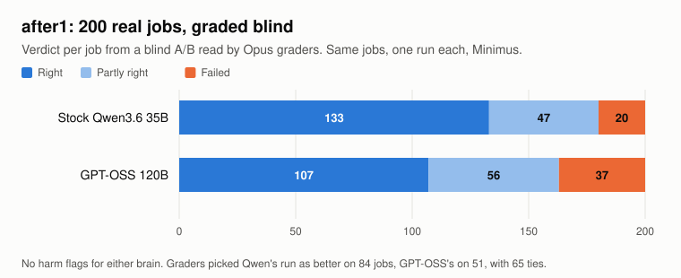
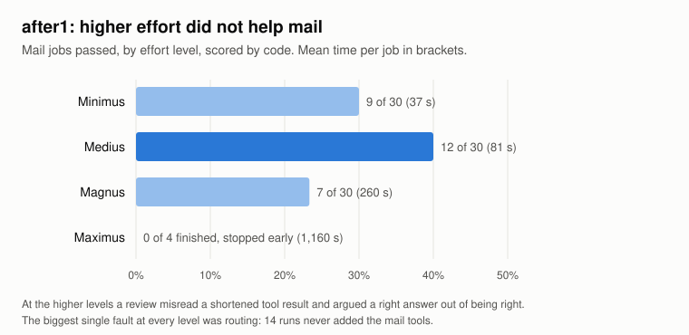
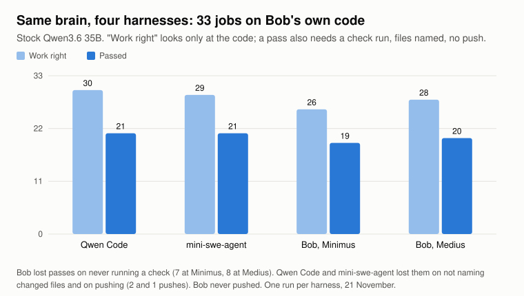
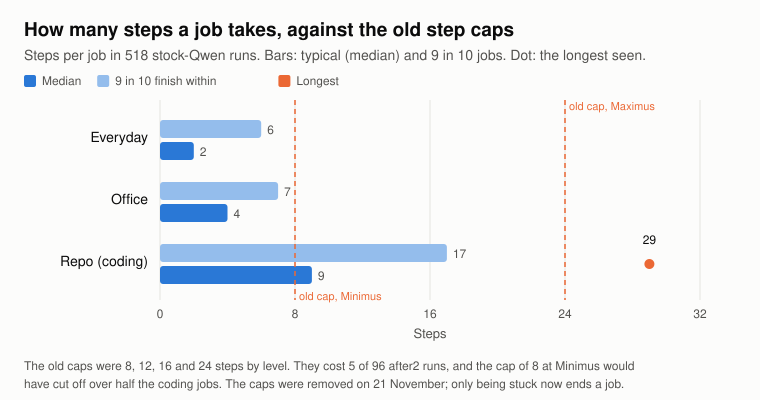

# Chapter 11. How we now make clean lessons

## 11.1 Introduction and research question

Chapters 5 to 7 show how faults hide inside synthetic lessons: hand-offs that pretend to work, fake tool results, copied test items. Chapter 9 gives the reason the faults matter after a cut, because a heal copies its teacher and so copies the teacher's faults. This chapter describes what the project now does about it.

The question is practical. Can a synthetic lesson set be made so that every lesson in it has been checked, without paying for a human to read thousands of lessons, and what does that cost in yield? The title of the dissertation makes a claim about the answer: clean lessons beat more lessons. This chapter does not test that claim. It describes the method that would produce the clean lessons, and it reports honestly what the method has produced so far.

The chapter is a method in progress. Most of its effect on a trained model is **not measured**. No model has been trained on a rewritten set at the time of writing. The evidence so far is about the pipeline itself: what it keeps, what it rejects, what stops a bad run and what it costs.

Status matters here, so we state it up front.

- PRs #254 (the lesson kit), #257 (the never-taught gate) and #263 (the lesson pre-flight) shipped in release 1.5.238 on 15 November 2026, whose pre-release check passed 276 of 276 test suites (1.5.238-PC-CHECKS.md).
- PR #251 (Qwen tool shape 2) shipped in the same release but has not been re-tested. The locked shapes, Qwen shape 4 and GPT-OSS shape 3, shipped later in PR #271 (release 1.5.240) and have not been re-scored either (section 8.10).
- The pre-flight values of section 11.5 (PR #263) are taken from the lab PC's console log of the lkt-fix3 run.
- The 534 held-out test items were sorted by Haiku with a 5% Opus spot-check. On 15 November MouseWurX chose to keep the held-out tests as they are while the full Opus re-sort of the lessons runs.
- The decisive retraining on reviewed lessons has **not** been run.

Sources are docs/TOOL-LESSONS-PLAN.md, docs/ROADMAP-ONE-MODEL.md, the "Clean-lesson pipeline" section of checked-numbers.md, the rentals hand-off of 15 November 2026 (HANDOFF-rentals-2026-11-15.md) and the lab PC's run files as copied into those documents.

## 11.2 Related work

### 11.2.1 Synthetic data written by models

Most agent lessons today are written by a model. Self-Instruct (Wang et al., 2022) had a pretrained model generate its own instructions, filtered out low-quality and repetitive examples, and fine-tuned on the rest. WizardLM's Evol-Instruct (Xu et al., 2023) started from seed instructions and had a model rewrite them into harder versions. "Textbooks Are All You Need" (Gunasekar et al., 2023) trained a compact 1.3-billion-parameter code model on curated web data and on textbooks and exercises written by GPT-3.5, and reported strong coding scores for its size.

All three treat the teacher as a source and the filter as a minor step. Bob's method differs in where it puts the effort. The teacher is open and local, and the main investment is in reading what it wrote.

### 11.2.2 Quality over quantity

A second line of work argues that a smaller, cleaner set can match a larger one. LIMA (Zhou et al., 2023) used 1,000 curated prompt and response pairs for alignment. AlpaGasus (Chen et al., 2023) filtered the 52,000 examples of Alpaca down to 9,000 chosen by a model and reported that the filtered set gave a better model on GPT-4-judged tests. These results are close in spirit to our title.

We borrow the idea but not the evidence. Both papers measure instruction following by chat judges, while our target is tool use, where a call is right or wrong. The AlpaGasus filter also relies on a model's scores of quality. Our full read is closer to that than to human curation, and we treat its verdicts the same way (section 11.8).

### 11.2.3 Duplicates, contamination and bad test items

Lee et al. (2022) showed that common language-model datasets hold many near-duplicate examples and long repeated passages, and that deduplication reduces memorised output and train-test overlap. This is the reason the lesson ledger described in section 11.5.3 fingerprints a lesson by its first request, its tool calls and a near-match print.

Xu et al. (2024) survey benchmark data contamination, where a model absorbs evaluation content during training and so gives scores that are unreliable. Our own contamination is a clear case. A check found that 519 of 534 held-out items appear word for word in files on the training side (chapter 7; checked-numbers.md). Northcutt et al. (2021) add a point that matters for our test items too: they found at least 3.3% label errors on average across ten widely used test sets, and that corrected test labels could change model rankings. A test is also data and needs reading.

### 11.2.4 Training on model output

Shumailov et al. (2023) report that training on model-generated content causes defects they call model collapse, in which the tails of the original distribution disappear. Bob's lessons are written by a model, so we take this seriously, though our setting is narrower than theirs: each round is a bounded set, written from real failures and checked, and it is mixed with general lessons (TOOL-LESSONS-PLAN.md, section 5). Whether that avoids the effect is an open question that we do not test.

The STaR method (Zelikman et al., 2022) keeps only the reasoning that led to a correct answer and retries failures with the answer as a hint. That idea of filtering by correctness is close to our checker, with one difference. We also keep the failed attempt, as the wrong side of a pair.

### 11.2.5 Tool-use data

Toolformer (Schick et al., 2023) has a model teach itself to use tools. Gorilla (Patil et al., 2023) connects a model to a large set of APIs, and ToolLLM (Qin et al., 2023) builds data for over 16,000 real-world APIs. These works concern which tools exist and how to call them. Chapter 8 found that for Bob's models the tool wording mattered little and lesson content mattered more, so the part of this literature we need is the data side: how a tool trace is made, checked and kept.

### 11.2.6 Judges that read the data

When a model reads data and gives a verdict, we depend on a judge. Zheng et al. (2023) report that strong LLM judges reach over 80% agreement with human preferences, the same level as agreement between humans. That figure is for chat preferences. We have no equivalent measure for a reader sorting tool lessons, and section 11.8 says so.

## 11.3 Starting point: what the old lessons held

Chapter 6 gives the full read of the old tool set. We repeat the counts here because they set the problem the pipeline has to solve.

| Verdict | Lessons | Share of 5,788 |
|---|---|---|
| Keep as written | 189 | 3.3% |
| Fix (small change) | 1,381 | 23.9% |
| Repair (rewrite) | 4,208 | 72.7% |
| Discard | 10 | 0.2% |

Table 11.1. Opus verdicts on all 5,788 non-held-out tool lessons (checked-numbers.md). Shares are our arithmetic.

Opus changed 1,922 of Haiku's verdicts. The hand-off lists 544 discards for the same sort. The sort's tally file explains this: 544 is the 534 held-out items, discarded up front by rule, plus the 10 that Opus confirmed (tool-6500 TALLY.md). The two counts agree. One consistency check supports the table: the lesson ideas file for the next round holds 5,565 rows, which the hand-off defines as Opus's fix and repair verdicts minus 24 held-out items. Fix plus repair is 5,589, and 5,589 minus 24 is 5,565.

The older set was also thin on real tool work. In the v4 copy of Bob's lesson set, 2,903 of 8,992 lessons (32%) had at least one tool call, 954 (11%) had two or more tool steps, and 46 of Bob's 93 tools appeared at least once. The most used tool was a hand-off to a specialist (465 lessons), and 47 tools had no lesson (TOOL-LESSONS-PLAN.md, section 1b).

So the pipeline has two jobs. It must repair what is repairable, and it must not make a new set with the same faults.

## 11.4 The pipeline

### 11.4.1 The steps

The pipeline runs in the order below. Each step is a separate command, and each can stop the run.

1. **Gather failures as seeds.** Failed runs become seeds: rejected lessons from the GPT-OSS v5 set (303 traced one by one), and turns that Riker and Bobert got wrong in their tool interviews. A seed that comes from a held-out test is used only to write new, similar requests, never taught itself (TOOL-LESSONS-PLAN.md, section 1).
2. **Sort every old lesson.** Haiku sorts all lessons first, then Opus reads them all. Each gets one of four verdicts with a note: keep, fix, repair or discard (section 11.6).
3. **Build the ideas file.** The fix and repair verdicts, minus the held-out items, become the list of requests to rewrite. For the next big round that is 5,565 rows with an id, a job, the text, a note and a seed.
4. **Lock the tool shape.** The tool names, inputs and wording are chosen first. The writer and the reviewer both use the same shape file (section 11.4.4).
5. **Pre-flight in code.** Before any card is rented, code counts the ideas, skips the ones already written, checks the shape, checks the room per slot and turns on the sample gate (section 11.5).
6. **Rewrite on a rented card.** The stock Qwen teacher writes each answer again, using real tools in a throwaway sandbox where it can (section 11.4.5).
7. **Check each lesson twice in the run.** A code checker (`tool-judge.mjs`) tests the right tool, the right inputs, every asked thing done and an answer that quotes the result. Then the teacher reviews the lesson. A lesson that fails review twice is dropped, and one that runs out of steps (the cap is 12) or room is dropped with a recorded reason.
8. **Stop early if the first ten fail.** The sample gate requires the first 10 ideas to save at least 60%. If they do not, the run exits with code 86 and the pod is deleted.
9. **Sort the output.** Opus reads the saved lessons and gives each a verdict again. Only keep, and fixed and repaired lessons that pass, go forward.
10. **Check against the ledger and the never-taught list.** A lesson already in the ledger is not written again, and a lesson that holds a test item is dropped (PR #257).
11. **Make right and wrong pairs.** The checked answer is the right side. The wrong side is the original failed answer, or the student's own failed answer.
12. **Scrub.** Names, paths, e-mail addresses, IP addresses, device names and keys are replaced, and the scrub checks itself and refuses if anything is left.
13. **Train and test.** A fresh stock Qwen is trained on the reviewed lessons and tested on a leak-free test. This step has not been run (section 11.10).

Steps 2 to 8 have run. Step 9 has run on the lessons of lkt-fix1. Steps 10 and 11 are in the kit shipped in 1.5.238 (PRs #254 and #257). Step 12 exists, with a known bug in its odds step that is to be fixed before any write (TOOL-LESSONS-PLAN.md, section 7). Step 13 is planned.

### 11.4.2 Start fresh from the stock model

Training starts from the stock Qwen3.6-35B-A3B downloaded fresh, not on top of Riker or Bobert, which learned from the old lessons. The plan lists as poison anything made by or scored by today's Bobert, Riker or Bill, and says that no weights, adapters, merges, keep lists or saved odds are inherited (ROADMAP-ONE-MODEL.md; TOOL-LESSONS-PLAN.md, section 6a).

The stock Qwen teacher writes every fresh answer. This directly answers chapter 9: a heal copies its teacher, so the teacher must be clean first.

### 11.4.3 The faults the audit looks for

Before an old set can be reused, it is audited for known kinds of poison (ROADMAP-ONE-MODEL.md, stage 2b; TOOL-LESSONS-PLAN.md, section 3i):

- fake tool results, such as a bare "Done.", a cut-off result or an error that does not match the task;
- answers that hand the job off with a pretend result, which was 37% of the old coding set;
- claims about a file, path or count that the tool result does not show;
- tool text or inputs from an old Bob copy that no longer match today's tools;
- tool jobs with no tool call, and plain chat that calls a tool;
- reviewer verdicts that relied on a phantom "JSON format" rule;
- anything personal that the scrub missed;
- answers made under a dial, steering or surgery, and anything from an evil or fiction check;
- test items or near copies of them.

Each old set receives one of three marks: clean, mend (only flagged rows are rewritten by the stock teacher and checked again) or drop. Stage 3 does not start until every set it draws from is marked clean or mended. If a set's poison cannot be found reliably, it is dropped.

### 11.4.4 Tool shapes are locked first

Chapter 8 found that the misses are about tool shape. So the shape is chosen before the lessons are written. The plan says the final lessons are written once MouseWurX has picked each brain family's tool shape (TOOL-LESSONS-PLAN.md).

A shape has a version, `TOOL_SHAPES` in src/tool-sets.js. MouseWurX locked the shapes on 15 November: shape 4 for Qwen brains and shape 3 for GPT-OSS brains (section 8.10). The early rewrite runs reported in this chapter, lkt-fix1 to lkt-fix3, were made on a shape-2 Qwen tree, before the lock, and their lessons say so in their `tool_shapes` stamp. Later lesson runs use the shape-4 tree and pass `--want-shapes 4` in the pre-flight, and the real-jobs runs of draft PR #275 run Bob's real loop with the shape-4 tools. Lessons for GPT-OSS brains are written on shape 3 and stamped `family: gpt-oss`. Lessons from a shape-2 tree are converted to shape 4 or dropped before any Qwen training, and are never mixed in unmarked (section 4.9.4).

A tool that already works for a family keeps its shape. "Working" means about 9 in 10 right, tool and inputs, in both thinking modes. Only failing tools get new shapes (TOOL-LESSONS-PLAN.md, section 2). An older line of the plan said that lessons are stored once, in Bob's tool names, with each family's wording added at training time. That line is superseded. MouseWurX's rule of 15 November is one lesson set per brain family, never cross-trained, and the code enforces it: every lesson carries a `family` stamp (model-lab/write-lessons.mjs, `--family qwen|gpt-oss`) and the heal skips a lesson stamped for another family (model-lab/forge/pod/data.py). The tool names and inputs are still the same for every family, so a lesson's calls need no renaming, but each family's lessons are written by a teacher of that family on that family's shape.

### 11.4.5 Every tool result is real, or labelled

In the older writer the teacher played the tool results and nothing was run (write-lessons.mjs header). That let a lesson show a result that no tool had produced.

The new kit runs each lesson in its own throwaway sandbox home with the real tools (PR #254). The hand-off lists what must run for real: make_diagram and the file, office and notes tools. Honest stand-ins are allowed for media tools and for system or app tools such as open_app, run_command and schedule_job. A stand-in uses Bob's exact success line and is labelled as one.

Two problems found in trials show why this matters. A lab bug made notice-board and remember writes fail and spoiled dozens of lessons (reported, not yet checked against a file; fixed). Office lessons cannot be made on the lab PC, which has no LibreOffice.

### 11.4.6 What a good tool lesson looks like

Every rewritten lesson follows one shape, so the model learns one habit (TOOL-LESSONS-PLAN.md, section 2).

1. Read the ask, and count the things asked.
2. Use what was given: names, paths, times and amounts go into the call exactly.
3. Make one call, then read the result.
4. Check before claiming: the answer quotes the real result.
5. Recover: on an error, try one other way or say plainly what went wrong.
6. Finish: every asked thing is done or named as not done.

Each step answers a kind of failure found in the traced v5 rejects: not checking the result (62), giving up or asking something answerable (39), typing the result in chat instead of saving it (26), extra calls (19) and skipping a step (14).

## 11.5 The gates

A gate stops a run, or a plan, before money or training time is spent on a lesson set that will fail. Table 11.2 lists them with their status.

| Gate | When it acts | What it stops | Status |
|---|---|---|---|
| Pre-flight | Before renting | A plan with a wrong ideas file, shape or room per slot | PR #263, shipped in 1.5.238; values from the lab log |
| Sample gate | First 10 ideas of a run | A run whose first 10 ideas save under 60% | Ran on lkt-fix3 and stopped it |
| Smoke gate | First minutes of a rental | A step that cannot run, such as odds that do not cover thinking or tool calls that do not parse | Described in FORGE-JOURNAL.md; exit 86 |
| Never-taught gate | Before renting | A plan whose lessons hold a test item; drops card-written lessons that do | PR #257, shipped in 1.5.238 |
| Lesson ledger | At every write | A lesson already taught, including a reworded copy | In the lesson kit of PR #254, shipped in 1.5.238 |
| Caps | At plan load | A plan with blank caps | Falls back to 9 hours and $40; every plan must set its own |

Table 11.2. The gates.

### 11.5.1 Pre-flight

Before a lesson rental, code checks the plan and stops if it is wrong. On the log of the run called lkt-fix3 the checks read as follows (checked-numbers.md).

| Check | Value |
|---|---|
| Ideas file rows counted | 211 |
| Already written (skipped) | 94 done, 117 to go |
| Tool shape | 2, checked (before the shapes were locked; later runs check 4) |
| Room per slot | 32,768 tokens (longest first request about 10,838, plus 16,384 to grow) |
| Sample gate | on: the first 10 ideas must save at least 60% |

Table 11.3. Pre-flight log of lkt-fix3.

The room check answers a past failure. On lkt-fix2, a context of 98,304 tokens split across 6 slots left about 16,000 each, while requests reached 16.8k, so the tail overflowed. The system prompt plus tools is about 7.7k tokens, and requests ran from a median of about 8.1k to a maximum of about 16.4k (hand-off). The fix was to use 4 slots, or a larger context.

### 11.5.2 The sample gate worked

On lkt-fix3 only 1 of 10 sample ideas saved. Five failed review twice, 2 had an unreadable review, 1 ran out of steps and 1 ran out of room. The run stopped with exit 86 and the pod was deleted after about $0.31 (checked-numbers.md). Stopping a bad run cheaply is a part of the method and not a side effect. It is the idea of the smoke gate in chapter 4, moved into the lesson writer.

### 11.5.3 Never-taught gate and ledger

The never-taught gate (PR #257) stops a teaching plan before renting if any lesson holds a test item, and drops card-written lessons that do. It shipped in 1.5.238, so a teaching plan now runs the check before renting. Before that, the hand-off noted that no training plan ran `lesson-ledger --check --never`, so the 519 leaked test items of chapter 7 were a risk for any earlier plan.

The ledger holds a fingerprint of every lesson ever taught: the first request, the list of tool calls and a near-match print, so a reworded copy is caught. A lesson already in the ledger is never written again. The never-taught list covers the 5% held-out split, the quiz items, Riker's 310 stock items, the interview test turns and the evaluation folders (TOOL-LESSONS-PLAN.md, section 6).

Outside lesson sets are never more than about 1 in 5 of a round, and are used as a filtered pool. Public benchmarks are test only and join the never-taught list.

## 11.6 Who writes and who sorts

An open teacher model rewrites lessons on rented cards. Claude models never write lesson text. They only sort each lesson as keep, fix, repair or discard, with a note (hand-off, "Rules").

- **Keep:** usable as it stands.
- **Fix and repair:** the request is reused and the open teacher writes the answer again. The first request and the failed answer are kept as a right-versus-wrong pair.
- **Discard:** dropped.

The split follows from chapter 9: the writer's output is what a student copies, so the writer is an open model the project controls, and the sorter only judges.

### 11.6.1 The reviewer rules

The reviewer settings are Opus 5.5, in batches of 9, 12 in parallel, and every lesson in the 6,500 set is checked (hand-off). Reviewers use the shape-2 tool file. The reviewer rejects the following (project notes; TOOL-LESSONS-PLAN.md):

- claims with no tool result behind them;
- wandering thinking;
- personality chatter, since Bob's personality lives only in the app prompt and never in the lessons;
- quoting the teacher's private note, because teacher-only notes are never saved in a lesson;
- the phantom "JSON format" rule, which earlier reviewers applied wrongly and which was removed from the review prompt.

Four rules shape how the reviewer is used.

1. **Every lesson is read, not sampled.** For the 6,500 set the plan reads all of them.
2. **No old model's work enters.** Nothing made by or scored by today's Bobert, Riker or Bill enters the new suite. The teacher is the stock Qwen model (ROADMAP-ONE-MODEL.md).
3. **A lesson that fails is fixed and checked again, or dropped.** The audit report lists every change, and the originals stay untouched.
4. **Reviewer verdicts are one reader's judgement.** They are recorded with notes, and a sample is hand-read (ROADMAP-ONE-MODEL.md, stage 3 plans a hand-read sample of 100).

### 11.6.2 Who read what

Scripts alone are not trusted to judge a lesson. A figure that scripts agreed with readers only 41% of the time was suggested for this chapter, but it is in no file we found. We do not use it.

What the files show is a full read. Opus read all 5,788 non-held-out tool lessons (Table 11.1). The test items were read differently. Haiku sorted the 534 held-out items, and Opus spot-checked 5% of them (hand-off). The result was 148 keep, 381 fix and 5 discard (checked-numbers.md). So the test items have not had a full Opus read, and MouseWurX chose on 15 November to keep them as they are while the full Opus re-sort of the lessons runs.

## 11.7 First results, with honest keep rates

Table 11.4 gives every round with a result. We report the rate that each file supports and mark each one with its status.

| Round | Result | Status |
|---|---|---|
| Full read of the old tool set | 189 keep of 5,788 (3.3%) | Checked (checked-numbers.md) |
| lkt-fix1 (first rewritten round, stock Qwen teacher, shape 2, about $0.55) | Opus verdicts: 20 keep, 34 fix, 45 repair, 1 discard (100 verdicts: 94 saved lessons plus 6 needs-review copies) | Checked (checked-numbers.md; cost from hand-off) |
| lkt-fix2 (211 ideas, about $0.82) | 94 saved of 211; see below. The 94 had no Opus review yet. | From hand-off |
| lkt-fix3 | Stopped by the sample gate: 1 of 10 saved. About $0.31. | Checked |
| Latest round | Opus kept 17 of 215 as they stand | **Reported, not yet checked against a file** |

Table 11.4. Rounds and results.

### 11.7.1 lkt-fix1

The four verdicts of lkt-fix1 sum to 100 (20 + 34 + 45 + 1). The hand-off says the sort file holds 94 lessons. The file resolves this: it holds 94 verdicts on saved lessons and 6 on needs-review copies of six of the same ideas (our count of all-verdicts-v2.jsonl). On the 94 saved lessons alone the verdicts are 20 keep, 32 fix, 42 repair and 0 discard, so 20 of 94 were kept, about 21% (our arithmetic). That is far higher than the 3.3% of the old set, but the two are not comparable: lkt-fix1 is a small round of rewrites, and the old set was a full read of lessons as first written.

### 11.7.2 lkt-fix2

The run was stopped at 13:16 UTC and its pod deleted at a cost of about $0.82. Its 211 ideas ended as follows (hand-off).

| Outcome | Ideas |
|---|---|
| Saved | 94 |
| Failed review twice | 39 |
| Ran out of steps (cap 12) | 12 |
| Review unparsed | 8 |
| Out of room | 3 |
| Context overflow | 1 |
| Cut by the stop | 12 |
| Never tried | 42 |
| Total | 211 |

Table 11.5. Outcomes of lkt-fix2.

The outcomes add to 211. Saved lessons were 94 of 211 (45%, our arithmetic), but they had no Opus review yet, so that is a save rate and not a keep rate. The rate was about 79 saved per card-hour overall, and about 125 an hour while the teacher was serving. The 8 unreadable reviews were kept in a file so they can be regraded off the card.

Two faults of the writer came out of this run. It keeps no raw reviewer reply and no step list for out-of-steps attempts, so the cause of those drops cannot be read afterwards. The suggested fixes are to save the first 2,000 characters of the raw reply and to write the step list before throwing.

### 11.7.3 The latest round: reported, not yet checked

The project notes say that in the latest round Opus kept 17 of 215 as they stand. **This figure is reported, not yet checked against a file.** We do not use it as a result. If it is right, the keep rate is about 8% (our arithmetic), lower than lkt-fix1. The count 215 also differs from the 211 ideas of lkt-fix2 and we cannot tell from the files whether it is a different round or a recount.

The same notes report that a lab bug made notice-board and remember writes fail and spoiled dozens of lessons, which was fixed, and that office lessons fail on the lab PC because it has no LibreOffice. These are also reported and not checked.

### 11.7.4 What the keep rates say

Keep rates are low. Most lessons need a fix or a repair, and many rewrites fail review twice. The honest reading is that the old lessons were mostly faulty and the new pipeline is slow and strict.

Part of the low yield is the result of set-up faults and not of the method. lkt-fix1 ran on Bob's stock phrasings because `--dir` resolved to a different folder than expected. Two A40 cards hung with no door and cost about $0.41. A lesson set written to the wrong folder is a plain process error. Each of these is now written down as a gotcha in the hand-off, and the pre-flight check exists so that they cannot repeat silently.

Spending so far, from the hand-off and the console log, is about $0.41 (two hung cards), $0.55 (lkt-fix1), $0.82 (lkt-fix2) and $0.31 (lkt-fix3). Added together, that is about $2.09. The figures come from different files, and the sum is our arithmetic. The rewrite of the whole 5,565-idea file has not been costed from these rounds, and we do not extrapolate from them.

### 11.7.5 The after1 round: the newest measured results (16 to 17 November)

after1 was two rentals at the same time on the same code: the end-of-turn loop checks, the Qwen text-call rescue and the hardware log (Chapter 4, section 4.8.4).

- **Stock Qwen3.6 35B, on an RTX 6000 Ada:** 200 real jobs at Minimus, and 30 mail jobs at each of Minimus, Medius and Magnus. Maximus did 4 of the 30 mail jobs before MouseWurX stopped it early. It also did 17 Office jobs. About $1.06.
- **GPT-OSS 120B, on an A100 80GB:** the same 200 real jobs at Minimus. About $1.04.

Every real job ran in the fake test home with real web search. Nothing was trained.

**Real jobs, blind A/B read** (method in section 4.5.5):

| Brain | Right | Partly | Failed | Harm | Reply quality (1-5) |
|---|---|---|---|---|---|
| Qwen3.6 35B | 133 | 47 | 20 | 0 | 3.87 |
| GPT-OSS 120B | 107 | 56 | 37 | 0 | 3.52 |

The graders picked Qwen's run as better on 84 jobs and GPT-OSS's on 51, with 65 ties.

*Figure 11.1. The blind read above, drawn as shares of the 200 jobs. Qwen's lead is in jobs done right (133 against 107); GPT-OSS gave more partly right and failed answers.*

- **Qwen's most common faults:** made-up details (12), incomplete answers (12), wrong answers (11), a tool call shown as text (6) and claiming something not done (6).
- **GPT-OSS's most common faults:** incomplete answers (21), asking the user instead of looking (17), wrong answers (13), made-up details (12) and giving up early (10).

GPT-OSS was faster (a median of 13 s against 24 s). It also made half as many tool calls (0.87 a job against 1.73), which matches its habit of asking instead of looking.

The limits are one run per job per brain and one grader per job. GPT-OSS ran only at Minimus with low reasoning. Its other reasoning levels are unproven in our lab, as we have yet to test.

**Mail, by effort level.** The same 30 mail jobs, each on two made-up inboxes of up to 50,000 messages. These are code scores only, with a rough pass mark:

| Level | Pass | Mean time | Mean steps |
|---|---|---|---|
| Minimus | 9 / 30 | 37 s | 4.2 |
| Medius | 12 / 30 | 81 s | 6.0 |
| Magnus | 7 / 30 | 260 s | 12.0 |
| Maximus | 0 / 4 | 1,160 s | 13.8 |

Higher effort did not help mail. Two of Maximus's finished jobs asked which senders are real people. In both, the first answer was right. Then the review read a shortened copy of the tool result as the tool's own cut-off and called the right answer a hallucination, and the final answer argued with itself. Magnus showed the same leak in 3 answers. At every level the biggest single mail fault was routing. 14 runs never added the mail tools for asks like "Trash everything from Kettle & Crumb", and searched the computer's folders instead.

*Figure 11.2. The mail table above as pass rates. Medius passed the most. Magnus passed fewer while taking over 3 times as long, and Maximus finished only 4 jobs before it was stopped.*

**Office.** 17 Word, Excel and PowerPoint jobs ran with LibreOffice in the test home, and 14 passed by code. Two misses made a new file instead of finding the user's own. One wrote a CSV in Bob's folder in place of the reading-log spreadsheet. The other asked for a deck's path after listing one empty folder. The third miss was a scorer slip.

**What changed because of it.** Each fix has a check in the test suite and an entry in the harness log:

- Mail asks that never say "email" now add the mail tools.
- An answer that is only a text tool call is shown as an honest "I didn't finish" line.
- Leaks from the recheck, and talk about earlier drafts, are caught.
- "Find it first" applies to the user's own files.
- "I've updated my memory" with no save behind it is caught.
- File searches leave Bob's own logs out.
- The review's record says when a tool result was only shortened for the review.
- Every engine shares one exit hook.

A replay of the new checks over all 511 after1 runs found that each new check fired only on real misses in the runs that were read, with no false alarms seen. Whether the fixes raise the pass rate is unproven in our lab, as we have yet to test. The next run of the same jobs is that test.

**Decisions taken from it.** Stock Qwen3.6 35B stays the default brain, and GPT-OSS 120B stays a tested alternative. Mail is to run at Medius at most, with a short path for bulk acts. That was MouseWurX's call, backed by the mail table above. The short path is being built and is unproven in our lab, as we have yet to test.

### 11.7.6 after2, Bob's own code, and other harnesses (21 November)

Training was parked, and the work turned to making the harness reliable with the stock brain (MouseWurX, 21 November). Four rentals ran that day, all with stock Qwen3.6 35B at Q4 and nothing trained. The figures here come from the rental reports of that day (score reports and run records kept on the home PC); they are one run per job.

**after2 (about $0.40).** The after1 mail jobs at Minimus and Medius, plus 36 Office jobs, 96 runs in all.

- **Office passed 27 of 36** by code. The misses were five edits not made or not saved, a .pptx taken for a .pdf, files compared without being read, a damaged file not called damaged, wrong totals on a 3,000-row sheet, and a fact left out.
- **Two harms in the mail jobs.** In the first, naming only a company trashed mail from people who work there; that is fixed and tested. In the second, on an unsubscribe job at Medius, Bob moved 84 mails he should not have; the bulk-plan guard is being fixed.
- **The step caps cost 5 of the 96 runs** (8, 12, 16 or 24 steps by level).
- **The mail pass totals by level were not recorded.** Their score report was kept only on the home PC and was deleted in a cleanup before it was copied anywhere else. They are left out rather than estimated.
- A second run of 300 everyday jobs stopped after 41 because the web search was blocked (about $0.41). Its jobs were rerun in steps40.

**steps40 (about $0.69).** 66 of after2's jobs and about 260 everyday jobs again, with a keyed search service and the caps raised to 40 steps (48 at Magnus, 64 at Maximus) and no 10-minute cutoff. The 5 runs that ran out of steps all finished, nothing looped, and Office stayed at 27 of 36.

**repo1 (about $0.41).** 33 jobs on a throwaway copy of Bob's own code, scored by code. A pass needs the change to be right and hidden checks to pass, and also needs Bob to have run the tests or a check himself, said which files he changed, touched no file he shouldn't, and not pushed.

| Level | Passed | Work done right | Pushed |
|---|---|---|---|
| Minimus | 19 / 33 | 26 | 0 |
| Medius | 20 / 33 | 28 | 0 |

The gap between right work and passes is mostly one habit: not checking his own work. Checking code after an edit was off by default, and that alone failed 7 to 9 jobs. Bob also ran a bare `node` with no script 21 times, which looked like success each time.

**The harness comparison (about $0.62).** The same 33 jobs, the same brain on the same card, run in two well-known open coding harnesses and scored by the same code:

| Harness | Passed | Work done right | Never ran a check | Pushed (a fail) |
|---|---|---|---|---|
| Qwen Code | 21 | 30 | 1 | 2 |
| mini-swe-agent (bash only, no guards) | 21 | 29 | 0 | 1 |
| Bob, Minimus | 19 | 26 | 7 | 0 |
| Bob, Medius | 20 | 28 | 8 | 0 |

*Figure 11.3. The comparison above. In every harness the passes fall well short of the right work. The other two lost passes on not naming the changed files (13 times for Qwen Code, 8 for mini-swe-agent) and on pushing. Bob lost his on never running a check.*

A plain bash loop with no rules did the work as well as Qwen Code and slightly better than Bob, so on coding Bob's extra rules did not buy right answers. Where Bob led was safety: he never pushed. One run per harness on 33 jobs leaves differences of 1 or 2 jobs inside the noise.

**How many steps jobs take.** Steps were counted over 518 stock-Qwen runs. Everyday jobs typically take 2 steps and 9 in 10 finish within 6. Office jobs typically take 4, and 9 in 10 within 7. Coding typically takes 9, 9 in 10 within 17, and the longest took 29.

*Figure 11.4. The step counts above, with the old caps. The cap of 8 at Minimus sat below the typical coding job, so it would have cut off over half of them.*

**Every tool call checked.** All 1,650 tool calls in the 518 runs were read for broken tools. No tool crashed or hung, and 27 tools never failed. The real breakage was the Office tools not finding files: they failed 30% to 40% of the time, and 27 of 36 "no file there" errors were files one folder away, usually in Documents. In one job Bob said a spreadsheet was not on the computer when it was. A second fault lost 21 calls in 11 runs: once the tools were taken away near a job's end, the brain wrote its next call as text, and the nudge asked for a real call it had no tools to make. Of 75 nudges graded, the maths nudge was ignored 7 times in 8.

**Limits removed (MouseWurX, 21 November).** "No step limits." An audit listed every limit that could stop or cut short Bob's work (bob-wip/limits/limits-audit-2026-11-21.md). These were removed, because misfiring rules, not lack of room, were ending good jobs:

- the step counts at every level (other people's chats keep 30)
- the 40-call and 96-call caps
- the always-on 10-minute cutoff
- the cap of 2 send-backs a turn (each kind of nudge now gets one go)
- the thinking budgets and the fixed reply size; a reply now stops only when it repeats itself
- in the lab, replies cut at 4,096 tokens (Bob allows up to 32,768) and jobs cut at 8 to 10 minutes. These made test scores worse than real use. The rental's money and time cap is now the only outer limit.

What still ends a job is being stuck: 3 rounds with nothing new, 4 rounds where every call failed, going in circles, or the same call 3 times. The safety rules stay: never push, post or send without a card, no admin, no shell, and the Recycle Bin only.

**Fixes made from these runs.** Checking code after an edit is on by default; the answer names the changed files; tests run on Windows; a bare `node` is refused with a hint; failing tests no longer get the tool set aside; Office tools find files the way `read_file` does; file search also matches file names; the text-call nudge asks for plain words when tools are off; and the Run tools load for project jobs. Each has a check in the test suite. Whether they lift Bob's passes towards his right work is unproven in our lab, as we have yet to test. The Flash-Next and DeepSeek runs of section 13.7 carry them.

## 11.8 Discussion

### 11.8.1 What the method buys

The pipeline's main gain is that no lesson reaches training unread. In the old process a script and a cheap model judged most lessons, and the full read found that about 3% were fit to teach as written. The new steps are meant to make that impossible. Three of them are cheap because they stop a bad run early: the sample gate stopped one run for about $0.31, the pre-flight checks catch plan faults in code, and the never-taught gate checks for leaks before a card is rented.

### 11.8.2 The reader is also an instrument

The reader's verdicts are one model's judgement. We have no human check of a sample yet, and the roadmap plans a hand-read sample of 100. The review-agreement result of Zheng et al. (2023) is for chat preferences. The retraction in chapter 10 is a warning from our own work: a model judge that is not validated can create a result that is not there. We report keep rates as the reader's keep rates.

## 11.9 Threats to validity and limits

- **No trained model yet.** The central claim, that clean lessons give a better model, is not tested by anything in this chapter.
- **One reader.** Opus is the only sorter of the full set. A different reader might sort differently, and there is no human check of a sample yet.
- **Mixed sources.** Counts come from a lab PC's sort files, a hand-off note and a console log. Two apparent mismatches are resolved by the files (544 discards is 534 held out plus 10; lkt-fix1's 100 verdicts are 94 saved lessons plus 6 needs-review copies), and the 17 of 215 figure has no file behind it.
- **Small rounds.** lkt-fix1 has 94 saved lessons (100 verdicts), and lkt-fix2 has 94 saved lessons without review.
- **Set-up faults inflate failure.** Some of the low yield comes from wrong folders, hung cards and a lab bug, so it is not a clean measure of the method.
- **Real tools are partial.** Media, web, e-mail and app tools are stand-ins, so tool results for them are labelled and not real.
- **Held-out tests unchanged.** The 534 test items still carry the leak of chapter 7 until the tests are replaced; the never-taught gate (shipped in 1.5.238) only stops them being taught.
- **Status.** PRs #254, #257 and #263 shipped in 1.5.238. PR #251 shipped too but is not re-tested.

## 11.10 The planned decisive test

The question that the dissertation asks cannot be answered without a trained model. The roadmap already defines the training steps (ROADMAP-ONE-MODEL.md, stage 5) and a "report card" that every step is scored against, where a step is kept only if no line drops. The decisive test is a matched comparison within that frame. The design below is our proposal built from the roadmap, and it has not been run or agreed.

**Arms.** All arms start from the same fresh stock Qwen3.6-35B-A3B and use the same training recipe and the same budget of training steps.

- **A. More lessons.** The old lesson set as it stands, at full size.
- **B. Fewer, clean lessons.** The reviewed lessons only, which is a much smaller set.
- **C. Size-matched control.** A random sample of the old set with the same number of lessons as arm B, to separate "cleaner" from "smaller".

**Test.** A leak-free test: new items written as look-alikes, checked against the never-taught list, and frozen before training. The 534 held-out items stay as they are for now, and their leak is reported with every score. The report card's tool lines (one-step and many-step tools), the coding line and the quiz are the main measures. Every arm is also scored on the old test, so that the amount of inflation from the leak can be measured. That is the "still to measure" item of chapter 7.

**Read-out.** A difference is claimed only when it is larger than the noise. The quiz moves 3 to 5 questions between runs on a 97-question quiz (checked-numbers.md), and the coding race is small. So the plan is to run each arm more than once where the budget allows, and to report ranges and not single scores.

**What would count against us.** If arm A matches arm B on the leak-free test, then the review did not help at this size. If arm C matches B, then the gain is about size and not about clean data. Both outcomes would be reported.

**Cost.** The roadmap's rough estimate for the first full training run is about 18 to 24 hours on an H200 and about $95 to $130 (ROADMAP-ONE-MODEL.md, stage 5). The cost of three arms is **not measured**.

**Preconditions.** The full Opus re-sort of the lessons must finish. The never-taught gate (PR #257, shipped in 1.5.238) must run on the plan. The test items must be replaced or re-sorted. Every step also waits on approval, because nothing trains or rents without it.

## 11.11 Future work

1. **Check the "17 of 215" figure** against its sort file.
2. **Add the planned script first-filter**, which catches cheap faults before the paid reviewer, and a fact-check flag for lessons that state facts.
3. **Hand-read a sample** of reviewed lessons and report the agreement between the reader and a person.
4. **Save the raw reviewer reply and the step list** of dropped attempts, so that failures can be diagnosed.
5. **Confirm the never-taught gate runs** in every training plan (it shipped in 1.5.238).
6. **Run the decisive test** of section 11.10.
7. **Run the full 5,565-idea rewrite** when the caps are set, and report keep rates and cost for it.

## 11.12 Summary

The project now makes lessons in a fixed order. It sorts every old lesson with a reader, rewrites the faulty ones with an open teacher using real tools where it can, checks each lesson in code and by review, and stops a run early when the first sample fails. It keeps a ledger so that nothing is taught twice and a never-taught list so that no test item is taught.

The first results are modest. The full read kept 189 of 5,788 old lessons. The first rewritten round kept 20 of its 94 saved lessons. The next round saved 94 of 211 ideas before review, and the sample gate stopped one run for about $0.31. A later figure, 17 kept of 215, is reported and not yet checked. Keep rates are low, and part of that comes from set-up faults.

Whether this gives a better model is not known. The decisive test, a matched comparison of old lessons, reviewed lessons and a size-matched control on a leak-free test, has not been run. Until it is, this chapter describes a method and not a result.

## References

Chen, L., Li, S., Yan, J., et al. (2023). AlpaGasus: Training A Better Alpaca with Fewer Data. arXiv:2307.08701. https://arxiv.org/abs/2307.08701

Gunasekar, S., Zhang, Y., Aneja, J., et al. (2023). Textbooks Are All You Need. arXiv:2306.11644. https://arxiv.org/abs/2306.11644

Lee, K., Ippolito, D., Nystrom, A., et al. (2022). Deduplicating Training Data Makes Language Models Better. ACL 2022. arXiv:2107.06499. https://arxiv.org/abs/2107.06499

Northcutt, C. G., Athalye, A., and Mueller, J. (2021). Pervasive Label Errors in Test Sets Destabilize Machine Learning Benchmarks. NeurIPS 2021 Datasets and Benchmarks. arXiv:2103.14749. https://arxiv.org/abs/2103.14749

Patil, S. G., Zhang, T., Wang, X., et al. (2023). Gorilla: Large Language Model Connected with Massive APIs. arXiv:2305.15334. https://arxiv.org/abs/2305.15334

Qin, Y., Liang, S., Ye, Y., et al. (2023). ToolLLM: Facilitating Large Language Models to Master 16000+ Real-world APIs. arXiv:2307.16789. https://arxiv.org/abs/2307.16789

Schick, T., Dwivedi-Yu, J., Dessì, R., et al. (2023). Toolformer: Language Models Can Teach Themselves to Use Tools. arXiv:2302.04761. https://arxiv.org/abs/2302.04761

Shumailov, I., Shumaylov, Z., Zhao, Y., Gal, Y., Papernot, N., and Anderson, R. (2023). The Curse of Recursion: Training on Generated Data Makes Models Forget. arXiv:2305.17493. https://arxiv.org/abs/2305.17493

Wang, Y., Kordi, Y., Mishra, S., et al. (2022). Self-Instruct: Aligning Language Models with Self-Generated Instructions. arXiv:2212.10560. https://arxiv.org/abs/2212.10560

Xu, C., Sun, Q., Zheng, K., et al. (2023). WizardLM: Empowering large pre-trained language models to follow complex instructions. arXiv:2304.12244. https://arxiv.org/abs/2304.12244

Xu, C., Guan, S., Greene, D., and Kechadi, M.-T. (2024). Benchmark Data Contamination of Large Language Models: A Survey. arXiv:2406.04244. https://arxiv.org/abs/2406.04244

Zelikman, E., Wu, Y., Mu, J., and Goodman, N. D. (2022). STaR: Bootstrapping Reasoning With Reasoning. arXiv:2203.14465. https://arxiv.org/abs/2203.14465

Zheng, L., Chiang, W.-L., Sheng, Y., et al. (2023). Judging LLM-as-a-Judge with MT-Bench and Chatbot Arena. NeurIPS 2023 Datasets and Benchmarks. arXiv:2306.05685. https://arxiv.org/abs/2306.05685

Zhou, C., Liu, P., Xu, P., et al. (2023). LIMA: Less Is More for Alignment. arXiv:2305.11206. https://arxiv.org/abs/2305.11206

